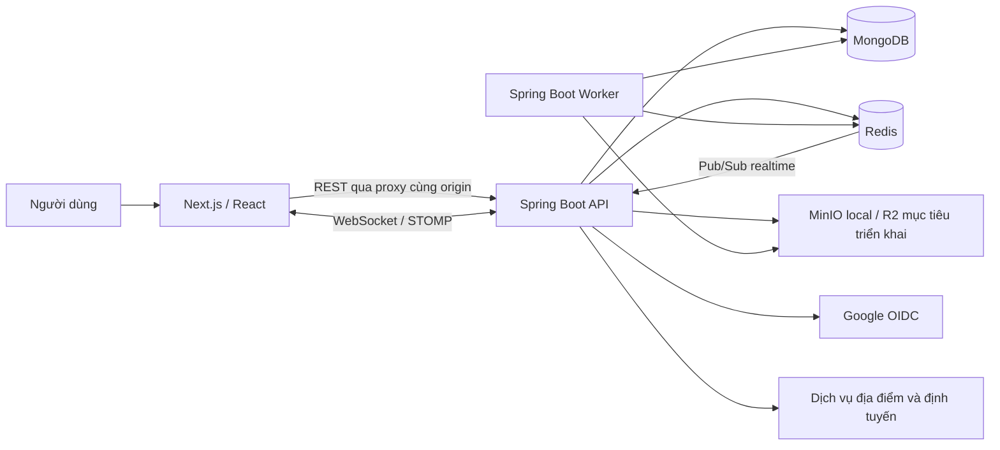
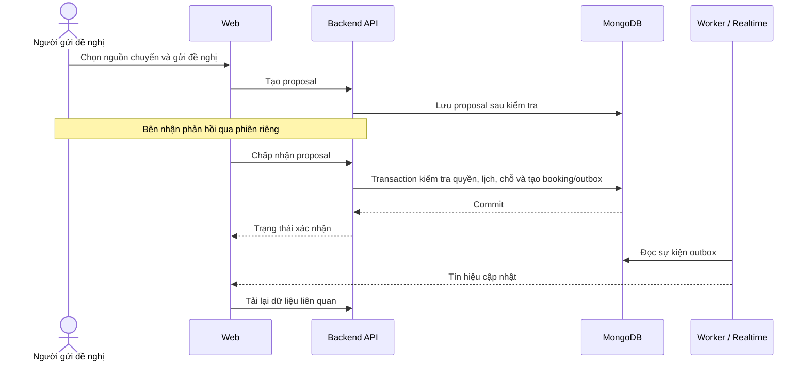

# BÁO CÁO PROJECT CUỐI KÌ — DIKE

## Thông tin đề tài

| Nội dung             | Thông tin                                                                                                                                                         |
| -------------------- | ----------------------------------------------------------------------------------------------------------------------------------------------------------------- |
| Tên đề tài           | Dike — Nền tảng kết nối và chia sẻ chuyến đi                                                                                                                      |
| Phạm vi báo cáo      | Frontend web và backend                                                                                                                                           |
| Học phần             | PRN232 (Enterprise Application Development)                                                                                                                       |
| Giảng viên hướng dẫn | Thầy Huỳnh Vang (Bộ môn SE) — mail: <vangh@fe.edu.vn>                                                                                                             |
| Nhóm thực hiện       | - Phan Chi Thông - QE190072<br>- Hồ Lê Quốc Khánh - QE190009<br>- Nguyễn Công Nhất - QE190017<br>- Nguyễn Ái Linh - QE190107<br>- Trần Nguyễn Bảo Long - QE190010 |
| Lớp                  | SEK19B.Net — Trường Đại học FPT Quy Nhơn                                                                                                                          |
| Ngày lập báo cáo     | 28/10/2026                                                                                                                                                        |

**Cơ sở báo cáo:** mã nguồn và tài liệu trong repository tại thời điểm soạn thảo. Việc có mã nguồn hoặc kịch bản kiểm thử không đồng nghĩa chức năng đã nghiệm thu trên môi trường triển khai thật. Báo cáo không bao gồm phần triển khai ứng dụng mobile.

## 1. Tổng quan đề tài

### 1.1. Bối cảnh và bài toán

Trong nhu cầu di chuyển hằng ngày, nhiều người có tuyến đường và thời gian tương đồng nhưng chưa có công cụ thuận tiện để kết nối. Việc tìm người đi cùng qua các nhóm mạng xã hội thường khiến thông tin bị phân tán, khó theo dõi số chỗ, khó thống nhất điểm đón và thiếu cơ chế ghi nhận trạng thái chuyến đi.

Dike được xây dựng để kết nối người có xe với người cần đi nhờ dựa trên tuyến đường, thời gian và phạm vi chia sẻ. Hệ thống hỗ trợ quá trình từ đăng nhu cầu, trao đổi, gửi đề nghị, xác nhận đặt chỗ đến thực hiện chuyến đi và đánh giá sau chuyến.

### 1.2. Mục tiêu

- Xây dựng giao diện web giúp người dùng quản lý nhu cầu và hoạt động đi chung xe.
- Xây dựng backend tập trung để kiểm soát dữ liệu, quyền truy cập và quy tắc nghiệp vụ.
- Bảo đảm việc xác nhận đặt chỗ không vượt số chỗ hoặc tạo đặt chỗ trùng khi có yêu cầu đồng thời.
- Hỗ trợ nhắn tin và thông báo cập nhật theo thời gian thực.
- Tích hợp quản lý hồ sơ, quyền riêng tư, quan hệ bạn bè, báo cáo và quản trị.
- Chuẩn hóa hợp đồng API và tổ chức mã nguồn để thuận tiện kiểm thử, bảo trì và mở rộng.

### 1.3. Đối tượng sử dụng

| Đối tượng             | Nhu cầu chính                                                                     |
| --------------------- | --------------------------------------------------------------------------------- |
| Khách truy cập        | Tìm hiểu nền tảng, truy cập màn hình đăng nhập                                    |
| Thành viên/hành khách | Quản lý hồ sơ, tạo nhu cầu di chuyển, tìm chuyến, gửi đề nghị và theo dõi booking |
| Tài xế đủ điều kiện   | Tạo chuyến, quản lý số chỗ, phản hồi đề nghị và cập nhật tiến trình chuyến đi     |
| Quản trị viên         | Xử lý báo cáo, quản lý trạng thái tài khoản và tra cứu nhật ký thao tác           |

Tài khoản đăng nhập không mặc nhiên có toàn bộ quyền của tài xế hoặc quản trị viên. Backend xác định quyền theo trạng thái tài khoản, điều kiện nghiệp vụ và tài nguyên đang thao tác.

### 1.4. Phạm vi và giới hạn

Báo cáo tập trung vào website Next.js, backend Spring Boot và hạ tầng dữ liệu phục vụ hai thành phần này. Mục tiêu pilot khoảng 500 người dùng là định hướng trong tài liệu dự án, chưa phải số liệu tải đã được đo kiểm.

Luồng xác nhận đóng góp chi phí ghi nhận phản hồi của hai bên; không được xem là tích hợp cổng thanh toán hoặc xác minh giao dịch ngân hàng. OTP/SMS thật, eKYC và phê duyệt phương tiện thực tế còn cần hoàn thiện và nghiệm thu. Chế độ tài xế thử nghiệm chỉ phục vụ local/test.

## 2. Phân tích yêu cầu

### 2.1. Yêu cầu chức năng

| Mã   | Nhóm chức năng        | Nội dung                                                                                    |
| ---- | --------------------- | ------------------------------------------------------------------------------------------- |
| FR01 | Xác thực              | Đăng nhập Google, xem phiên, đăng xuất và thu hồi phiên                                     |
| FR02 | Hồ sơ và riêng tư     | Cập nhật hồ sơ, số điện thoại, quyền riêng tư, chấp thuận tài liệu và yêu cầu xóa tài khoản |
| FR03 | Quan hệ xã hội        | Gửi/nhận lời mời kết bạn, hủy kết bạn và chặn người dùng                                    |
| FR04 | Kế hoạch di chuyển    | Quản lý lịch, ngoại lệ lịch và nhu cầu di chuyển                                            |
| FR05 | Bản đồ và tuyến đường | Tìm địa điểm, chọn điểm đi/đến, truy vấn tuyến đường và ước lượng hành trình                |
| FR06 | Bài đăng              | Tạo nháp, đăng, đóng, xem chi tiết và lưu bài                                               |
| FR07 | Chuyến đi             | Tạo và quản lý chuyến, số chỗ, điểm dừng và trạng thái chuyến                               |
| FR08 | Đề nghị và booking    | Gửi, chấp nhận, từ chối, rút đề nghị; theo dõi và thao tác booking                          |
| FR09 | Giao tiếp             | Hội thoại, tin nhắn, thông báo và đánh dấu đã đọc                                           |
| FR10 | Tin cậy và quản trị   | Đánh giá, gửi báo cáo, xử lý báo cáo, khóa/mở khóa tài khoản và audit                       |

Đây là danh mục yêu cầu và phạm vi mã nguồn. Mức sẵn sàng thực tế phụ thuộc adapter, cấu hình và kết quả kiểm thử của từng luồng.

### 2.2. Yêu cầu phi chức năng

- **Nhất quán dữ liệu:** thay đổi booking, số chỗ và sự kiện liên quan cần được xử lý nguyên tử khi chấp nhận đề nghị.
- **Bảo mật:** kiểm tra xác thực, phân quyền, ownership và dữ liệu đầu vào tại backend; bảo vệ yêu cầu thay đổi dữ liệu từ trình duyệt.
- **Quyền riêng tư:** kiểm soát khả năng xem hồ sơ, bài đăng, hội thoại và dữ liệu vị trí.
- **Khả năng phục hồi:** client có thể tải lại dữ liệu REST khi mất kết nối realtime; tác vụ nền có cơ chế xử lý lại.
- **Khả năng bảo trì:** chia module theo nghiệp vụ, dùng hợp đồng OpenAPI và kiểm tra ranh giới kiến trúc.
- **Khả năng sử dụng:** có phản hồi khi tải dữ liệu, danh sách trống, lỗi và phiên đăng nhập hết hạn; kiểm tra accessibility cho các luồng chính.

## 3. Kiến trúc tổng thể

### 3.1. Sơ đồ thành phần



Frontend chịu trách nhiệm trình bày và tương tác. Backend quyết định quyền truy cập, kiểm tra điều kiện và thay đổi dữ liệu nghiệp vụ. MongoDB lưu dữ liệu bền vững; Redis phục vụ phiên và dữ liệu ngắn hạn; object storage lưu nội dung tệp.

API và worker sử dụng cùng codebase, domain model và artifact triển khai. Worker chạy các công việc nền theo profile riêng, không phải một hệ microservice độc lập.

### 3.2. Công nghệ sử dụng

| Thành phần          | Công nghệ trong cấu hình repository            | Vai trò                                     |
| ------------------- | ---------------------------------------------- | ------------------------------------------- |
| Web framework       | Next.js 16.3.8, React 19.3.0                   | Routing, trang web và giao diện tương tác   |
| Ngôn ngữ frontend   | TypeScript 6.0.3                               | Kiểm tra kiểu dữ liệu                       |
| Dữ liệu phía client | TanStack React Query 5                         | Truy vấn, cache và cập nhật dữ liệu server  |
| Biểu mẫu            | React Hook Form, Zod                           | Quản lý form và kiểm tra dữ liệu            |
| Bản đồ và đồ họa    | MapLibre GL, Three.js                          | Bản đồ, hiển thị mô hình 3D ở giao diện     |
| Realtime client     | STOMP.js                                       | Nhận sự kiện WebSocket                      |
| Backend             | Java 21, Spring Boot 4.1.1                     | REST API, bảo mật và xử lý nghiệp vụ        |
| Kiến trúc backend   | Spring Modulith, ArchUnit                      | Tổ chức và kiểm tra ranh giới module        |
| Dữ liệu             | MongoDB, Redis                                 | Dữ liệu nghiệp vụ và trạng thái ngắn hạn    |
| Tệp                 | API tương thích S3; MinIO/R2                   | Lưu và truy cập object                      |
| Hợp đồng API        | Springdoc/OpenAPI, generated TypeScript client | Đồng bộ kiểu dữ liệu giữa web và backend    |
| Công cụ phát triển  | pnpm workspace, Maven Wrapper, Docker Compose  | Quản lý monorepo, build và môi trường local |
| Kiểm thử            | Vitest, Playwright, Axe, JUnit, Testcontainers | Kiểm thử giao diện, nghiệp vụ và tích hợp   |

Phiên bản được ghi theo manifest của dự án, không phải kết quả tra cứu phiên bản mới nhất.

### 3.3. Cấu trúc repository

```text
apps/
  web/                     Website Next.js
    app/                   Routes, layouts và thành phần giao diện
    src/                   Mã theo nhóm nghiệp vụ, API và realtime
    e2e/                   Kịch bản Playwright
  backend/                 Ứng dụng Spring Boot
packages/
  api-client-ts/           Client và kiểu dữ liệu API dùng chung
  design-tokens/           Giá trị thiết kế dùng chung
  web-ui/                  Thành phần UI dùng chung
  frontend-config/         Cấu hình frontend dùng chung
docs/                      OpenAPI, kiến trúc và hướng dẫn vận hành
infra/                     Docker Compose và cấu hình hạ tầng
plan/                      Kế hoạch và trạng thái các giai đoạn
```

## 4. Thiết kế và triển khai frontend web

### 4.1. Tổ chức giao diện

Website sử dụng App Router của Next.js. Thư mục `app` tổ chức màn hình theo URL; thư mục `src` tập hợp logic theo nghiệp vụ như `auth`, `profile`, `social`, `routing`, `rides` và `journey`. Cách chia này giúp lần theo một chức năng từ trang hiển thị đến lời gọi API tương ứng.

Các package `web-ui` và `design-tokens` cung cấp thành phần và giá trị thiết kế dùng chung. Màn hình trang chủ còn có nội dung đồ họa 3D được tải động ở client cùng trạng thái chờ tải.

### 4.2. Các nhóm màn hình

| Nhóm                      | Route tiêu biểu                                                | Nội dung                                         |
| ------------------------- | -------------------------------------------------------------- | ------------------------------------------------ |
| Giới thiệu và đăng nhập   | `/`, `/login`, `/auth/complete`                                | Giới thiệu nền tảng và hoàn tất luồng xác thực   |
| Onboarding                | `/onboarding/phone`, `/verification`                           | Bổ sung thông tin và điều kiện truy cập          |
| Trang chính và hành trình | `/home`, `/journeys`, `/rides/new`                             | Điều hướng hoạt động và bắt đầu nhu cầu đi chung |
| Bài đăng                  | `/feed/[id]`, `/feed/new`                                      | Chi tiết và tạo bài đăng                         |
| Lịch di chuyển            | `/schedules`, `/schedules/new`, `/schedules/[id]`              | Quản lý lịch và nhu cầu liên quan                |
| Chuyến đi                 | `/trips`, `/trips/new`, `/trips/[id]`                          | Tạo và theo dõi chuyến                           |
| Đề nghị, đặt chỗ          | `/proposals`, `/proposals/[id]`, `/bookings`, `/bookings/[id]` | Phản hồi ghép chuyến và tiến trình booking       |
| Giao tiếp                 | `/inbox`, `/inbox/[id]`, `/notifications`                      | Hội thoại, tin nhắn và thông báo                 |
| Hồ sơ và xã hội           | `/profile`, `/me/profile`, `/users/[userId]`, `/friends`       | Hồ sơ cá nhân, hồ sơ người khác và bạn bè        |
| Cài đặt                   | `/settings/privacy`, `/settings/consent`, `/account/sessions`  | Quyền riêng tư, chấp thuận và phiên đăng nhập    |
| Quản trị                  | `/admin`, `/admin/reports/[id]`                                | Tổng quan và xử lý báo cáo                       |

Danh sách trên phản ánh route có trong mã nguồn; sự hiện diện của route không tự xác nhận toàn bộ luồng đã sẵn sàng trên production.

### 4.3. Quản lý trạng thái và dữ liệu

Trạng thái cục bộ của React phục vụ tương tác như mở hộp thoại, chọn tab hoặc nhập biểu mẫu. Dữ liệu từ server được quản lý bằng React Query, có query key để nhận diện dữ liệu và cơ chế tải lại sau thao tác thay đổi.

Provider hiện cấu hình `staleTime` mặc định 30 giây và tắt retry tự động cho query/mutation. Lỗi xác thực từ cả hai nhóm được chuyển qua bộ xử lý hết phiên dùng chung. Cấu hình này giúp kiểm soát việc gửi lại yêu cầu; các thao tác nhạy cảm vẫn cần idempotency và kiểm tra tại backend.

### 4.4. Giao tiếp với backend

Trình duyệt gọi API dưới đường dẫn `/api/...` cùng origin với website. Next.js chuyển tiếp đến Spring Boot dựa trên `DIKE_API_INTERNAL_ORIGIN`. Trong local, web chạy cổng 3000 và backend chạy cổng 8080.

Các hàm API theo nghiệp vụ sử dụng hợp đồng TypeScript dùng chung. Khi thay đổi API, quy trình sinh lại và kiểm tra client giúp phát hiện sai lệch giữa frontend và OpenAPI. Dữ liệu người dùng và phiên cần được tải theo chính sách phù hợp để tránh hiển thị dữ liệu cũ hoặc dữ liệu của phiên trước.

### 4.5. Bản đồ và thời gian thực

Giao diện bản đồ hỗ trợ lựa chọn vị trí và xem tuyến đường. Kết quả tính tuyến và các điều kiện có ảnh hưởng đến booking phải được backend xác minh; giao diện không tự quyết định số chỗ hoặc điều khoản hợp lệ.

WebSocket/STOMP truyền tín hiệu thay đổi để giao diện cập nhật nhanh. REST vẫn là kênh lấy lại trạng thái khi kết nối gián đoạn hoặc người dùng quay lại màn hình. Điều này tránh phụ thuộc hoàn toàn vào việc nhận đủ mọi sự kiện realtime.

## 5. Thiết kế và triển khai backend

### 5.1. Modular monolith

Backend được chia theo năng lực nghiệp vụ trong cùng ứng dụng Spring Boot. Kiến trúc này phù hợp với phạm vi nhóm và giúp xử lý transaction giữa các thao tác liên quan mà chưa phải vận hành nhiều dịch vụ độc lập.

| Module      | Trách nhiệm                                                             |
| ----------- | ----------------------------------------------------------------------- |
| `identity`  | Danh tính, session, OTP, hồ sơ, riêng tư, consent, tệp và xóa tài khoản |
| `community` | Cộng đồng, membership, kết bạn, chặn và chính sách quan hệ xã hội       |
| `planning`  | Lịch, nhu cầu di chuyển, bài đăng, bài lưu, địa điểm và snapshot tuyến  |
| `ride`      | Chuyến, điểm dừng, proposal, booking, availability và đóng góp chi phí  |
| `messaging` | Hội thoại, tin nhắn, thông báo, trạng thái đọc và realtime              |
| `trust`     | Đánh giá, báo cáo, moderation, thao tác quản trị và audit               |
| `shared`    | Hạ tầng dùng chung: thời gian, ID, lỗi, outbox và observability         |

### 5.2. Phân lớp bên trong module

```text
api → application → domain
          ↑            ↑
          infrastructure
```

- `api`: nhận HTTP request, ánh xạ dữ liệu và trả response.
- `application`: điều phối use case, kiểm tra quyền và transaction.
- `domain`: định nghĩa đối tượng, quy tắc và chuyển trạng thái nghiệp vụ.
- `infrastructure`: triển khai truy cập MongoDB, Redis, object storage và dịch vụ ngoài.

Controller không gọi repository trực tiếp. Domain không phụ thuộc MongoDB, Redis hay HTTP framework. Các module giao tiếp qua API công khai hoặc sự kiện đã công bố; Spring Modulith và ArchUnit hỗ trợ kiểm tra ranh giới này.

### 5.3. Dữ liệu nghiệp vụ

| Nhóm dữ liệu                        | Ý nghĩa và quan hệ chính                                                          |
| ----------------------------------- | --------------------------------------------------------------------------------- |
| Tài khoản, danh tính và hồ sơ       | Xác định người dùng, nguồn đăng nhập, hồ sơ và thiết lập riêng tư                 |
| Quan hệ xã hội                      | Liên kết người dùng qua kết bạn, chặn và phạm vi cộng đồng                        |
| Lịch và travel intent               | Biểu diễn kế hoạch và nhu cầu di chuyển của người dùng                            |
| Ride post và route snapshot         | Thông tin bài đăng, phạm vi hiển thị và tuyến đường tham chiếu                    |
| Trip                                | Chuyến do tài xế quản lý, chứa số chỗ, thời gian, tuyến và phiên bản điều khoản   |
| Proposal                            | Đề nghị giữa tài xế và hành khách, tham chiếu nguồn ghép chuyến                   |
| Booking                             | Kết quả chấp nhận đề nghị, gắn người tham gia với chuyến và điều khoản thống nhất |
| Conversation, message, notification | Dữ liệu trao đổi và thông báo                                                     |
| Review, report, audit               | Phản hồi sau chuyến, báo cáo vi phạm và lịch sử quản trị                          |
| Outbox và receipt                   | Sự kiện chờ xử lý nền và dấu vết chống thực hiện thao tác trùng                   |

MongoDB là nguồn dữ liệu nghiệp vụ chính. Redis lưu session, giới hạn tần suất và dữ liệu có thời hạn. Nội dung tệp nằm trong object storage; metadata và quyền sở hữu được quản lý tại backend. Cấu trúc trên mô tả mô hình logic, không thay cho danh mục collection vật lý chi tiết.

### 5.4. API tiêu biểu

Các đường dẫn dưới đây được đặt sau prefix `/api/v1` khi sử dụng API. Method và schema đầy đủ được quản lý trong `docs/api/openapi.json`.

| Nhóm        | Endpoint tiêu biểu                                                    | Chức năng                            |
| ----------- | --------------------------------------------------------------------- | ------------------------------------ |
| Xác thực    | `/auth/google`, `/auth/session`, `/auth/logout`, `/auth/sessions`     | Đăng nhập và quản lý phiên           |
| Hồ sơ       | `/me/profile`, `/me/privacy`, `/me/consents`                          | Cập nhật thông tin và quyền riêng tư |
| Bạn bè      | `/friendships/requests`, `/friendships`, `/blocks`                    | Quản lý quan hệ                      |
| Lịch        | `/schedules`, `/schedules/{id}/exceptions/{date}`                     | Lịch và ngoại lệ theo ngày           |
| Định tuyến  | `/routing/places`, `/routing/routes`, `/routing/estimates`            | Địa điểm, tuyến và ước lượng         |
| Bài đăng    | `/ride-posts`, `/ride-posts/{id}/publish`, `/saved-posts`             | Quản lý và lưu bài                   |
| Ghép chuyến | `/ride-discovery`, `/ride-posts/{postId}/pickup-checks`               | Khám phá và kiểm tra khả năng đón    |
| Chuyến      | `/trips`, `/trips/{id}/open`, `/trips/{id}/actions`                   | Vòng đời chuyến đi                   |
| Đề nghị     | `/proposals`, `/proposals/{id}/accept`                                | Gửi và phản hồi đề nghị              |
| Booking     | `/bookings`, `/bookings/{id}/actions`, `/bookings/{id}/boarding-code` | Theo dõi, hành động và mã lên xe     |
| Giao tiếp   | `/conversations`, `/conversations/{id}/messages`, `/notifications`    | Tin nhắn và thông báo                |
| Tin cậy     | `/reviews`, `/reports`, `/admin/reports`, `/admin/audit`              | Đánh giá, xử lý vi phạm và audit     |

### 5.5. Nhất quán, concurrency và outbox

Khi chấp nhận proposal, backend cần kiểm tra lại quyền truy cập, trạng thái đề nghị, lịch rảnh, số chỗ và điều khoản hiện hành trong transaction. Booking và sự kiện outbox được ghi cùng thay đổi nghiệp vụ, tránh trạng thái đã giữ chỗ nhưng chưa tạo booking hoặc mất sự kiện sau commit.

Version và unique index hỗ trợ phát hiện cập nhật cạnh tranh và chống tạo booking lặp. Receipt/idempotency hỗ trợ xử lý yêu cầu gửi lại. Với tác vụ nền, sự kiện có thể được xử lý lại, vì vậy handler phải tránh tạo tác dụng trùng.

Worker đọc outbox để xử lý công việc sau transaction, chẳng hạn cập nhật projection và phát tín hiệu realtime. Redis Pub/Sub vận chuyển tín hiệu đến API phục vụ người dùng đang kết nối; dữ liệu bền vững vẫn nằm ở MongoDB.

## 6. Luồng nghiệp vụ chính

### 6.1. Đăng nhập và hoàn thiện tài khoản

1. Người dùng chọn đăng nhập Google trên website.
2. Backend xử lý Google OIDC và thiết lập phiên đăng nhập phía server.
3. Website truy vấn trạng thái phiên và xác định màn hình tiếp theo.
4. Người dùng bổ sung hồ sơ, số điện thoại và các chấp thuận cần thiết.
5. Backend xác định quyền hiệu lực khi người dùng thực hiện từng yêu cầu.

Trong local/test, chế độ simulated có thể phục vụ kiểm thử với quyền thử nghiệm. Số điện thoại nhập hợp lệ trong chế độ này không đồng nghĩa đã được nhà cung cấp SMS xác minh.

### 6.2. Tìm và xác nhận chuyến đi



Nếu số chỗ đã hết hoặc điều kiện không còn hợp lệ, backend từ chối thay đổi. Giao diện phải thông báo và tải lại dữ liệu thay vì tự xác nhận đặt chỗ.

### 6.3. Vòng đời dữ liệu chuyến đi

| Đối tượng | Trạng thái được định nghĩa trong domain                                                                     |
| --------- | ----------------------------------------------------------------------------------------------------------- |
| Trip      | `DRAFT`, `OPEN`, `FULL`, `IN_PROGRESS`, `COMPLETED`, `CANCELLED`, `EXPIRED`                                 |
| Proposal  | `PENDING`, `ACCEPTED`, `REJECTED`, `WITHDRAWN`, `EXPIRED`                                                   |
| Booking   | `CONFIRMED`, `DRIVER_ARRIVED`, `BOARDED`, `IN_PROGRESS`, `COMPLETED`, `CANCELLED`, `NO_SHOW`, `ENDED_EARLY` |

Các giá trị trên không có nghĩa mọi trạng thái đều chuyển trực tiếp sang nhau. Domain kiểm tra hành động, vai trò người thực hiện và trạng thái hiện tại. Luồng booking điển hình gồm xác nhận, tài xế đến, xác nhận lên xe, thực hiện và hoàn tất; các nhánh hủy, không xuất hiện hoặc kết thúc sớm có điều kiện riêng.

Mã lên xe chỉ được cung cấp cho đúng người tham gia theo vai trò. Backend giới hạn thử mã và tiêu thụ mã sau xác nhận thành công. Việc giải phóng chỗ khi hủy được kiểm soát để không cộng lại nhiều lần.

### 6.4. Sau chuyến và xử lý vi phạm

Người tham gia có thể ghi nhận đóng góp chi phí và đánh giá khi đáp ứng điều kiện. Người dùng gửi báo cáo đối với nội dung hoặc hành vi vi phạm; quản trị viên xem chi tiết, nhận xử lý và cập nhật trạng thái. Nhật ký audit hỗ trợ truy vết thao tác quản trị.

## 7. Bảo mật và quyền riêng tư

### 7.1. Xác thực và phân quyền

Website sử dụng cookie phiên; trạng thái phiên được quản lý phía server với Redis. Backend kiểm tra tài khoản và quyền hiệu lực theo yêu cầu, đồng thời kiểm tra người dùng có quyền thao tác trên tài nguyên cụ thể hay không. Ẩn nút hoặc chặn route trên frontend hỗ trợ trải nghiệm, nhưng quyết định cấp quyền vẫn thuộc backend.

Các yêu cầu thay đổi dữ liệu từ browser được bảo vệ bằng CSRF, kiểm tra Origin và chính sách cookie theo cấu hình bảo mật. Chức năng local/test phải được giới hạn theo môi trường và không trở thành đường cấp quyền trên staging/production.

### 7.2. Dữ liệu cá nhân và vị trí

Phạm vi chia sẻ và quan hệ giữa người dùng ảnh hưởng đến quyền xem bài đăng, hồ sơ và nội dung trao đổi. Dữ liệu vị trí chính xác cần được bảo vệ theo giai đoạn và sự đồng ý của người tham gia. Thông tin công khai của bài đăng không được mặc nhiên tương đương địa chỉ đón/trả chính xác.

Tệp riêng tư được truy cập qua quyền do backend xác nhận và URL có thời hạn. Secret, mã xác nhận và thông tin nhạy cảm không nên xuất hiện trong Git hoặc log. Dự án có các thành phần kiểm tra cấu hình môi trường và che dữ liệu nhạy cảm trong log.

## 8. Kiểm thử và đánh giá

### 8.1. Các lớp kiểm thử có trong repository

| Lớp kiểm thử  | Công cụ/minh chứng                                                            | Nội dung                                         |
| ------------- | ----------------------------------------------------------------------------- | ------------------------------------------------ |
| Frontend unit | Vitest; test route-access, session-expiry, onboarding-destination             | Điều hướng, quyền truy cập màn hình và hết phiên |
| Frontend E2E  | Playwright; auth-flow, rides-flow, unified-ride-flow, social-flow, admin-flow | Tương tác theo các hành trình người dùng         |
| Accessibility | Axe + Playwright; accessibility.spec.ts                                       | Kiểm tra khả năng truy cập theo kịch bản         |
| Backend unit  | RideLifecycleTest, RideServiceTest, SocialServiceTest                         | Quy tắc domain và điều phối use case             |
| Bảo mật       | SecurityConfigurationTest, TrustedOriginFilterTest                            | Cấu hình và điều kiện truy cập                   |
| Kiến trúc     | ArchitectureVerificationTest                                                  | Ranh giới module và phân lớp                     |
| Tích hợp      | RideAcceptanceIT, MongoFoundationIT và các test Testcontainers                | Transaction, dữ liệu và tình huống đồng thời     |
| Hợp đồng      | OpenApiContractTest, api:check                                                | Đồng bộ OpenAPI và client TypeScript             |

Kịch bản E2E có mock API chỉ chứng minh hành vi giao diện trong điều kiện mock. Nghiệm thu toàn luồng cần chạy thêm với backend, database và adapter thật.

### 8.2. Tình huống nghiệm thu đề xuất

| Mã   | Tình huống                                            | Kết quả cần xác nhận                                          |
| ---- | ----------------------------------------------------- | ------------------------------------------------------------- |
| TC01 | Truy cập màn hình yêu cầu đăng nhập khi chưa có phiên | Điều hướng đúng và không lộ dữ liệu riêng tư                  |
| TC02 | Phiên hết hạn trong lúc thao tác                      | Hiển thị đúng và xử lý dữ liệu cache của phiên                |
| TC03 | Gửi dữ liệu form không hợp lệ                         | Frontend báo lỗi; backend tiếp tục từ chối nếu request bị sửa |
| TC04 | Hai người đồng thời chấp nhận chỗ cuối                | Chỉ có số booking phù hợp với sức chứa                        |
| TC05 | Gửi lại yêu cầu chấp nhận cùng proposal               | Không tạo booking trùng                                       |
| TC06 | Người ngoài xem booking hoặc hội thoại riêng          | Backend từ chối truy cập                                      |
| TC07 | Nhập sai hoặc sử dụng lại mã lên xe                   | Backend từ chối theo quy tắc và giới hạn thử                  |
| TC08 | Hủy booking nhiều lần                                 | Không hoàn chỗ nhiều lần                                      |
| TC09 | Ngắt rồi kết nối lại WebSocket                        | REST tải lại được trạng thái hiện hành                        |
| TC10 | Người thường gọi API quản trị                         | Backend từ chối và không thay đổi dữ liệu                     |

### 8.3. Ghi nhận kết quả

Báo cáo này được biên soạn qua đối chiếu mã nguồn, hợp đồng API và tài liệu. Chưa chạy lại bộ kiểm thử ứng dụng trong lần soạn báo cáo, vì vậy không công bố tỷ lệ pass, số test thành công hoặc chỉ số hiệu năng. Trước khi nộp, nhóm cần đính kèm log kiểm thử, phiên bản commit, môi trường chạy và ảnh chụp các luồng demo.

Tài liệu readiness ngày 09/10/2026 ghi nhận production pilot còn bị chặn bởi nhiều gate. Do tài liệu này có thời điểm cập nhật trước báo cáo, cần audit lại các gate thay vì coi mọi mô tả cũ là trạng thái chắc chắn của mã nguồn mới nhất.

## 9. Cài đặt và chạy thử

### 9.1. Môi trường

- Node.js 24.21.0 và pnpm 12.9.1 theo cấu hình dự án.
- Java 21; Maven thông qua wrapper trong repository.
- Docker Desktop và Docker Compose v2.
- Google OAuth development client nếu demo đăng nhập Google thật.
- Cấu hình local cho các dịch vụ tích hợp; không đưa credential vào báo cáo.

### 9.2. Khởi động local trên Windows

```powershell
corepack enable
corepack prepare pnpm@12.9.1 --activate
pnpm install --frozen-lockfile
pnpm setup:repo
pnpm dev
```

Tham khảo `.env.local.example` để tạo cấu hình local cần thiết. `pnpm dev` điều phối hạ tầng MongoDB, Redis, MinIO và các tiến trình API, worker, web theo script dự án. Nếu chạy riêng từng thành phần:

```powershell
pnpm infra:up
pnpm dev:api
pnpm dev:worker
pnpm dev:web
```

Các tiến trình phát triển dài hạn cần chạy ở các cửa sổ terminal riêng khi khởi động thủ công.

| Dịch vụ         | Địa chỉ local                            |
| --------------- | ---------------------------------------- |
| Website         | `http://localhost:3000`                  |
| API qua website | `http://localhost:3000/api/v1`           |
| API trực tiếp   | `http://localhost:8080/api/v1`           |
| OpenAPI         | `http://localhost:8080/api/openapi.json` |
| MinIO console   | `http://localhost:9001`                  |

### 9.3. Lệnh kiểm tra

```powershell
pnpm check
.\mvnw.cmd -B -ntp verify
pnpm --filter @dike/web e2e
```

`pnpm check` đã bao gồm `api:check`. Maven integration test cần Docker hoạt động; test bị skip không phải bằng chứng đạt nghiệm thu. Cần đối chiếu cấu hình Playwright và chuẩn bị dịch vụ tương ứng trước khi chạy E2E.

## 10. Kết quả, hạn chế và hướng phát triển

### 10.1. Kết quả về mặt triển khai

Dự án có cấu trúc monorepo cho frontend và backend, các màn hình web theo nghiệp vụ, hợp đồng API dùng chung và backend chia module rõ ràng. Domain đã mô hình hóa vòng đời trip, proposal và booking; mã nguồn có các cơ chế transaction, outbox, quản lý phiên, kiểm soát quyền và kiểm thử tương ứng.

Về mặt học thuật, đề tài thể hiện sự kết hợp giữa thiết kế giao diện, xây dựng API, quản lý dữ liệu, mô hình trạng thái, xử lý yêu cầu đồng thời và giao tiếp thời gian thực. Phần triển khai cần được đánh giá cùng bằng chứng chạy thực tế, đặc biệt ở các chức năng phụ thuộc provider bên ngoài.

### 10.2. Hạn chế

- OTP/SMS, eKYC và phê duyệt tài xế/phương tiện thật chưa có đầy đủ bằng chứng sẵn sàng triển khai trong các tài liệu được đối chiếu.
- Chế độ simulated chỉ phù hợp demo có kiểm soát; không chứng minh quy trình xác minh danh tính thật.
- Chưa có số liệu kiểm thử tải hoặc xác nhận mục tiêu pilot trong lần lập báo cáo này.
- Sự tồn tại của cấu hình deploy, backup hoặc monitoring chưa chứng minh đã diễn tập thành công trên hạ tầng thật.
- Một số runbook được cập nhật trước mã nguồn hiện tại; cần rà soát lại khả năng matching, nguồn xe và các adapter khi nghiệm thu.
- Chức năng ghi nhận đóng góp chi phí chưa tương đương xử lý thanh toán trực tuyến.

### 10.3. Hướng phát triển

1. Hoàn thiện provider OTP, quy trình duyệt tài xế/phương tiện và nghiệm thu trên staging.
2. Chạy E2E xuyên suốt web–API–database với dữ liệu kiểm thử có kiểm soát.
3. Đo thời gian phản hồi, truy vấn và xử lý đồng thời để tối ưu theo kết quả thực tế.
4. Hoàn thiện theo dõi vận hành, cảnh báo, backup/restore và diễn tập rollback.
5. Rà soát nội dung quyền riêng tư, thời hạn lưu dữ liệu và các luồng đồng ý chia sẻ vị trí.
6. Cải thiện trải nghiệm lỗi, mất mạng, accessibility và tính nhất quán của giao diện.

## 11. Kịch bản thuyết trình và demo

| Bước | Nội dung trình bày                           | Điểm cần làm rõ                            |
| ---- | -------------------------------------------- | ------------------------------------------ |
| 1    | Giới thiệu bài toán và kiến trúc             | Vai trò web, API, database và worker       |
| 2    | Đăng nhập và xem hồ sơ                       | Phiên đăng nhập và quyền truy cập          |
| 3    | Chọn địa điểm, tuyến và tạo nhu cầu/bài đăng | Dữ liệu đầu vào và thông tin hiển thị      |
| 4    | Dùng tài khoản thứ hai gửi và nhận đề nghị   | Trao đổi giữa hai vai trò                  |
| 5    | Chấp nhận đề nghị và xem booking             | Số chỗ, trạng thái và chống thao tác trùng |
| 6    | Nhắn tin, nhận thông báo và cập nhật chuyến  | Realtime kết hợp đồng bộ REST              |
| 7    | Hoàn tất, đánh giá hoặc báo cáo              | Điều kiện nghiệp vụ sau chuyến             |
| 8    | Mở màn hình quản trị                         | Phân quyền và audit                        |

Chuẩn bị tài khoản và dữ liệu demo trước buổi trình bày. Ghi rõ những bước sử dụng adapter mô phỏng, mock hoặc dữ liệu khởi tạo. Chỉ demo luồng tài xế/booking khi cấu hình và nguồn tài nguyên tương ứng đã sẵn sàng.

## 12. Phân công thành viên

| Thành viên      | Phần phụ trách                        | Sản phẩm/minh chứng                        |
| --------------- | ------------------------------------- | ------------------------------------------ |
| [Họ tên – MSSV] | Frontend web                          | [Màn hình, chức năng và commit/PR thực tế] |
| [Họ tên – MSSV] | Backend identity/community            | [API, quy tắc và kiểm thử thực tế]         |
| [Họ tên – MSSV] | Backend planning/ride                 | [API, domain và kiểm thử thực tế]          |
| [Họ tên – MSSV] | Messaging/trust, tích hợp và tài liệu | [Chức năng, kiểm thử và tài liệu thực tế]  |

Bảng phân công là mẫu cần điền theo đóng góp thực tế của nhóm; không phải xác nhận số lượng hay vai trò thành viên đã tham gia.

## 13. Kết luận

Dike vận dụng kiến trúc frontend–backend để giải quyết bài toán kết nối đi chung xe có quản lý trạng thái và quyền truy cập. Frontend cung cấp các màn hình cho hành trình người dùng; backend tập trung xử lý quy tắc, dữ liệu và tính nhất quán. Những phần cần hoàn thiện tiếp gồm tích hợp xác minh thật, kiểm thử xuyên suốt và bằng chứng vận hành trước khi mở pilot.

## 14. Tài liệu tham chiếu trong dự án

- [README và hướng dẫn chạy](../README.md).
- [Kế hoạch tổng thể](../plan/PLAN_MASTER.md).
- [Tổng quan kiến trúc](architecture/system-architecture-overview.md).
- [Danh mục module backend](architecture/modules/README.md).
- [Thiết kế proxy xác thực web](architecture/auth/web-same-origin-proxy.md).
- [Hợp đồng OpenAPI](api/openapi.json).
- [Runbook bài đăng, chuyến và booking](runbooks/posts-trips-bookings.md).
- [Danh mục quyết định kiến trúc](architecture/adr/README.md).
- [Readiness và gate triển khai](../plan/STAGE_17_READINESS.md).
- [Manifest frontend](../apps/web/package.json) và [cấu hình Maven](../pom.xml).
