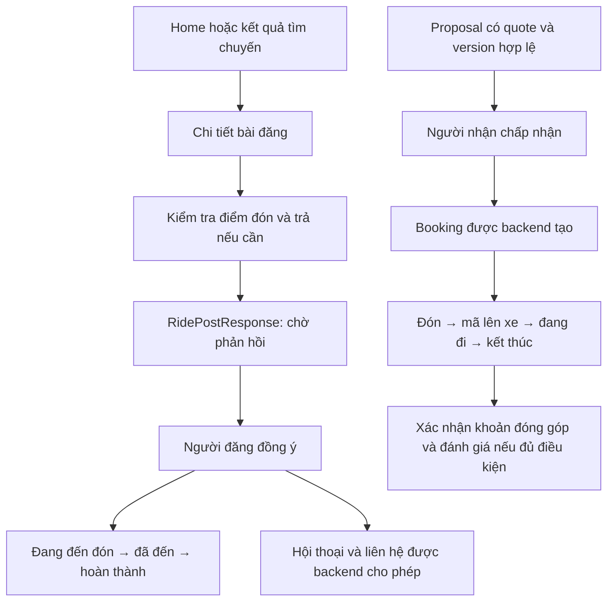

# Plan nâng cấp UX Dike Mobile theo nghiệp vụ web

Ngày đánh giá: **20/10/2026**. Baseline: `main` tại `bef64b2`, cộng các thay đổi mobile/backend local đang có sau khi pull. Trạng thái: **đã triển khai đợt 1, đợt 2 và đợt 3 theo phạm vi bên dưới; các hạng mục còn lại vẫn là đề xuất**.

## Tiến độ đợt 1 — 20/10/2026

- UX-01: đổi tên tab “Khám phá” thành “Chuyến đi”. Chưa tổ chức lại hub hoặc thêm nguồn dữ liệu response/proposal.
- UX-04: CTA Home dựa trên chủ bài, loại bài, trạng thái và số yêu cầu: “Quản lý bài”, “Xem yêu cầu”, “Xem chuyến đi”, “Xem nhu cầu”, “Xem bài đăng”. Tất cả vẫn mở chi tiết, không ngụ ý đã gửi yêu cầu. Feed chưa có `myResponse`; việc trình bày tiến độ yêu cầu cá nhân thuộc đợt tiếp theo.
- UX-06: sửa loại báo cáo bài đăng thành `POST` ở mobile và helper API client dùng cho web; báo cáo người dùng giữ `USER`.
- UX-07: hiển thị nhãn tiếng Việt cho `NONE/SIMULATED/REAL`; chỉ đánh dấu danh tính thật khi evidence là `REAL`. Quyền tài xế và bằng chứng duyệt được diễn giải riêng, không suy ra phương tiện đã được duyệt.
- Giữ nguyên banner, đường cong tiếp giáp, vị trí ảnh vịt, map/avatar và thanh điều hướng Home vừa chốt. Không thêm dependency hoặc thay đổi backend trong đợt này.
- Xác nhận: mobile/API client lint và typecheck pass; 6 kiểm thử API rides pass; 5 kiểm thử Playwright cho CTA, điều hướng, hợp đồng report và ba trạng thái evidence pass. Playwright dùng API fixture; chưa nghiệm thu lại trên APK với backend thật.

## Tiến độ đợt 2 — 20/10/2026

- Thêm màn **Bài của tôi** với nhóm tất cả/bản nháp/đang mở/đã đóng, phân trang và làm mới khi quay lại. Điểm vào **Bài của tôi**, **Bản nháp**, **Yêu cầu đi cùng** nằm trong tab Chuyến đi.
- Nháp mở lại được từ danh sách và có bước xác nhận đăng với tuyến/giờ/phạm vi. Nháp người đi ké dùng publish hiện có; nháp người chở tra chuyến nguồn thuộc chủ bài rồi mở chuyến đúng version. Retry giữ key theo post/version và tiến độ chuyến nguồn; backend vẫn kiểm tra quyền, tuyến, phương tiện và thời hạn. Nháp hết hạn bị khóa đăng; chưa có chỉnh sửa toàn bộ tuyến/giờ của nháp trong đợt này.
- Thêm hộp **Yêu cầu đi cùng** nhận được/đã gửi, lọc chờ phản hồi, phân trang và lịch sử; liên kết về chi tiết bài với `responseId`, ưu tiên yêu cầu đó trong danh sách. Các thao tác chấp nhận/rút/cập nhật tiến độ vẫn dùng màn chi tiết và kiểm tra actor/version hiện có.
- Thêm khối tiếp tục hành trình đã đồng ý trên Home và Chuyến đi, giữ riêng response với trip/booking. Không coi accept response là tạo booking. Chưa triển khai proposal hub hoặc tái cấu trúc toàn bộ tab Chuyến đi.
- Bổ sung API đọc `GET /ride-post-responses?direction=sent|received&cursor=...` và `GET /ride-posts/{id}/draft-source?version=...`; inbox giới hạn người tham gia, recheck quyền đọc bài và cursor thuộc actor. Cập nhật OpenAPI và generated client.
- Sau gửi/đồng ý/rút/tiến độ/đóng/đăng, các danh sách liên quan được invalidate. Polling mới dừng khi màn mất focus; lifecycle nền/foreground toàn app vẫn thuộc giai đoạn sau.
- Xác nhận: 23 kiểm thử backend (post, response và OpenAPI) pass; 10 Playwright đợt 1+2 và 1 kiểm thử phục hồi lỗi/bố cục 360–430px pass; mobile lint/typecheck, API client typecheck và `api:check` pass. Đã xem ảnh các màn mới. Playwright dùng fixture; chưa nghiệm thu APK với hai tài khoản/backend thật.
- Cần khởi động lại backend bằng source mới và reload mobile để dùng API bổ sung. Không thêm native dependency, không cần build APK mới riêng cho đợt này.
- Lần chạy lại riêng kiểm thử inbox sau khi chỉnh fixture actor bị chặn bởi Chromium crash và Metro hết bộ nhớ; chưa xác nhận lại fixture cuối đó. Các lần pass ở trên là kết quả trước chỉnh fixture; mã ứng dụng không đổi giữa hai lần.

## Tiến độ đợt 3 — 20/10/2026

- Refactor composer thành luồng **chọn tuyến → thời gian/thông tin → kết quả phù hợp**. Nút chính trước khi có kết quả là **Tìm người cùng đường**; đăng bài hoặc lưu nháp là lựa chọn rõ ràng sau khi đã xem kết quả.
- Kết nối API thật `/routing/routes`, `/routing/estimates` và `/ride-discovery`. Gợi ý đóng góp không chặn discovery nếu estimate tạm lỗi. Thêm các lựa chọn giờ nhanh 30 phút, 1 giờ và 2 giờ; vẫn giữ ô nhập chính xác để không thêm native dependency hoặc buộc build APK mới.
- Thêm danh sách kết quả có người đăng, tuyến, thời gian lệch, khoảng lệch đầu/cuối tuyến, chi phí và ghi chú. Có trạng thái loading, không có kết quả, lỗi và retry; quay lại chỉnh thông tin hoặc tuyến không làm mất dữ liệu đã nhập.
- Gửi yêu cầu ngay từ kết quả. Với `OFFER_RIDE`, mobile tạo pickup check trước rồi mới tạo response. Sheet xác nhận nói rõ bài đang soạn chưa được đăng; gửi thành công không gọi tạo trip/source/post. Người dùng vẫn có thể chọn **Đăng bài của tôi** hoặc **Lưu bản nháp của tôi** riêng.
- Giữ publication retry/idempotency của đợt trước. Lỗi discovery không làm mất route; lỗi estimate không chặn tìm kiếm; gửi thành công vô hiệu hóa nút của đúng kết quả và làm mới inbox response.
- Xác nhận: mobile lint và typecheck pass; 3 Playwright mới cho T04 pass; test publication retry hiện có cũng pass sau khi đổi sang luồng discovery. Playwright dùng fixture API; chưa nghiệm thu APK với routing/backend và hai tài khoản thật.

## 1. Kết luận và phạm vi

Mobile hiện có nhiều màn hình và đã dùng API thật, nhưng chưa tạo thành một hành trình sử dụng liền mạch. Vấn đề chính nằm ở **cách tổ chức công việc, phân biệt vai trò và nối trạng thái**, sau đó mới đến mỹ thuật. Tiếp tục sửa từng card riêng sẽ không giải quyết được việc người dùng không biết vào đâu, đang chờ ai, hoặc cần làm gì tiếp.

Đề xuất giữ phong cách Home đã chốt: banner mới, mascot, xanh ngọc/vàng và thanh điều hướng nổi. Tổ chức lại phần còn lại thành ba công việc rõ ràng: **tìm người cùng đường → xử lý kết nối → thực hiện hành trình**.

Phạm vi đối chiếu gồm các nhóm route web thành viên: auth/onboarding; Home/feed; tạo/tìm hành trình; yêu cầu từ bài đăng; trip/proposal/booking; lịch định kỳ và nhu cầu theo ngày; hội thoại/bạn bè; thông báo; hồ sơ/quyền riêng tư/phiên đăng nhập/xóa tài khoản; xác minh, vị trí, khoản đóng góp, đánh giá và báo cáo. Có rà soát route quản trị để xác định ranh giới, không đề xuất đưa console admin vào app thành viên.

Phương pháp: đọc route, handler truy vấn/mutation, component nghiệp vụ, API client và các service backend liên quan; đối chiếu với screenshot người dùng và hai plan mobile cũ. Đây là **audit source và luồng nghiệp vụ**, không phải biên bản nghiệm thu native hoặc nghiên cứu người dùng. Chưa chạy lại toàn bộ web/native với hai tài khoản và backend thật trong lượt đánh giá này. Những khoảng trống phía mobile dưới đây được kết luận theo source hiện tại, không theo việc thiếu một screenshot.

## 2. Nguyên tắc lấy web làm tham chiếu

1. Học nghiệp vụ và thông tin cần quyết định từ web; thiết kế lại thao tác cho điện thoại, không thu nhỏ nguyên trang desktop.
2. API/backend là nguồn sự thật cho quyền, capability, version, giá, tuyến và trạng thái. Web cũng có nhánh cũ và copy chưa cập nhật.
3. Không coi hai đối tượng cùng có chữ “chuyến” là cùng vòng đời. Không tự tạo booking hoặc gán quyền chỉ để UI trông liền mạch.
4. Giữ nút **+** ngang hàng thanh điều hướng theo lựa chọn hiện tại của người dùng; đây là action tạo mới, không phải tab thứ năm. Không thêm lại nút tạo bài riêng ở cuối feed.
5. Giữ các điểm tốt đã có: session guard; Google OAuth và lưu token; OTP có hạn/cooldown; trạng thái quyền thử nghiệm; publication có key/progress khi retry; message có `clientMessageId`; API thật và lỗi có đường thử lại.
6. Plan này thay thế các quyết định IA/luồng mâu thuẫn trong `mobile-ui-plan.md` và `mobile-redesign-plan.md`. Hai tài liệu đó vẫn dùng làm lịch sử triển khai mỹ thuật, không phải chứng nhận đầy đủ nghiệp vụ.

## 3. Bản đồ nghiệp vụ hiện tại

### 3.1. Vào ứng dụng

Google → phiên đăng nhập → kiểm tra `nextAction` → đồng ý tài liệu hoặc điện thoại/OTP nếu cần → Home. Local personas chỉ dành cho development và vẫn phải qua backend. Xác minh danh tính thật, quyền thử nghiệm và phương tiện được duyệt là các khái niệm riêng.

### 3.2. Tìm hoặc đăng hành trình

Web `UnifiedRideFlow`: chọn vai trò → điểm đi/đến → phương tiện, ghế, đi ngay/giờ hẹn → route + đóng góp gợi ý → tìm kết quả theo tuyến/thời gian/vai trò → gửi yêu cầu cho kết quả hoặc đăng bài của mình. Việc gửi yêu cầu cho kết quả không đồng nghĩa bài đang soạn đã được đăng.

Mobile `create-trip.tsx`: chọn vai trò/tuyến → nhập thời gian và thông tin → tính route → xem lại → thêm một sheet xác nhận → tạo nguồn/trip/post rồi đăng hoặc lưu nháp. Hiện không gọi `/ride-discovery` và không có màn kết quả trước khi đăng.

### 3.3. Hai vòng đời cần giữ riêng



**Không có mũi tên mặc định từ E sang J.** `RidePostResponseService.decide()` hiện cập nhật response, mở hội thoại và thông báo; không tạo booking. Nhánh proposal/booking do `RideService` xử lý có điều kiện và giao dịch riêng. `COMPLETED` của response không đủ để hiển thị mã lên xe, đối soát hoặc đánh giá booking.

### 3.4. Các luồng đi kèm

| Nhóm                   | Web hiện có                                                                               | Mobile hiện có / khoảng trống                                                               |
| ---------------------- | ----------------------------------------------------------------------------------------- | ------------------------------------------------------------------------------------------- |
| Home/feed              | Lọc/tìm/sắp xếp; card đang có kết nối hoặc booking; phân biệt chủ bài và người xem        | Có feed, lọc loại/ngày, tìm chuỗi; thiếu khối tiếp tục hành trình và CTA theo ngữ cảnh      |
| Bài của tôi/đã lưu     | Feed theo `mine`, `saved`, publish/close, lưu/bỏ lưu                                      | Chưa có điểm vào quản lý bài/nháp/đã lưu; chi tiết chủ bài chỉ có đóng                      |
| Tìm theo tuyến         | Route, estimate, discovery, kết quả và gửi yêu cầu                                        | Đang là form tạo bài, chưa có discovery/estimate                                            |
| Yêu cầu từ bài đăng    | Kiểm tra đón/trả, chi tiết phát sinh, xử lý yêu cầu và tiến độ; active response trên Home | Có gửi/đồng ý/rút/tiến độ trong chi tiết bài; chưa có hub theo dõi xuyên bài                |
| Proposal               | Danh sách/chi tiết, nhận/gửi, accept/reject/withdraw                                      | Không có route danh sách/chi tiết proposal                                                  |
| Trip/booking           | Danh sách riêng, vai trò, trạng thái, hành động tiếp theo                                 | Có cả hai nhưng nối tiếp trong một trang; card booking thiếu tuyến và người đi cùng         |
| Hậu chuyến             | Payment acknowledgement, review eligibility/reviews, find-again                           | Có gửi review; chưa có đối soát, find-again, no-show trong UI                               |
| Lịch định kỳ           | Lịch gốc + nhu cầu di chuyển theo ngày, lượt đi/về                                        | Có CRUD lịch gốc; thiếu timeline ngày và chi tiết travel intent                             |
| Hội thoại              | Hội thoại, lời mời, bài ghim/đính kèm, tiến độ và liên hệ đúng quyền                      | Có chat và nhận lời mời; chưa có ngữ cảnh hành trình ghim, gửi kèm bài, phân loại rõ        |
| Bạn bè                 | Tìm theo tên, nhận/gửi/rút/chấp nhận/hủy, chặn/bỏ chặn                                    | Hồ sơ chỉ có nhắn tin/chặn/báo cáo; chưa có quản lý bạn bè/lời mời/danh sách chặn           |
| Thông báo              | Phân loại; điều hướng cả proposal/user/post/booking/conversation                          | Có ngày và đọc/tất cả; resolver thiếu proposal/user và focus response                       |
| Hồ sơ                  | Avatar upload/processing, thông tin cá nhân, public profile                               | Chỉnh tên/bio/Facebook; chưa có đổi avatar và các trường tương ứng còn lại                  |
| Tài khoản              | Privacy, consent, session, reauth và yêu cầu xóa                                          | Có privacy/consent/session; chưa có xóa tài khoản và điểm đổi điện thoại trong settings     |
| Vị trí/sẵn sàng        | Availability có hạn, consent và live location theo booking                                | Chưa có luồng tương ứng; nút pin Home hiện là trang trí                                     |
| Tin tức thời gian thực | STOMP ticket + invalidation; social revision monitor                                      | Chủ yếu polling từng màn; chưa có monitor cấp app cho foreground/network/social             |
| Push hệ điều hành      | Không lấy UI web làm bằng chứng đã có push native                                         | Mobile mới xin quyền; chưa thấy đăng ký push token/handler mở app trong source đã rà        |
| Trust/moderation       | Report nhiều loại đối tượng, moderation/admin web                                         | Report USER/RIDE_POST; thiếu báo cáo trong chat/booking/review, có mismatch target bài đăng |

Các trang chuyển hướng như `/feed/new`, `/trips/new`, `/inbox/[id]`, `/users/[id]` được tính là điểm vào, không phải tính năng độc lập. Thành phần `BookingDetail` được dùng thật ở route booking là `src/rides/booking-detail.tsx`; không lấy một export cùng tên cũ trong `detail.tsx` làm chuẩn.

## 4. Phát hiện ưu tiên và hướng sửa

P0: chặn hoàn thành tác vụ, hiểu sai cam kết/quyền hoặc gọi sai hợp đồng. P1: thiếu tính năng quan trọng, ma sát lớn hoặc nguy cơ thông tin cũ. P2: hoàn thiện và mở rộng sau khi luồng chính đúng. Đây là mức ưu tiên thực hiện, không phải khẳng định mọi rủi ro đã tái hiện trên thiết bị.

| ID    | Mức | Bằng chứng hiện tại                                                                                                           | Tác động / đề xuất                                                                                                                                                                                                                                         |
| ----- | --- | ----------------------------------------------------------------------------------------------------------------------------- | ---------------------------------------------------------------------------------------------------------------------------------------------------------------------------------------------------------------------------------------------------------- |
| UX-01 | P0  | `(tabs)/_layout.tsx:134` ghi “Khám phá”; `(tabs)/trips.tsx:19` và `:28` chỉ lấy trip/booking                                  | Tên đích không khớp công việc. Đổi thành **Chuyến đi**, tổ chức theo việc cần xử lý và thời điểm                                                                                                                                                           |
| UX-02 | P0  | Chuyến đi không lấy `/ride-post-responses/active`; Home web có query này                                                      | Người đã được đồng ý đi cùng dễ tưởng hành trình biến mất. Thêm khối tiếp tục trên Home và response vào hub với nhãn đúng domain                                                                                                                           |
| UX-03 | P0  | `create-trip.tsx:68` chỉ tính route; `:95` chuyển sang publish                                                                | Người muốn tìm chuyến bị dẫn vào đăng bài. Thêm discovery trước đăng và phân biệt rõ “Gửi yêu cầu” / “Đăng nhu cầu”                                                                                                                                        |
| UX-04 | P0  | Home `index.tsx:441` luôn ghi “Đi ké ngay”, root card chỉ mở detail                                                           | Chủ bài, bài cần người chở và bài đã gửi cùng một CTA. Tạo presenter theo actor/type/status/myResponse; CTA nói đúng thao tác thật                                                                                                                         |
| UX-05 | P0  | Tạo bài cho phép `DRAFT`; `posts/[id].tsx` nhánh own chỉ đóng; không có danh sách `mine`                                      | Lưu nháp xong thiếu đường quay lại đăng. Có **Bài của tôi / Bản nháp**, xem lại và publish theo version/capability thực                                                                                                                                    |
| UX-06 | P0  | `ReportSheet.tsx` gửi `targetType=RIDE_POST`; `Report.TargetType` chỉ có `POST` cho bài đăng                                  | Báo cáo bài có thể bị `REPORT_INVALID_TARGET`. Sửa adapter theo enum backend; kiểm thử cả report từ mobile và helper web, vì helper web cũ cũng có mismatch này                                                                                            |
| UX-07 | P0  | `verification.tsx` so evidence với `VERIFIED`; backend `VerificationEvidence` dùng `REAL`                                     | Trạng thái xác minh có thể hiển thị sai; chuẩn hóa `NONE/SIMULATED/REAL`, tách quyền tài xế và phương tiện được duyệt                                                                                                                                      |
| UX-08 | P1  | Ngày/giờ nhập chuỗi; nút + mặc định driver; form thêm sheet sau bước xem lại                                                  | Nhiều thao tác và chọn sai vai trò. Vai trò mặc định trung lập khi vào từ +; date/time picker và một điểm xác nhận có ý nghĩa                                                                                                                              |
| UX-09 | P1  | Pickup check mobile chỉ hiển thị phù hợp/giờ đón; web `PickupSummary` có phát sinh/giới hạn/map                               | Người chở thiếu dữ liệu để đồng ý. Hiển thị điểm đón/trả, giờ đến, phát sinh km/phút, giới hạn và route overlay trước accept                                                                                                                               |
| UX-10 | P1  | `posts/[id].tsx:68` chưa gắn snapshot check với `postVersion` hiện tại và chưa giải thích rõ khi check hết hiệu lực           | Input đã bị khóa lúc request chạy, nên chưa kết luận có lỗi sửa địa điểm đồng thời. Backend có kiểm tra version/hạn dùng; bổ sung vô hiệu hóa snapshot khi post/input đổi, thông báo cần kiểm tra lại và kiểm thử các tình huống refetch/quay lại màn hình |
| UX-11 | P1  | `posts/[id].tsx` decision dùng một sheet “Xác nhận cập nhật” và label trạng thái làm action                                   | Không rõ ai thao tác, ai chờ. Timeline theo domain/actor; một CTA hành động chính, hành động nguy hiểm vào menu riêng                                                                                                                                      |
| UX-12 | P1  | `(tabs)/trips.tsx` nối trip + booking; không có nhóm response/proposal; nhãn booking “Kết nối”                                | Trộn đối tượng, có thể lặp cùng việc hoặc thiếu một luồng. Dùng view model có `sourceKind`, source ID và quan hệ do API cung cấp; không dedupe bằng tuyến/tên                                                                                              |
| UX-13 | P1  | Booking mobile tự tải/hiện mã, không có no-show/find-again/payment; trip/booking chia nhiều nút dọc                           | Tạo màn đang đi theo vai trò với bước tiếp theo, mã bấm để xem/ẩn; các tiện ích chỉ xuất hiện khi backend cho phép                                                                                                                                         |
| UX-14 | P1  | `chat/[id].tsx` cuộn xuống ở mọi `onContentSizeChange`; chưa có lịch sử ngữ cảnh ghim                                         | Có thể kéo người đang đọc lên trên về cuối. Chỉ auto-scroll khi gần cuối hoặc người dùng vừa gửi; thêm thông báo tin mới và card hành trình ghim                                                                                                           |
| UX-15 | P1  | Inbox lọc tên nhưng dùng cùng empty “Chưa có cuộc trò chuyện”; `canSend=false` được diễn giải như đang chờ                    | Nhầm không có dữ liệu với không tìm thấy; nhầm pending/rejected/blocked/read-only. Presenter dựa state + actor, giữ search và action phục hồi phù hợp                                                                                                      |
| UX-16 | P1  | Notification mobile đánh dấu đọc + refetch trước điều hướng; resolver bỏ proposal/user/response focus                         | Một lỗi đánh dấu đọc chặn mở nội dung; nhiều thông báo không tới việc cần làm. Tách điều hướng và ack, resolver theo loại thông báo + context                                                                                                              |
| UX-17 | P1  | Chặn chỉ refetch relation; không có social revision/invalidation cấp app                                                      | Nội dung trước đó còn trong cache UI dù server có thể đã thu hồi quyền. Reset cache nhạy cảm theo quan hệ/session, refresh khi app về foreground                                                                                                           |
| UX-18 | P1  | `schedules/edit.tsx` khởi tạo hai place rỗng khi sửa; bắt tìm lại dù chỉ đổi tên; list chỉ refetch khi refresh                | Chỉnh sửa quá tốn công và danh sách có thể cũ sau lưu. Giữ địa điểm đã lưu qua contract hợp lệ, cập nhật/invalidate cache sau save                                                                                                                         |
| UX-19 | P1  | Không có travel-intent route trên mobile                                                                                      | Lịch định kỳ không dẫn tới chuyến theo ngày. Thêm timeline, lượt đi/về, chi tiết nhu cầu và đường vào compose/discovery mang ngữ cảnh                                                                                                                      |
| UX-20 | P1  | `Screen`/`DetailPage` thường dùng brand/art header lớn; nhiều full-width button/card; bản đồ 100×100                          | Trọng tâm bị đẩy xuống và nhiều thành phần ngang cấp. Header tác vụ gọn, grouping theo quyết định, chi tiết phụ mở dần, CTA cuối màn an toàn                                                                                                               |
| UX-21 | P1  | Home `ScrollView` + `posts.map` và mỗi preview có route query/WebView; nhiều màn polling không có focus/app lifecycle manager | Nguy cơ nhiều request/GPU/battery khi tải thêm; chưa có đo thực tế. Virtualize, chỉ mount map gần viewport, dừng polling khi inactive, đo trên APK                                                                                                         |
| UX-22 | P1  | `ResourceState` dùng cùng error cho các HTTP lỗi; thiếu app offline coordinator                                               | 403/404/409/network bị gộp; thiếu giữ form và khôi phục tác vụ. Chuẩn hóa error/state contract; không tự replay mutation hệ trọng khi có mạng lại                                                                                                          |
| UX-23 | P1  | Một số mutation mới tạo `randomUUID()` mỗi lần gọi lại; web `useRideCommand` giữ key theo signature                           | Retry tác vụ hệ trọng cần cùng key, version và payload khi endpoint hỗ trợ; 409 thì tải lại trạng thái thay vì sinh một ý định mới                                                                                                                         |
| UX-24 | P2  | Nhiều token/cỡ chữ 10–12 rải rác; `theme` và `homeTheme` riêng; màu sáng cố định                                              | Hợp nhất semantic tokens, chuẩn type/spacing/contrast, text scaling; dark mode sau nền tảng luồng, không làm song song khi state còn sai                                                                                                                   |

UX-06/07 có mismatch trong source và cần kiểm thử tái hiện khi triển khai. UX-10 là khoảng trống xử lý snapshot phía UI; backend vẫn kiểm tra tính hợp lệ, chưa có bằng chứng vượt qua kiểm tra hoặc race khi nhập liệu. Các rủi ro hiệu năng UX-21 cần đo, không suy ra FPS/p95 từ việc đọc code.

## 5. Kiến trúc thông tin đề xuất

```text
Thanh dưới: Trang chủ | Chuyến đi | (+) | Tin nhắn | Cá nhân

Trang chủ
  Việc đang diễn ra / chờ bạn phản hồi (khi có)
  Tìm tuyến nhanh + Tôi chở / Tôi đi ké
  Bảng tin cộng đồng + bộ lọc

Chuyến đi
  Cần xử lý | Sắp đi | Đang đi | Lịch sử
  Lối vào phụ: Bài của tôi · Đã lưu · Lịch định kỳ
  Chi tiết mở theo nguồn: response / proposal / trip / booking

(+) chọn “Tôi chở” hoặc “Tôi đi ké” → cùng luồng tuyến và tìm kết quả

Tin nhắn
  Hội thoại + lời mời nhắn tin
  Bạn bè/lời mời kết bạn là mục phụ có tên riêng, không trộn hai loại lời mời

Cá nhân
  Hồ sơ · Phương tiện/quyền tạo chuyến · Xác minh
  Quyền riêng tư · Đã chặn · Thiết bị · Điều khoản · Xóa tài khoản
```

- Không thêm một tab “Khám phá” nữa: việc tìm kiếm nằm ở Home và compose/discovery.
- “Cần xử lý” là danh sách công việc, không phải một domain mới. Có section/nhãn phân biệt response và proposal; phản hồi ở đúng endpoint.
- “Sắp đi/Đang đi” hiển thị người cùng đi, vai trò của tôi, tuyến, giờ và bước tiếp theo. Các booking trong một trip có thể nhóm nếu backend có quan hệ rõ ràng. Không tự gộp response với booking khi chỉ giống địa điểm/thời gian.
- Lịch sử tách kết quả đã hoàn thành và đã hủy; không vẽ timeline thành công cho `CANCELLED/EXPIRED/NO_SHOW`.
- Giữ vị trí + như hiện tại; màn chọn vai trò là action sheet. Entry từ card Home có thể bỏ sheet vì người dùng đã chọn vai trò.

## 6. Luồng mobile mới cần thiết kế

### 6.1. Home và card bài đăng

Thứ tự ưu tiên: có hành trình active → khối “Tiếp tục hành trình” xuất hiện trước feed; có việc cần phản hồi → badge/link vào Chuyến đi. Nếu không có, hiện tìm tuyến và feed như hiện tại. Banner không cần xuất hiện lại trên màn giao dịch/chat.

| Ngữ cảnh card                                           | CTA chính                                                 |
| ------------------------------------------------------- | --------------------------------------------------------- |
| Bài của mình                                            | Quản lý bài · Xem N yêu cầu                               |
| Bài OFFER_RIDE còn nhận, mình chưa gửi                  | Đi ké chuyến này                                          |
| Bài NEED_RIDE còn nhận, mình đủ điều kiện theo contract | Đề nghị chở                                               |
| Đã gửi, đang chờ                                        | Xem yêu cầu · Chờ người đăng phản hồi                     |
| Hai bên đã đồng ý                                       | Tiếp tục hành trình                                       |
| Bài đóng/hết hạn/không còn quyền xem                    | Thông báo trạng thái và đường quay lại; không mời gửi mới |

Nhãn phải khớp kết quả bấm: “Đi ké chuyến này” mở bước kiểm tra/chốt yêu cầu, không giả như đã đặt chỗ ngay. Không hiện “tiện đường” chỉ vì cùng địa danh. Phân biệt lọc bài đã tải với tìm theo tuyến thực; lọc ngày nên dùng `from/until` server đang hỗ trợ để không kết luận sai khi trang đầu rỗng.

### 6.2. Tìm người cùng đường và đăng bài

1. Chọn vai trò, hai địa điểm, đi ngay/giờ hẹn; dùng picker ngày/giờ, giữ timezone thống nhất.
2. Tính route, hiển thị bản đồ mở rộng, thời lượng và đóng góp gợi ý từ API; không nhập các ID kỹ thuật.
3. **Tìm chuyến/người cần chở** qua discovery. Giữ input khi quay lại. Không tạo trip/source/post chỉ để xem kết quả.
4. Có kết quả: xem chi tiết, kiểm tra đón/trả rồi gửi yêu cầu. Thông báo rõ bài đang soạn chưa đăng.
5. Không có hoặc muốn đăng riêng: xem lại thông tin, phạm vi hiển thị, capability và chi phí → **Đăng bài** hoặc **Lưu nháp**. Lưu nháp là lựa chọn lưu, không phải giá trị visibility.
6. Publication lỗi giữa chừng: giữ source/trip/post/key đã thành công và tiếp tục đúng bước. Nếu tuyến hết hạn trước khi tạo nguồn thì tính lại; không xóa tiến độ đã ghi server để làm lại mù.

Không tự ý thay giới hạn ghé đón, công thức giá, arrival window hay horizon nghiệp vụ. UI phải hiển thị/cho chọn từ policy backend; giá gợi ý không phải quote đã chốt cho booking.

### 6.3. Gửi và xử lý yêu cầu từ bài đăng

- Người đi ké thấy điểm đón/trả đang dùng, có thể sửa; check gắn với revision input, postVersion, expiry. Chỉ gửi khi snapshot phù hợp và hợp lệ theo backend.
- Nếu API cho phép cùng toàn tuyến mà không cần check riêng, chỉ bỏ bước check sau contract test; không sao chép riêng cách web bỏ bước này khi chưa xác nhận server.
- Người đăng xem người yêu cầu, vai trò, đón/trả, giờ dự kiến, phát sinh km/phút và map trước khi đồng ý.
- Sau gửi: đưa về chi tiết yêu cầu hoặc hub với trạng thái chờ; có rút yêu cầu khi được phép. Sau đồng ý: mở progress đúng vai trò + hội thoại/người liên hệ do server cung cấp.
- Khi nhận 409 hoặc snapshot hết hạn lúc accept: giải thích cần kiểm tra lại, giữ lời nhắn; không khẳng định đã ghép.

### 6.4. Chuyến đang diễn ra

Đầu màn là tuyến, người cùng đi, trạng thái và một việc tiếp theo. Tách hai presenter:

- **Response**: chờ phản hồi → đã đồng ý → người chở đang đến → đã đến điểm đón → hoàn thành. Không tự thêm boarding/payment/review booking.
- **Booking**: đã xác nhận → đã đến → đã lên xe → đang đi → kết thúc; mã lên xe chỉ hành khách được xem và tài xế được nhập; thời điểm bắt đầu trip/booking phải theo engine backend, không phát minh nút `START` cho booking.

Booking hiển thị đúng hành động được phép: đến điểm đón, lên xe, hoàn thành, hủy, no-show theo thời hạn server, kết thúc sớm, tìm lại sau khi kết thúc bất thường. Lý do/confirmation dùng cho thao tác có hệ quả; cập nhật tiến độ thường ngày không cần một modal chung chung ở mọi bước.

Sau kết thúc hợp lệ: hiển thị xác nhận trả/nhận khoản đóng góp của hai bên và đánh giá khi eligibility cho phép. Không gọi đó là giao dịch ngân hàng đã xác minh. Không hiển thị đánh giá chỉ dựa trên chữ `COMPLETED` từ một response.

### 6.5. Chat, thông báo và quan hệ

- Header chat gọn; có người nhận và card hành trình ghim; mở đúng yêu cầu/booking từ chat, hiển thị liên hệ sau xác nhận nếu API cho phép.
- Tin đã gửi/đang gửi/lỗi có trạng thái cục bộ; retry giữ `clientMessageId`; vẫn cho soạn tin kế tiếp hoặc bỏ bản lỗi có xác nhận. Không gửi vô điều kiện khi `canSend` chưa xác định.
- Phân biệt lời mời gửi đi/nhận được, bị từ chối, blocked và read-only bằng contract hiện tại; chấp nhận lời mời chỉ ở đúng actor.
- Notification resolver dùng `type` + payload, hỗ trợ proposal/user/response; mở đúng ngữ cảnh, rồi đánh dấu đọc độc lập. Việc đọc thất bại không cản mở chi tiết.
- Request bị xóa/không còn quyền: màn giải thích và back hợp lý. Login/OTP/consent xong phải tiếp tục đích deep link hợp lệ ban đầu.
- Chặn/hủy bạn có giải thích hệ quả và invalidation; không xóa liên hệ phục vụ booking active trái policy. Không hiện lại nội dung protected từ cache sau quyền bị thu hồi.

### 6.6. Lịch, hồ sơ và trust

- Lịch: phân biệt “Lịch định kỳ” với “Chuyến theo ngày”; chọn ngày, lượt đi/về, xem nhu cầu được sinh và tìm/đăng với ngữ cảnh đã có. Sửa tên/giờ không bắt nhập lại địa điểm không đổi nếu API cho phép giữ nguồn.
- Hồ sơ: đổi avatar qua upload grant → upload → complete → processing/ready/error; giữ tên/bio, bổ sung các trường đã có trên web theo nhu cầu. Trường không hỗ trợ không làm nút giả.
- Privacy/consent/session vẫn tách; cài đặt có đổi điện thoại và yêu cầu xóa với reauth đúng backend. Không tự thêm hủy yêu cầu xóa khi server chưa hỗ trợ.
- Report dùng enum contract đúng; mở từ bài, người dùng, tin nhắn/chuyến/review theo quyền và context. Sau gửi reset form/mutation để lần báo cáo sau không bị kẹt ở “đã gửi”.
- Vị trí: tách chọn vị trí cho tìm kiếm, availability người chở và live location theo booking. Không xin quyền nền ngay lúc mở app; thêm foreground trước, background chỉ làm khi có yêu cầu và thiết kế riêng.
- Xin quyền thông báo không đồng nghĩa push đã hoạt động. Chỉ hứa nhắc khi app đóng sau khi có token registration, backend delivery và deep-link handling được kiểm chứng.

## 7. Công việc và thứ tự triển khai

| Gói                                     | Ưu tiên / phụ thuộc                               | Nội dung và file chính                                                                                                                                   | Điều kiện hoàn thành                                                                                                      |
| --------------------------------------- | ------------------------------------------------- | -------------------------------------------------------------------------------------------------------------------------------------------------------- | ------------------------------------------------------------------------------------------------------------------------- |
| A. Chốt domain và presenter             | P0, làm đầu tiên                                  | Kiểu discriminated union cho post response/proposal/trip/booking; bảng state × actor × action; query keys/error mapper; `core/`, API client              | Không cast chung các status; mapping contract test cho mọi trạng thái hiện có; xác nhận response accept không tạo booking |
| B. Sửa lỗi hợp đồng và ngữ cảnh         | P0, sau A                                         | Report target, evidence, input revision pickup, CTA Home, draft publish; `ReportSheet`, `verification`, `posts/[id]`, Home                               | Contract/role tests qua; không gửi check cũ; nháp mở lại đăng được; bài của mình không có CTA đi ké                       |
| C. Hub hành trình                       | P0, sau A; một phần cần API mới                   | Đổi tab, active response + booking trên Home, cần xử lý/sắp đi/đang đi/lịch sử; route chi tiết theo nguồn                                                | Response đã đồng ý luôn tìm lại được; proposal đúng endpoint; không giả booking; không dedupe bằng text                   |
| D. Compose + discovery                  | P0 cho happy path, sau A/B                        | Refactor `create-trip` thành route/time/results/review; date/time picker; route/estimate/discovery; capability gate sớm                                  | Tìm được mà chưa tạo bài; gửi từ kết quả không tự đăng; đổi vai trò giữ dữ liệu hợp lệ; retry không tạo trùng             |
| E. Chi tiết yêu cầu và đang đi          | P1, sau B/C                                       | Presenter tiến độ, pickup summary/map, liên hệ theo quyền, booking controls, boarding reveal, find-again, payment/review                                 | Người dùng nhận biết đang chờ ai; role/time/version guard đúng; UI đủ no-show/early end/reauth/errors                     |
| F. Liên lạc và đồng bộ                  | P1, bắt đầu nền tảng lifecycle cùng A; UI sau C/E | Chat theo ngữ cảnh, resolver notification, friends/blocked, focus/app/network manager, social invalidation; STOMP theo ticket nếu xác nhận hỗ trợ bearer | Back stack và context được giữ; ack lỗi vẫn mở được nội dung; không poll nền; giữ key khi gửi lại                         |
| G. Lịch và tài khoản                    | P1 sau A, có thể chia PR độc lập sau luồng chính  | Timeline travel intents, sửa lịch không mất input, avatar/profile, phone/account deletion, consent/reauth                                                | CRUD phản ánh ngay; dùng contract file/identity đúng; xóa yêu cầu đúng policy, không tự khẳng định có thể hoàn tác        |
| H. Hiệu năng, accessibility và mỹ thuật | Nền tảng làm từ A; nghiệm thu sau D–G             | Virtualized lists/maps viewport, typography/token, safe area, keyboard, TalkBack/VoiceOver; dùng lại `Screen`, `DetailPage` có biến thể                  | Nội dung 360px không tràn; cỡ chữ lớn không mất action; không mount toàn bộ WebView feed; không hồi quy Home đã chốt      |
| I. Tính năng mở rộng                    | P2, sau các gate tương ứng                        | Availability/foreground location, native push end-to-end, dark mode; background location và admin mobile không mặc định trong scope                      | Có backend/native capability và kiểm thử thật; nếu chưa có thì không hiển thị là tính năng hoàn tất                       |

Đợt đầu nên giao **A → B → C**, rồi **D**. Không bắt đầu bằng đổi màu hoặc dựng lại toàn bộ app. Mỗi gói tách PR có thể review và rollback; không trộn thay đổi auth/backend transaction với PR mỹ thuật.

## 8. Phụ thuộc API và quyết định cần chốt

### Có thể dùng ngay từ contract hiện tại

Feed `mine`/`saved`, publish/close; routing/estimates/discovery; responses theo post, response active; proposals/bookings/trips; boarding/no-show/find-again; payment acknowledgement/review; social relations/search/blocks/revision; travel intents; profile/file/consents/session/deletion; availability/location và realtime ticket. “Có endpoint” không có nghĩa mọi tài khoản hoặc môi trường đã có capability/quyền thực thi.

### Cần bổ sung hoặc xác minh trước khi làm hub hoàn chỉnh

1. `/ride-post-responses/active` chỉ lấy `ACCEPTED/DRIVER_STARTED/DRIVER_ARRIVED`, giới hạn 20; không thay được inbox pending và lịch sử. Đề xuất API phân trang cho **yêu cầu của tôi**, lọc nhận/gửi/trạng thái; tên endpoint phải chốt, chưa coi `/me/ride-post-responses` là API đã có.
2. Chưa có GET response detail độc lập trong controller đã kiểm tra. Deep link cần cặp `postId + responseId`, hoặc bổ sung API đọc response theo ID có kiểm tra participant. Không đọc danh sách toàn hệ thống ở client.
3. Booking card thiếu tuyến/người cùng đi trong response danh sách hiện tại. Có thể join tài nguyên được phép đọc trong adapter trước; nếu N+1 ảnh hưởng thì thêm summary projection hoặc batch endpoint. Đo trước khi chốt một overview API mới.
4. `allowedActions` cấp UI không được giả là server đang trả cho mọi resource. Lập mapping frontend từ contract hiện có trước; API trả action/reason authoritative là cải tiến cần thống nhất.
5. Xác nhận same-route pickup không cần check riêng, điều kiện check version/expiry, và mọi enum report/evidence bằng contract tests. Web đang gửi same-route thiếu check trong một nhánh; không copy khi backend chưa nhận.
6. Xác minh native bearer với realtime ticket và websocket handshake trước khi dùng STOMP như web. Nếu chưa tương thích: polling theo focus + foreground là phương án đầu, không tự đổi auth transport.
7. Push native là workstream riêng nếu backend chưa có device registration/delivery; không xem `requestPermissionsAsync` là hoàn tất push.

**Quyết định sản phẩm đề xuất:** trong đợt UX này giữ response flow hiện tại của web làm đường đi phổ biến, vẫn hỗ trợ proposal/booking như luồng riêng. Việc chuyển mọi accepted response thành booking cần thiết kế lại cam kết ghế/giá/lịch/transaction ở backend, không nằm trong một refactor UX. Nếu muốn thống nhất về sau, phải có ADR và migration/compatibility plan riêng.

## 9. Quy chuẩn màn hình và trạng thái

- Một header tác vụ, một CTA chính. Art hero dành cho Home/empty/onboarding thích hợp; chat, xác nhận đón, review và setting dùng header gọn.
- Quyền chạm vẫn ≥48dp Android/44pt iOS dù hình tròn avatar hoặc icon nhỏ hơn. Nội dung quan trọng đọc được, không dùng chữ 10px cho quyết định tuyến/giá/thời gian.
- Footer tránh safe area/bàn phím; thanh dưới giữ nhãn. Kiểm chứng custom tab bar thật sự ẩn khi keyboard mở, không chỉ dựa vào `tabBarHideOnKeyboard` của navigator.
- Form thay đổi nhưng chưa lưu có cảnh báo khi rời màn; back không reset vai trò/tuyến nếu còn trong cùng tác vụ. Nháp local không thay cho idempotency server và không lưu mã OTP/boarding code vào draft lâu dài.
- Route/map thiếu, đang tính, network fail, không còn quyền là bốn trạng thái riêng. Map lỗi không làm mất tuyến chữ/giờ/CTA hợp lệ; không vẽ đường giả để lấp ô.

| Nhóm                | Loaded                    | Empty                                            | Loading                               | Error                           | Offline                                           | Success                       | Permission / policy denied                                |
| ------------------- | ------------------------- | ------------------------------------------------ | ------------------------------------- | ------------------------------- | ------------------------------------------------- | ----------------------------- | --------------------------------------------------------- |
| Feed/search         | Card theo actor           | Không có bài khác không có kết quả; clear filter | Skeleton/card stable                  | Retry riêng feed/map            | Chỉ giữ cache còn được phép + nhãn cũ             | Thông báo gửi/lưu đúng action | Không còn quyền thì gỡ nội dung protected                 |
| Compose             | Route + thông tin         | Chưa chọn điểm                                   | Tính route/tìm kết quả tách nhau      | Giữ input và progress/key       | Không tự đăng khi mạng lại                        | Nói rõ đăng/nháp/gửi yêu cầu  | Capability thiếu có lý do và điểm đi tiếp thực tế         |
| Yêu cầu/chuyến      | Timeline + bước tiếp theo | Không có việc cần xử lý                          | Không reset timeline khi refresh      | 409 cập nhật lại trước thao tác | Không thực thi boarding/accept trên trạng thái cũ | Actor nhận phản hồi cụ thể    | Server deny thì dừng action, không giữ nút cho dữ liệu cũ |
| Chat                | Tin + ngữ cảnh            | Hội thoại mới khác search rỗng                   | Giữ lịch sử khi tải thêm              | Retry cùng clientMessageId      | Bản soạn giữ; không gửi mù                        | Tin gửi được xác nhận         | Pending/rejected/blocked/read-only có copy riêng          |
| Hồ sơ/lịch/settings | Giá trị server + draft    | Giới thiệu thiếu dữ liệu                         | Tránh editor rỗng khi query chưa xong | Giữ draft, reload khi conflict  | Không tự ghi đè bản mới                           | Saved có vị trí rõ            | Vị trí/notification bị từ chối có đường vào settings      |

## 10. Nghiệm thu theo tình huống

| Test | Kịch bản cần qua                                                                                                                                                                               |
| ---- | ---------------------------------------------------------------------------------------------------------------------------------------------------------------------------------------------- |
| T01  | A đăng OFFER_RIDE; B chọn đón/trả, gửi; A thấy trong cần xử lý; đồng ý; cả hai mở lại từ Home/hub thấy response, không hiển thị booking giả                                                    |
| T02  | A đăng NEED_RIDE; B đề nghị chở; A đồng ý; B mới có action đến đón; A thấy đang chờ B; không mặc định owner luôn là driver                                                                     |
| T03  | Cùng toàn tuyến và khác điểm đón đều qua contract; input khóa khi check chạy; đổi địa chỉ sau check, refetch hoặc quay lại màn hình; check/post hết hạn trước accept; không dùng snapshot cũ   |
| T04  | Chọn vai trò từ + và card Home; discovery có/không kết quả; gửi từ kết quả không tạo bài; quay lại không mất input                                                                             |
| T05  | Lưu nháp, đóng app/mở lại, tìm trong Bài của tôi, xem lại và đăng theo version/capability; lỗi publication giữa bước không tạo thêm nguồn/trip/post                                            |
| T06  | Proposal thực: đúng người nhận accept; booking chỉ hiện sau server trả; request timeout rồi retry cùng key không đặt chỗ lần hai                                                               |
| T07  | Booking theo driver/passenger: ẩn/hiện mã, mã sai/hết hạn/quá số lần, arrive/board/start trip/complete đúng engine, no-show đủ giờ và lý do                                                    |
| T08  | Cancel/early end/find-again; khoản đóng góp chưa đủ hai xác nhận/đã khóa; review đủ/không đủ điều kiện/đã gửi/quá hạn                                                                          |
| T09  | Notification response/proposal/user/booking/chat; read ack fail; resource mất quyền; cold start hoặc session hết hạn → login/consent/OTP → quay đúng đích                                      |
| T10  | Tin nhắn lỗi gửi lại cùng ID; vừa gõ vừa poll không mất draft; đọc tin cũ không bị kéo xuống; pending đúng bên nhận; blocked/read-only không bị gọi là chờ chấp nhận                           |
| T11  | Friend request nhận/gửi/rút/accept/remove/cooldown; block từ thiết bị khác gỡ nội dung protected khi foreground/revision; active booking giữ liên hệ theo policy                               |
| T12  | Lịch sinh lượt đi/về theo ngày; sửa tên/giờ không phải chọn lại nơi không đổi; conflict version giữ draft và hướng dẫn nạp lại                                                                 |
| T13  | Đổi avatar processing/ready/error; profile validation; evidence REAL/SIMULATED/NONE; đổi số/reauth/xóa theo backend policy                                                                     |
| T14  | Report USER/POST/MESSAGE/TRIP/REVIEW đúng enum/context; đóng/mở report sheet reset; duplicate/quota không hiện success giả                                                                     |
| T15  | Máy Android thật 360–430dp và iOS nếu release hỗ trợ: font lớn, TalkBack/VoiceOver, keyboard, back, safe area, mất mạng/foreground; tải thêm nhiều trang không giữ tất cả map worker hoạt động |

Tách ba lớp bằng chứng: unit/contract cho mapping/guards; E2E mock cho UI và retry; smoke hai tài khoản với backend/routing thật cho booking/response/social/native permission. Playwright web không thay thế nghiệm thu APK.

Không lấy số API đã gọi hoặc số màn đã dựng làm tiêu chí hoàn tất. Ghi nhận completion/drop-off cho tìm → gửi → phản hồi → tiếp tục, số bước và lỗi retry trước/sau để so sánh; chưa đặt chỉ tiêu % cải thiện khi chưa có baseline đo.

## 11. Nguồn đối chiếu và giới hạn

| Nhóm                  | Source chính                                                                                                                                                                                                                                                          |
| --------------------- | --------------------------------------------------------------------------------------------------------------------------------------------------------------------------------------------------------------------------------------------------------------------- |
| Home, active work     | `apps/web/app/components/authenticated-home.tsx`; `apps/mobile/src/app/(tabs)/index.tsx`                                                                                                                                                                              |
| Compose/discovery     | `apps/web/app/rides/new/unified-ride-flow.tsx`; `apps/mobile/src/app/create-trip.tsx`; `packages/api-client-ts/src/rides.ts`                                                                                                                                          |
| Response và đón/trả   | `apps/web/src/rides/detail.tsx`; `passenger-request.tsx`; `response-progress.tsx`; `apps/mobile/src/app/posts/[id].tsx`; backend `planning/application/RidePostResponseService.java`, `PickupCompatibilityService.java`                                               |
| Proposal/trip/booking | `apps/web/src/rides/dashboard.tsx`, `proposal-detail.tsx`, `booking-detail.tsx`; `apps/mobile/src/app/(tabs)/trips.tsx`, `trip/[id].tsx`, `booking/[id].tsx`; backend `ride/application/RideService.java`                                                             |
| Lịch                  | `apps/web/app/schedules/`, `travel-intents/[id]/page.tsx`, `src/schedules/api.ts`; `apps/mobile/src/app/schedules.tsx`, `schedules/edit.tsx`                                                                                                                          |
| Liên lạc/quan hệ      | `apps/web/app/inbox/`, `friends/page.tsx`, `src/social/`, `src/journey/realtime.tsx`; mobile `inbox.tsx`, `chat/[id].tsx`, `user/[id].tsx`, `notifications.tsx`                                                                                                       |
| Tài khoản/trust       | Web `me/profile`, `settings`, `account/sessions`, `verification`, `availability`, `src/journey/booking-tools.tsx`, `src/trust/report-dialog.tsx`, `admin/`; mobile `settings/`, `onboarding/phone`, `verification`, `ReportSheet`; API clients profile/social/journey |
| UI nền tảng           | Mobile `Screen`, `DetailPage`, `ResourceState`, `PlacePicker`, `PostRoutePreview`, `RouteMapSurface`, `ui`, `theme`, `home-theme`, `_layout`                                                                                                                          |

Một số điểm web không nên sao chép nguyên trạng: menu điều hướng có đường cũ; `new-post.tsx` không phải composer route mới; `detail.tsx` có export BookingDetail cũ không phải component route đang dùng; helper report có target mismatch; một nhánh travel intent dẫn `/feed/new?intent=...` trong khi redirect hiện chỉ nhận `route`; copy privacy còn nói chat chưa ra mắt. Khi port luôn lần theo route dùng thật, contract backend và test, không chỉ tên file hoặc tài liệu Stage cũ.

Audit heuristic của skill đã chạy trên `apps/mobile/src`: **139 cờ error, 202 warning, 47 suggestion; điểm máy 0/100 do công thức cộng phạt toàn thư mục**. Đây không phải “UX bằng 0”, cũng không phải 139 lỗi đã tái hiện: token lint và state regex có false positive khi state nằm ở wrapper. Contrast/target checker không tìm ra issue không có nghĩa đã đo đạt toàn bộ màn hình. Các cờ phải được triage bằng component thực và thiết bị.

Artifact nội bộ tại `.tmp/mobile-ux-audit/`: `route-inventory.json` gồm 38 page route web và 27 file route/layout mobile; `validators.json` chứa toàn bộ output nguyên gốc. Chúng là snapshot tại thời điểm đánh giá, không phải tài liệu khẳng định phạm vi sẽ không thay đổi.

Các gate chưa kiểm chứng trong lượt này: native build WebView mới trên điện thoại, hai tài khoản thật, push delivery, GPS/foreground/background, runtime accessibility, performance/battery, và race/transaction backend thật. Plan chỉ coi từng gate hoàn thành sau khi có bằng chứng tương ứng.
