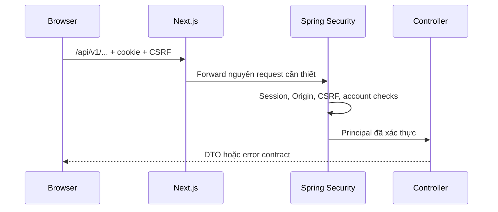
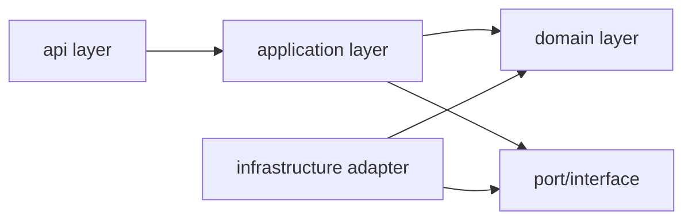
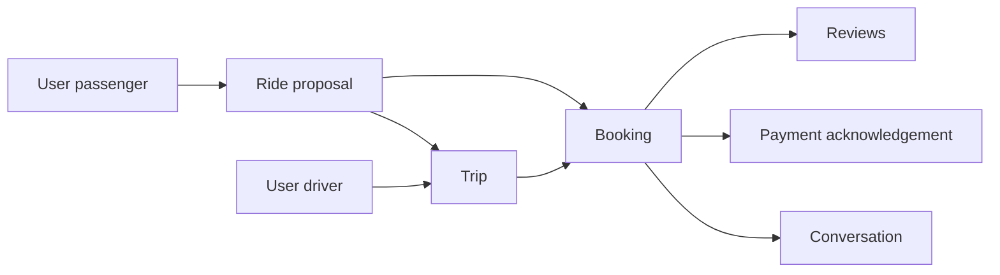
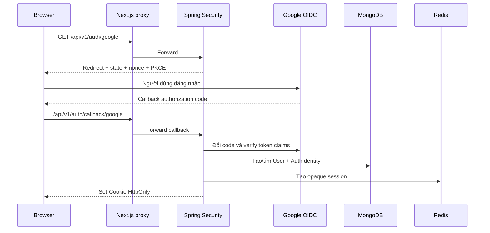
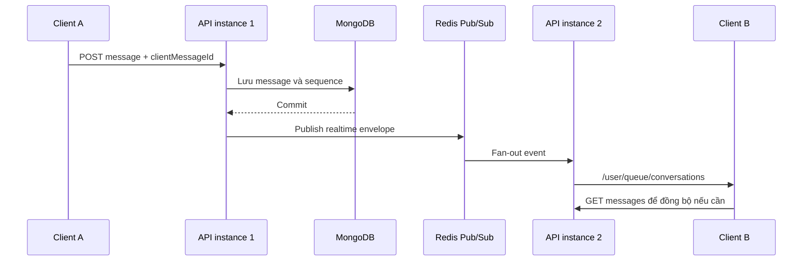
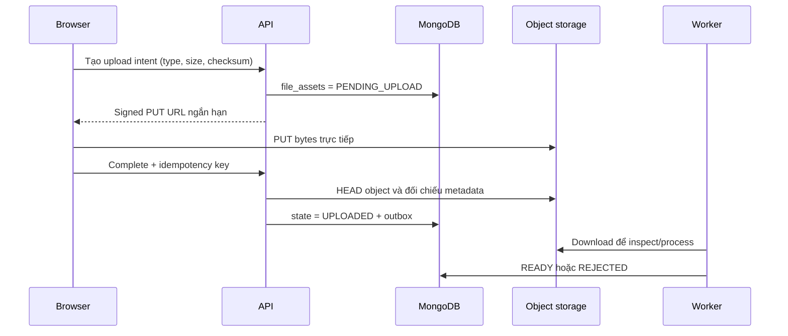

# Lộ trình kiến thức Software Engineering để hiểu Dike

Tài liệu này dành cho thành viên mới hoặc fresher muốn hiểu không chỉ code chạy
thế nào mà còn hiểu vì sao Dike thiết kế nghiệp vụ như hiện tại.

Không cần học hết mọi chủ đề rồi mới đọc code. Nên học từng phần, tìm ví dụ tương
ứng trong Dike, chạy test và quay lại bổ sung kiến thức còn thiếu.

## 1. Cách sử dụng tài liệu

Mỗi kiến thức được trình bày theo bốn câu hỏi:

1. **Là gì?** Khái niệm có nghĩa gì bằng ngôn ngữ đơn giản.
2. **Mục đích?** Nó giải quyết rủi ro hoặc vấn đề nào.
3. **Dike áp dụng thế nào?** Khái niệm xuất hiện ở đâu trong luồng nghiệp vụ.
4. **Nên đọc gì?** Điểm bắt đầu trong source hoặc tài liệu.

Khi gặp một khái niệm khó, đừng chỉ học định nghĩa. Hãy trả lời thêm:

- Nếu không có cơ chế này, lỗi thực tế nào có thể xảy ra?
- Dữ liệu trước và sau thao tác nằm ở đâu?
- Khi hai request chạy đồng thời thì kết quả có còn đúng không?
- Khi API, worker hoặc dependency chết giữa chừng thì hệ thống phục hồi thế nào?
- Test nào chứng minh cơ chế thật sự hoạt động?

Thứ tự học đề xuất:

```text
Nghiệp vụ Dike
  → HTTP và client-server
  → Java/TypeScript căn bản
  → module và layer
  → domain model và state machine
  → MongoDB/Redis/object storage
  → authentication/authorization
  → transaction và concurrency
  → outbox/realtime
  → testing, observability và deployment
```

## 2. Phân tích nghiệp vụ và domain modeling

### 2.1. Actor, use case và business rule

**Là gì?**

- **Actor** là người hoặc hệ thống tham gia một luồng, ví dụ hành khách, tài xế,
  moderator hoặc Goong.
- **Use case** là mục tiêu hoàn chỉnh của actor, ví dụ “đăng nhu cầu đi nhờ” hoặc
  “chấp nhận proposal”.
- **Business rule** là điều kiện nghiệp vụ bắt buộc phải đúng.

**Mục đích:** giúp đội ngũ nói về hành vi người dùng trước khi nói về controller,
database hoặc framework. Nếu chưa biết ai làm gì và điều kiện thành công là gì thì
không thể thiết kế API đúng.

**Dike áp dụng:** các actor có quyền khác nhau. Người lạ chỉ thấy thông tin công
khai; participant booking mới thấy dữ liệu chuyến đi; moderator xử lý report;
admin thực hiện một số thao tác quản trị có audit.

**Nên đọc:** controller để tìm actor đầu vào, application service để tìm use case,
test để tìm rule. Bắt đầu từ các package `planning`, `ride`, `messaging` và `trust`.

### 2.2. Entity, value object và aggregate

**Là gì?**

- **Entity** có danh tính tồn tại theo thời gian, ví dụ `Booking` có `id`.
- **Value object** được nhận diện bằng giá trị, ví dụ tọa độ hoặc khoảng thời gian.
- **Aggregate** là nhóm dữ liệu có một cửa vào chịu trách nhiệm giữ invariant.

**Mục đích:** tránh sửa từng field rời rạc làm trạng thái nghiệp vụ trở nên vô lý.
Thay vì controller tự đổi `status`, domain cung cấp hành vi hợp lệ như accept,
cancel hoặc complete.

**Dike áp dụng:** `Trip`, `Proposal`, `Booking`, `ScheduleRule` và `TravelIntent`
chứa state và rule riêng. Application service điều phối nhiều aggregate khi một use
case cần transaction.

**Nên đọc:** `apps/backend/src/main/java/com/dike/*/domain` và các test domain tương
ứng trong `apps/backend/src/test/java`.

### 2.3. Invariant và state machine

**Là gì?**

- **Invariant** là điều luôn phải đúng, ví dụ số chỗ không được âm.
- **State machine** mô tả các trạng thái và transition hợp lệ, ví dụ proposal chỉ
  có thể từ `PENDING` sang `ACCEPTED`, `DECLINED` hoặc `EXPIRED` theo rule.

**Mục đích:** ngăn request hợp lệ về JSON nhưng sai về nghiệp vụ, chẳng hạn hoàn
thành một booking đã bị hủy.

**Dike áp dụng:** booking, proposal, trip, report, file và account deletion đều có
vòng đời. Backend kiểm tra trạng thái hiện tại và version trước khi chuyển trạng
thái.

**Bài tập:** chọn một entity, vẽ bảng `trạng thái hiện tại → hành động → trạng thái
mới → ai được phép`, sau đó đối chiếu với domain test.

### 2.4. Quyền riêng tư như một business rule

**Là gì?** Privacy không chỉ là che field ở frontend. Nó là quy tắc xác định ai
được thu thập, lưu, đọc và chia sẻ dữ liệu nào.

**Mục đích:** giảm rủi ro lộ PII và vị trí chính xác.

**Dike áp dụng:** trước booking chỉ hiển thị vùng làm mờ; live location chính xác
chỉ tồn tại ngắn hạn khi participant đã consent; MongoDB lưu receipt đồng ý nhưng
không lưu lịch sử tọa độ chính xác.

**Nên đọc:** ADR 0017 về location privacy, `AvailabilityService` và
`LiveLocationConsent`.

### 2.5. Case study nghiệp vụ: chấp nhận một proposal

Giả sử hành khách gửi proposal xin một chỗ trên chuyến của tài xế. Tài xế bấm
“Chấp nhận”. Nhìn từ UI, đây chỉ là một nút; nhìn từ nghiệp vụ, hệ thống phải trả
lời đồng thời nhiều câu hỏi:

| Câu hỏi                                                 | Rule cần bảo vệ         |
| ------------------------------------------------------- | ----------------------- |
| Người bấm có phải tài xế sở hữu trip không?             | Ownership/authorization |
| Proposal còn `PENDING` và chưa hết hạn không?           | State machine           |
| Trip còn chỗ không?                                     | Capacity invariant      |
| Hành khách hoặc tài xế có lịch trùng không?             | Time-overlap invariant  |
| Route và estimate còn hiệu lực không?                   | Snapshot/expiry rule    |
| Request bị gửi lại do timeout có tạo hai booking không? | Idempotency             |
| Hai proposal cùng tranh chỗ cuối thì sao?               | Concurrency control     |
| Booking thành công nhưng notification lỗi thì sao?      | Transactional outbox    |

Luồng tư duy đúng:

```text
Xác định actor
  → tải trạng thái hiện tại từ source of truth
  → kiểm tra authority và ownership
  → kiểm tra state transition
  → fence tài nguyên cạnh tranh
  → kiểm tra invariant
  → transaction ghi business state + receipt + outbox
  → commit
  → worker xử lý conversation/notification
```

Pain point thường gặp là kiểm tra tất cả điều kiện ở frontend hoặc kiểm tra
`availableSeats > 0` rồi mới ghi. Frontend có thể bị sửa; hai request backend có
thể cùng đọc thấy một chỗ. Rule phải được bảo vệ lại ở backend và tại thao tác
database có tính nguyên tử.

### 2.6. Cách chuyển yêu cầu tự nhiên thành model

Yêu cầu “người dùng có thể hủy chuyến” còn quá mơ hồ. Trước khi code, cần tách:

1. Ai được hủy: tài xế, hành khách hay admin?
2. Resource nào bị hủy: trip, proposal hay booking?
3. Trạng thái nào cho phép hủy?
4. Có deadline trước giờ khởi hành không?
5. Số chỗ và interval có được trả lại không?
6. Counterpart cần được thông báo không?
7. Retry cùng request có an toàn không?
8. Audit hoặc lý do hủy có cần giữ lại không?

Kết quả của bước phân tích nên là state transition, invariant, authorization rule,
transaction boundary và side effect; không nên bắt đầu bằng việc tạo collection
hoặc endpoint.

## 3. Kiến thức nền về web và API

### 3.1. Client-server và request-response

**Là gì?** Client gửi request; server xác thực, xử lý và trả response. Client không
được xem là môi trường đáng tin cậy.

**Mục đích:** xác định trách nhiệm. UI có thể hỗ trợ validation và hiển thị, nhưng
server phải quyết định quyền và nghiệp vụ.

**Dike áp dụng:** React gửi request qua Next.js proxy tới Spring Boot. Spring Boot
đọc principal, validation DTO, gọi application service rồi trả JSON hoặc error
contract.

**Nên đọc:** `apps/web/src`, `apps/web/next.config.ts`, các class `*Controller` và
`docs/api/openapi.json`.

### 3.2. HTTP, REST và status code

**Là gì?** HTTP định nghĩa method, URL, header, cookie, body và status code. REST
mô hình hóa API quanh resource và hành động chuẩn của HTTP.

**Mục đích:** tạo contract rõ ràng giữa web/mobile và backend.

**Dike áp dụng:** `GET` đọc dữ liệu; `POST` tạo hoặc thực hiện command; `PUT/PATCH`
cập nhật; `DELETE` xóa. `400` biểu thị request sai, `401` chưa xác thực, `403` không
có quyền, `404` không tìm thấy, `409` xung đột trạng thái và `422` sai rule dữ liệu.

**Bài tập:** mở một endpoint trong OpenAPI, tìm controller tương ứng và theo request
tới response DTO.

### 3.3. API contract, DTO và OpenAPI

**Là gì?** DTO là cấu trúc dữ liệu đi qua biên API. OpenAPI mô tả endpoint và
schema ở dạng máy đọc được.

**Mục đích:** không để frontend phụ thuộc trực tiếp vào entity/database model và
giúp sinh TypeScript client đồng bộ với backend.

**Dike áp dụng:** Spring controller định nghĩa request/response; OpenAPI được xuất
ra `docs/api/openapi.json`; package `api-client-ts` được generate từ contract.

**Nên nhớ:** không sửa tay generated client. Khi contract đổi, cập nhật backend,
sinh lại client rồi chạy contract check.

### 3.4. Cookie, header và same-origin proxy

**Là gì?** Origin là bộ `scheme + host + port`. Cookie và chính sách browser phụ
thuộc origin. Proxy cho phép browser gọi `/api` cùng origin với web dù Spring Boot
chạy ở host khác.

**Mục đích:** giữ session cookie first-party và giảm cấu hình CORS phức tạp.

**Dike áp dụng:** Next.js rewrite `/api/*` tới Spring Boot. Next.js không xử lý
booking hay user; nó chỉ forward method, header, cookie, body và response.

**Nên đọc:** `apps/web/next.config.ts` và tài liệu
`docs/architecture/auth/web-same-origin-proxy.md`.

### 3.5. Case study HTTP: cập nhật một resource

Một request minh họa có thể trông như sau:

```http
PUT /api/v1/schedules/schedule-123 HTTP/1.1
Cookie: DIKE_SESSION=<opaque-id>
X-XSRF-TOKEN: <csrf-token>
Idempotency-Key: 8f6c...
Content-Type: application/json

{
  "version": 4,
  "departureTime": "07:30",
  "originPlaceRef": "place-ref-1"
}
```

Ý nghĩa từng phần:

- URL xác định resource/use case.
- Cookie giúp backend tìm session, không trực tiếp chứng minh ownership.
- CSRF token chứng minh mutation được tạo từ luồng web hợp lệ.
- Idempotency key giúp retry an toàn nếu client không nhận được response.
- `version` cho biết client sửa dựa trên revision nào.
- Body chỉ là đề nghị thay đổi; backend vẫn tải state thật và validation lại.

Nếu document đã ở version 5, request version 4 nên nhận `409 Conflict` thay vì ghi
đè thay đổi mới hơn. Nếu user không sở hữu schedule, nên trả `403` hoặc response
được thiết kế để không rò rỉ sự tồn tại của resource.

### 3.6. Luồng proxy và trust boundary



**Trust boundary** là biên mà dữ liệu đi từ vùng không tin cậy sang vùng phải kiểm
soát. Browser, mobile và provider response đều nằm ngoài trust boundary. TypeScript
type không phải biện pháp bảo mật vì attacker có thể gửi HTTP thủ công.

## 4. Nền tảng lập trình dùng trong Dike

### 4.1. Java, OOP và dependency injection

**Là gì?** OOP tổ chức hành vi quanh object/class. Dependency injection truyền
dependency vào class thay vì class tự tạo chúng.

**Mục đích:** tách business logic khỏi MongoDB, Redis hoặc provider cụ thể và giúp
test bằng fake/mock.

**Dike áp dụng:** application service nhận các port/store qua constructor. Spring
tạo và nối `Mongo...Store`, `Redis...Store` hoặc `GoongRoutingProvider` phù hợp cấu
hình.

**Cần nắm:** class, interface, record, enum, exception, collection, generic,
constructor injection và annotation Spring cơ bản.

### 4.2. TypeScript, React và Next.js

**Là gì?** TypeScript thêm type cho JavaScript. React xây UI từ component và state.
Next.js cung cấp routing, rendering và server-side proxy.

**Mục đích:** giúp UI phản ánh server state nhất quán và tái sử dụng component.

**Dike áp dụng:** route nằm trong `apps/web/app`; API client nằm trong
`apps/web/src` hoặc package generated; component dùng package `web-ui` và
`design-tokens`.

**Cần nắm:** component, props, hook, controlled form, async/await, fetch, server
state so với UI state và error handling.

### 4.3. Exception và error contract

**Là gì?** Exception biểu thị luồng không thể tiếp tục bình thường. Error contract
chuyển lỗi nội bộ thành status/code/message ổn định cho client.

**Mục đích:** frontend không phải đoán lỗi từ text hoặc để lộ stack trace.

**Dike áp dụng:** domain/application ném lỗi có nghĩa nghiệp vụ; controller hoặc
global handler map thành HTTP status và mã như `ROUTE_NOT_FOUND` hoặc
`PLACE_SESSION_INVALID`.

### 4.4. Ví dụ dependency injection và khả năng test

Nếu service tự tạo provider:

```java
class RouteService {
  private final GoongClient client = new GoongClient("secret");
}
```

service bị gắn cứng với Goong, khó test offline và dễ để secret/config lọt vào code.
Cách Dike hướng tới là phụ thuộc vào abstraction:

```java
class RouteService {
  RouteService(RoutingProvider provider, RouteCache cache) { ... }
}
```

Production inject `GoongRoutingProvider`; test hoặc local đặc biệt có thể inject
`FakeRoutingProvider`. Business service không đổi khi adapter đổi.

### 4.5. Luồng state trong frontend

```text
Server state: booking, post, notification
  → API client tải về
  → query cache giữ bản sao
  → component render
  → mutation thành công
  → invalidate/refetch
  → UI đồng bộ lại từ server

UI state: modal mở, tab đang chọn, text chưa submit
  → component/local store
  → không cần ghi backend
```

Pain point là copy server state vào nhiều store rồi tự đồng bộ. Sau mutation, một
store đổi còn store khác giữ dữ liệu cũ. Với dữ liệu nghiệp vụ, ưu tiên một cơ chế
server-state cache và refetch từ API.

## 5. Kiến trúc phần mềm

### 5.1. Modular monolith

**Là gì?** Một artifact/deployment nhưng chia code thành module nghiệp vụ có biên
rõ ràng.

**Mục đích:** giữ vận hành và transaction đơn giản cho đội nhỏ mà không biến
monolith thành code hỗn độn.

**Dike áp dụng:** backend có các module `identity`, `community`, `planning`, `ride`,
`messaging`, `trust` và `shared`. Spring Modulith/architecture test kiểm tra phụ
thuộc giữa module.

### 5.2. Layered architecture

**Là gì?** Bên trong mỗi module, code được chia thành `api`, `application`, `domain`
và `infrastructure`.

**Mục đích:** domain không phụ thuộc HTTP/database; controller không chứa use case
phức tạp; adapter công nghệ có thể thay thế.

**Dike áp dụng:** controller gọi application service; application gọi domain và
port; infrastructure implement port bằng MongoDB, Redis, S3 hoặc Goong.

### 5.3. Ports and adapters

**Là gì?** Port là interface mô tả điều application cần. Adapter là implementation
kết nối port với công nghệ thật.

**Mục đích:** test use case không cần gọi dịch vụ ngoài và có thể thay provider mà
ít sửa domain.

**Dike áp dụng:** `RoutingProvider` có adapter Goong và fake; `ObjectStorage` có
adapter S3-compatible; store interface có Mongo adapter.

### 5.4. Coupling và cohesion

**Là gì?** Coupling là mức phụ thuộc giữa các phần; cohesion là mức các phần trong
một module cùng phục vụ một mục đích.

**Mục đích:** cohesion cao và coupling thấp giúp thay đổi một nghiệp vụ ít làm hỏng
nghiệp vụ khác.

**Dike áp dụng:** `ride` sở hữu booking, `messaging` sở hữu conversation. Module
khác dùng public contract/event, không import implementation nội bộ tùy tiện.

### 5.5. Ví dụ đặt code đúng và sai layer

Yêu cầu: “chỉ participant mới được xem booking”.

Thiết kế dễ sai:

```text
BookingController
  → gọi MongoTemplate trực tiếp
  → query booking theo id
  → trả toàn bộ document
```

Vấn đề: controller biết database, authorization dễ bị quên ở endpoint khác và
domain rule không tái sử dụng được.

Thiết kế phù hợp hơn:

```text
BookingController
  → BookingQueryService.get(actor, bookingId)
    → RideStore.booking(bookingId)
    → kiểm tra participant/authority
    → map sang BookingView an toàn
```

### 5.6. Dependency direction



Domain không import Spring MVC, MongoTemplate hay RedisTemplate. Infrastructure
được phép biết domain/port để chuyển dữ liệu, nhưng domain không biết adapter nào
đang chạy. Đây là dependency inversion ở mức thực tế.

## 6. Database và quản lý dữ liệu

### 6.1. Document database và MongoDB

**Là gì?** MongoDB lưu document BSON trong collection. Document có thể có object và
array lồng nhau nhưng vẫn cần schema logic.

**Mục đích:** phù hợp dữ liệu profile, lịch và snapshot có cấu trúc tiến hóa; đồng
thời Dike cần replica set để dùng transaction.

**Dike áp dụng:** MongoDB là source of truth cho user, post, booking, message,
review, report và outbox.

**Cần nắm:** collection/document, query criteria, embed so với reference, index,
unique index, transaction, read/write concern và migration.

### 6.2. Data modeling và quan hệ bằng ID

**Là gì?** Document có thể nhúng dữ liệu hoặc giữ ID tham chiếu document khác.

**Mục đích:** chọn đúng cách giúp tránh document quá lớn, dữ liệu trùng khó cập
nhật hoặc quá nhiều query.

**Dike áp dụng:** booking giữ ID của trip/proposal/user; route dùng snapshot để bảo
toàn dữ liệu lịch sử; message tách khỏi conversation vì số lượng tăng liên tục.

### 6.3. Index và query plan

**Là gì?** Index là cấu trúc phụ giúp tìm nhanh hoặc áp đặt uniqueness.

**Mục đích:** tránh scan toàn collection và dùng database làm lớp bảo vệ cuối cho
dữ liệu trùng.

**Dike áp dụng:** unique identity theo `issuer + subject`, message chống trùng bằng
client message ID, social relation và booking có index phục vụ rule cạnh tranh.

**Nên đọc:** các class có tên `*Migration`, vì index được quản lý bằng migration
thay vì tự động tạo tùy ý lúc chạy.

### 6.4. Transaction

**Là gì?** Một nhóm thao tác hoặc cùng commit hoặc cùng rollback.

**Mục đích:** bảo vệ invariant trải trên nhiều document.

**Dike áp dụng:** chấp nhận proposal có thể giảm chỗ, tạo booking, update proposal,
tạo receipt và outbox event trong cùng transaction. Không được để giảm chỗ thành
công nhưng booking không tồn tại.

### 6.5. Migration

**Là gì?** Migration là thay đổi schema/index/data theo phiên bản có kiểm soát.

**Mục đích:** mọi môi trường đạt cùng cấu trúc database và việc deploy có thể kiểm
tra, audit hoặc rollback theo kế hoạch.

**Dike áp dụng:** backend có Mongo migration runner và collection lưu migration đã
chạy. Production release phải chạy migration trước/sau deploy theo runbook.

### 6.6. Case study dữ liệu booking

Một mô hình khái niệm đơn giản:



MongoDB không tự bảo đảm toàn bộ quan hệ chỉ vì document giữ ID. Application
service vẫn phải kiểm tra proposal thuộc trip nào, actor có đúng vai trò không và
booking chưa tồn tại cho proposal đó.

### 6.7. Timeline race condition với chỗ cuối

Không có concurrency control:

```text
T0: Trip còn 1 chỗ
T1: Request A đọc còn 1
T2: Request B đọc còn 1
T3: A tạo booking và ghi còn 0
T4: B cũng tạo booking và ghi còn 0
Kết quả: 2 booking dùng 1 chỗ
```

Có transaction/version/fence:

```text
T1: A và B cùng cố chạm record fence/version
T2: A commit trước: version 7 → 8, còn 0 chỗ
T3: B update với version 7 thất bại hoặc transaction conflict
T4: B reload và trả conflict/hết chỗ
```

Unique index bổ sung lớp bảo vệ cho quan hệ phải duy nhất, ví dụ một booking trên
một proposal. Nó không thay mọi business check nhưng ngăn race lọt qua lớp Java.

### 6.8. Snapshot so với reference

- **Reference** phù hợp khi luôn cần trạng thái hiện tại, ví dụ `booking.tripId` để
  tìm trip.
- **Snapshot** phù hợp khi cần giữ sự thật tại thời điểm giao dịch, ví dụ route,
  địa điểm hoặc contribution đã dùng khi tạo booking.

Nếu chỉ giữ reference tới route/provider hiện tại, dữ liệu cũ có thể thay đổi hoặc
hết hạn làm lịch sử booking không còn giải thích được. Snapshot đánh đổi thêm dung
lượng để có lịch sử ổn định.

## 7. Redis và dữ liệu ngắn hạn

### 7.1. Cache và TTL

**Là gì?** Cache là bản sao có thể tạo lại. TTL là thời gian key được phép sống.

**Mục đích:** giảm độ trễ/tải và tự dọn dữ liệu tạm.

**Dike áp dụng:** route cache, resolved place, realtime ticket, availability và live
location đều có TTL. Mất cache không được làm mất booking.

### 7.2. Server-side session

**Là gì?** Browser giữ một ID ngẫu nhiên; thông tin session thật nằm server-side.

**Mục đích:** backend có thể revoke một thiết bị, logout toàn bộ và tính lại quyền
mà không chờ token client hết hạn.

**Dike áp dụng:** web dùng opaque session trong Redis và cookie `HttpOnly`.

### 7.3. Rate limiting

**Là gì?** Giới hạn số request theo user, IP, device hoặc resource trong một cửa sổ
thời gian.

**Mục đích:** chống spam, brute force, lạm dụng OTP và provider có tính phí.

**Dike áp dụng:** login, OTP, file và routing có bucket Redis riêng; response có
thể trả `429 Too Many Requests` và thời gian retry.

### 7.4. Pub/Sub, lease và distributed coordination

**Là gì?** Pub/Sub phát message cho subscriber đang online. Lease là quyền tạm thời
để một worker xử lý tài nguyên.

**Mục đích:** phối hợp nhiều API/worker instance mà không giữ state trong RAM của
một máy duy nhất.

**Dike áp dụng:** Redis Pub/Sub fan-out realtime; một số scheduled job dùng Redis
lease. Pub/Sub không thay outbox vì subscriber offline có thể bỏ lỡ message.

### 7.5. Case study Redis: tìm địa điểm và lập route

```text
1. Backend tạo place-session trong Redis, TTL 5 phút.
2. User nhập query; backend gọi Goong AutoComplete.
3. Backend không trả providerPlaceId trực tiếp mà tạo placeRef nội bộ.
4. Redis map placeRef với providerPlaceId trong đúng session/user.
5. User chọn suggestion; backend consume session một lần.
6. Place Detail được resolve và PlaceSnapshot lưu Redis có TTL.
7. Khi tính route, backend kiểm tra route cache bằng HMAC key.
8. Cache miss thì gọi Goong Direction rồi cache kết quả.
9. Route dùng cho nghiệp vụ được lưu thành snapshot trong MongoDB.
```

Pain point được giải quyết:

- Session một lần hạn chế replay/mix suggestion giữa user.
- TTL tự dọn dữ liệu tìm kiếm không cần tồn tại mãi.
- HMAC key tránh để tọa độ/provider ID xuất hiện rõ trong Redis key hoặc log.
- Cache giảm chi phí và độ trễ gọi Goong.
- Mongo snapshot giữ dữ liệu cần thiết sau khi Redis cache hết hạn.

### 7.6. Cache invalidation và dữ liệu cũ

Cache nhanh nhưng có thể cũ. Trước khi cache một giá trị, cần trả lời:

1. Source of truth là gì?
2. Cache key đại diện đầy đủ input chưa?
3. TTL bao lâu là chấp nhận được?
4. Khi source đổi thì xóa cache hay chờ TTL?
5. Cache miss có đường tính lại không?
6. Cache poisoning hoặc lộ PII trong key/value được ngăn thế nào?

Không cache số chỗ rồi dùng cache để quyết định booking. Capacity là invariant
nghiệp vụ nên phải đọc/ghi qua Mongo transaction. Route estimate có thể cache vì
miss hoặc mất cache chỉ làm hệ thống gọi provider lại.

## 8. Authentication, authorization và application security

### 8.1. Authentication và authorization

**Là gì?** Authentication trả lời “ai đang gọi?”. Authorization trả lời “người đó
được làm gì với resource này?”.

**Mục đích:** đã đăng nhập không đồng nghĩa được đọc mọi booking hoặc sửa mọi post.

**Dike áp dụng:** Spring Security xác thực session; application service tiếp tục
kiểm tra role, ownership, participant, block policy và account state.

### 8.2. OAuth 2.0, OpenID Connect và PKCE

**Là gì?** OAuth 2.0 là framework ủy quyền; OIDC bổ sung identity; PKCE ràng buộc
authorization request với callback.

**Mục đích:** đăng nhập Google mà Dike không nhận password Google và chống đánh cắp
authorization code.

**Dike áp dụng:** Google login dùng state, nonce và PKCE. Identity được nhận diện
bằng `issuer + subject`, không tự merge chỉ vì email trùng.

### 8.3. Cookie, CSRF, CORS và SameSite

**Là gì?** Browser tự gửi cookie nên website xấu có thể cố tạo request thay user;
đó là CSRF. CORS giới hạn script từ origin khác đọc/gửi request nhất định.

**Mục đích:** bảo vệ mutation dựa trên cookie.

**Dike áp dụng:** cookie `HttpOnly`, `SameSite`, CSRF token, exact Origin allowlist
và same-origin proxy phối hợp với nhau. Không cơ chế nào thay hoàn toàn cơ chế còn
lại.

### 8.4. Hashing, encryption và secret management

**Là gì?** Hash một chiều dùng để so sánh mà không khôi phục dữ liệu gốc. Encryption
có thể giải mã bằng key. Secret là credential không được commit.

**Mục đích:** giảm thiệt hại nếu log/cache/source bị lộ.

**Dike áp dụng:** realtime ticket lưu digest; route cache key dùng HMAC; boarding
secret được bảo vệ; OAuth/Goong/storage key đi qua environment secret.

### 8.5. PII, data minimization và audit

**Là gì?** PII là dữ liệu nhận diện cá nhân. Data minimization nghĩa là chỉ thu và
lưu dữ liệu thực sự cần. Audit log ghi ai đã làm gì và khi nào.

**Dike áp dụng:** không log query/tọa độ/API key; file private dùng signed URL;
moderation/admin operation có audit; vị trí chính xác không được lưu lịch sử dài
hạn.

### 8.6. Case study đăng nhập Google



Mỗi cơ chế chặn một pain point khác nhau:

| Cơ chế           | Nếu thiếu có thể xảy ra gì?                                      |
| ---------------- | ---------------------------------------------------------------- |
| `state`          | Attacker gắn callback của họ vào phiên của nạn nhân              |
| `nonce`          | ID token cũ có thể bị replay trong sai ngữ cảnh                  |
| PKCE             | Authorization code bị lấy cắp có thể bị đổi token                |
| `issuer+subject` | Account bị merge sai chỉ vì email trùng hoặc thay đổi            |
| Opaque session   | Khó revoke từng thiết bị hoặc quyền cũ tiếp tục sống phía client |
| `HttpOnly`       | JavaScript đọc trực tiếp session cookie khi có lỗ hổng script    |

### 8.7. Case study authorization theo resource

Endpoint `GET /bookings/{id}` không nên chỉ kiểm tra user đã login:

```text
principal.userId
  → tải booking từ MongoDB
  → booking có participant(userId)?
  → account còn active và authority version hiện hành?
  → field nào được phép trả theo vai trò/trạng thái?
  → map sang response DTO
```

Không tin `userId` gửi trong query/body để quyết định actor. Actor phải lấy từ
principal. ID trong URL chỉ xác định resource cần truy cập.

### 8.8. Threat modeling tối thiểu

Trước một feature nhạy cảm, hỏi:

- Tài sản cần bảo vệ là gì: account, booking, vị trí, file hay secret?
- Ai có thể tấn công: người lạ, user đã login, participant cũ hay admin bị lộ?
- Entry point nào nhận input: REST, WebSocket, upload, callback hay worker event?
- Có thể giả mạo actor, sửa ID, replay request, spam hoặc race không?
- Log/error có làm lộ sự tồn tại của resource hoặc dữ liệu riêng tư không?

Threat modeling không thay security test; nó giúp biết cần viết test nào.

## 9. Concurrency và hệ phân tán

### 9.1. Race condition

**Là gì?** Kết quả sai xảy ra khi nhiều request đọc và ghi cùng dữ liệu ở thời điểm
gần nhau.

**Mục đích:** hiểu vì sao `if (seats > 0)` trong Java chưa đủ để chống vượt chỗ.

**Dike áp dụng:** booking, proposal, social relation, moderation và message sequence
có thể bị cạnh tranh giữa nhiều request.

### 9.2. Optimistic locking và fencing

**Là gì?** Optimistic locking dùng `version` để từ chối update dựa trên dữ liệu cũ.
Fencing buộc transaction cạnh tranh chạm cùng một record để tạo xung đột có thể
phát hiện.

**Mục đích:** tránh lost update và giữ invariant khi nhiều tài nguyên liên quan.

**Dike áp dụng:** client gửi version khi transition; Mongo update kèm điều kiện
`id + version`; luồng booking fence user/intent/trip trước khi kiểm tra overlap.

### 9.3. Idempotency

**Là gì?** Gửi cùng một command nhiều lần vẫn tạo một kết quả nghiệp vụ.

**Mục đích:** mobile/browser có thể retry sau timeout dù request đầu đã commit.

**Dike áp dụng:** mutation nhạy cảm dùng idempotency key hoặc client message ID;
command receipt lưu kết quả để không tạo booking/message hai lần.

### 9.4. Retry, timeout, backoff và circuit breaker

**Là gì?** Timeout giới hạn thời gian chờ. Retry thử lại lỗi tạm thời. Backoff tăng
khoảng chờ. Circuit breaker tạm ngừng gọi dependency đang lỗi liên tục.

**Mục đích:** tránh một provider chậm giữ hết thread hoặc retry dồn dập làm sự cố
nặng hơn.

**Dike áp dụng:** Goong adapter có timeout, retry có jitter và circuit breaker đơn
giản; outbox worker retry với exponential backoff và số lần tối đa.

### 9.5. Consistency model

**Là gì?** Strong/immediate consistency yêu cầu kết quả đúng ngay sau commit.
Eventual consistency cho phép projection hoặc notification xuất hiện chậm.

**Mục đích:** chọn phần nào phải nằm trong transaction và phần nào có thể làm nền.

**Dike áp dụng:** số chỗ và booking nhất quán trong transaction; conversation hoặc
notification tạo từ outbox có thể xuất hiện sau vài giây.

### 9.6. Case study timeout và retry

Tình huống:

```text
Client gửi Accept Proposal
  → backend commit booking
  → mạng đứt trước khi response tới client
  → client thấy timeout và không biết request đã thành công chưa
  → client gửi lại cùng idempotency key
```

Không có idempotency, retry có thể tạo booking thứ hai hoặc trả lỗi khó hiểu dù
booking đầu đã tồn tại. Có command receipt, backend nhận ra command cũ và trả lại
kết quả tương ứng.

Nguyên tắc retry:

- Chỉ retry lỗi có khả năng tạm thời như timeout, `429` hoặc một số `5xx`.
- Không retry vô hạn; có maximum attempts.
- Dùng exponential backoff và jitter để nhiều client không retry cùng lúc.
- Mutation chỉ retry tự động khi có idempotency mechanism.
- Validation/authorization error không tự biến mất nên không retry mù.

### 9.7. Case study optimistic locking

Hai moderator cùng mở report version 3. Người A cập nhật trước thành version 4.
Người B vẫn gửi quyết định dựa trên version 3:

```text
UPDATE reports
SET state = ..., version = 4
WHERE id = ? AND version = 3
```

Kết quả update của B có modified count bằng 0. Backend trả conflict để B tải lại
thay vì âm thầm ghi đè quyết định của A.

### 9.8. Chọn strong hay eventual consistency

| Dữ liệu/thao tác       | Mức consistency  | Lý do                        |
| ---------------------- | ---------------- | ---------------------------- |
| Capacity và booking    | Ngay lập tức     | Sai sẽ gây vượt chỗ          |
| Proposal state         | Ngay lập tức     | Không thể accept hai lần     |
| Command receipt        | Cùng transaction | Bảo vệ retry                 |
| Notification           | Eventual         | Chậm vài giây chấp nhận được |
| Rating summary         | Eventual         | Có thể rebuild từ review     |
| Realtime badge trên UI | Best effort      | REST refetch phục hồi được   |

Không chọn eventual consistency chỉ vì dễ code. Trước tiên phải xác định business
invariant nào người dùng kỳ vọng đúng ngay.

## 10. Outbox và xử lý bất đồng bộ

### 10.1. Dual-write problem

**Là gì?** Một request cần ghi database rồi gửi event. Process có thể chết giữa hai
bước, làm một bên thành công và bên kia mất.

**Mục đích:** hiểu vì sao không gửi notification trực tiếp sau `mongo.save()` rồi
hy vọng không có sự cố.

**Dike áp dụng:** business state và `outbox_events` được ghi cùng Mongo transaction.
Worker claim event sau commit và gọi handler.

### 10.2. At-least-once delivery và idempotent consumer

**Là gì?** At least once bảo đảm cố giao event nhưng có thể giao trùng. Idempotent
consumer xử lý event lặp mà không tạo tác dụng trùng.

**Mục đích:** worker có thể crash sau khi side effect thành công nhưng trước khi
đánh dấu event hoàn tất.

**Dike áp dụng:** delivery được theo dõi theo `(eventId, consumerName)`; handler dùng
unique index/upsert/check tồn tại để replay an toàn.

**Nên đọc:** package `shared.outbox`, đặc biệt `OutboxPublisher`, `OutboxWorker`,
`OutboxStore` và `OutboxDeliveryStore`.

### 10.3. Timeline sự cố dual write

Cách không an toàn:

```text
1. MongoDB commit booking.
2. Process định gửi notification.
3. Container chết.
4. Request đã thành công nhưng không còn dấu vết việc cần gửi notification.
```

Cách dùng outbox:

```text
1. Transaction ghi booking và outbox event.
2. Commit cả hai.
3. Container API có thể chết nhưng event vẫn ở MongoDB.
4. Worker claim event bằng lease.
5. Handler tạo notification/conversation.
6. Worker ghi delivery và complete event.
```

Nếu worker chết sau bước 5 nhưng trước bước 6, event được giao lại. Vì vậy handler
phải dựa vào unique key, upsert hoặc delivery record để không tạo side effect trùng.

### 10.4. Trạng thái và retry của outbox

Một event thường đi qua các trạng thái khái niệm:

```text
PENDING
  → CLAIMED (có lease owner và lease expiry)
  → COMPLETED
  hoặc
  → PENDING với nextAttemptAt sau backoff
  → FAILED sau maximum attempts
```

Lease giải quyết worker chết khi đang giữ event: khi lease hết hạn, worker khác có
thể claim lại. Delivery theo consumer giải quyết một event có nhiều handler, trong
đó một handler đã thành công còn handler khác cần retry.

## 11. Realtime communication

### 11.1. WebSocket và STOMP

**Là gì?** WebSocket giữ kết nối hai chiều lâu dài. STOMP thêm destination và frame
semantics trên WebSocket.

**Mục đích:** đẩy message/notification tới client nhanh mà không polling liên tục.

**Dike áp dụng:** client xin realtime ticket một lần, kết nối WebSocket và chỉ
subscribe `/user/queue/*`. Mutation vẫn đi bằng REST để giữ authorization rõ ràng.

### 11.2. Realtime không phải source of truth

**Là gì?** Frame WebSocket hoặc Redis Pub/Sub có thể bị mất khi client/API offline.

**Mục đích:** UI phải có đường phục hồi sau reconnect.

**Dike áp dụng:** message/notification được lưu MongoDB trước; realtime envelope chỉ
báo có thay đổi; client refetch REST để đồng bộ dữ liệu thật.

### 11.3. Case study gửi message khi nhiều API instance



Redis cần thiết vì socket của B có thể nằm ở API instance 2, không cùng instance
nhận REST request của A.

### 11.4. Reconnect và mất frame

Tình huống client B mất mạng:

1. Message vẫn được commit trong MongoDB.
2. Redis Pub/Sub phát lúc B offline nên frame có thể bị bỏ lỡ.
3. Khi online lại, B xin realtime ticket mới và reconnect.
4. B gọi REST lấy message sau read marker/sequence hiện có.
5. UI hợp nhất dữ liệu theo ID/sequence và cập nhật unread count.

Pain point là nếu UI coi WebSocket frame là dữ liệu duy nhất, message sẽ mất khỏi
giao diện dù database đúng. Realtime nên kích hoạt cập nhật nhanh; REST cung cấp
khả năng phục hồi.

## 12. Tích hợp dịch vụ ngoài và file storage

### 12.1. Provider adapter

**Là gì?** Adapter cô lập API của nhà cung cấp bên ngoài khỏi domain nội bộ.

**Mục đích:** tránh để response schema, ID hoặc lỗi của provider lan khắp hệ thống.

**Dike áp dụng:** Goong autocomplete/detail/direction nằm sau `RoutingProvider`.
Backend map provider error thành error contract và map provider ID thành reference
nội bộ.

### 12.2. Snapshot

**Là gì?** Snapshot là bản chụp dữ liệu tại thời điểm nghiệp vụ diễn ra.

**Mục đích:** provider hoặc dữ liệu nguồn có thể thay đổi; booking cũ vẫn cần biết
route/địa điểm được dùng lúc tạo.

**Dike áp dụng:** resolved place và route được chuyển thành snapshot trước khi tham
gia schedule, intent hoặc booking.

### 12.3. Object storage và signed URL

**Là gì?** Object storage lưu file bằng bucket/key. Signed URL cấp quyền upload hoặc
download có thời hạn mà không trao storage credential cho client.

**Mục đích:** file bytes không đi qua database và backend không phải proxy mọi byte.

**Dike áp dụng:** MongoDB giữ `file_assets`; MinIO/R2 giữ bytes; backend kiểm tra
quyền rồi cấp signed URL; worker inspect/process file sau upload.

### 12.4. Case study provider lỗi hoặc trả dữ liệu xấu

Provider ngoài không nằm trong transaction và không được tin tuyệt đối:

- Có thể timeout, trả `429`, `5xx` hoặc JSON thiếu field.
- Cùng địa điểm có thể đổi label hoặc provider ID về sau.
- Không được đưa API key/query nhạy cảm vào log.
- Không nên để controller phụ thuộc trực tiếp schema response của Goong.

Luồng adapter an toàn:

```text
Application gọi RoutingProvider
  → adapter tạo URL và timeout
  → validate status/body
  → map sang PlaceSnapshot/RouteResult nội bộ
  → map lỗi sang code ổn định
  → cache khi phù hợp
```

### 12.5. Case study upload file không đi qua backend



Pain point và cơ chế:

- File lớn làm API tốn RAM/bandwidth → browser upload trực tiếp bằng signed URL.
- Client khai gian size/type → backend kiểm tra metadata và nội dung.
- Upload xong nhưng không gọi complete → TTL/cleanup job dọn staging object.
- Complete bị retry → idempotency key tránh xử lý trùng.
- File private bị đoán URL → bucket private và signed GET có expiry.

## 13. Testing và đảm bảo chất lượng

### 13.1. Unit test

**Là gì?** Test một rule/class nhỏ với dependency fake/mock.

**Dike áp dụng:** domain transition, contribution calculation và service rule được
kiểm tra nhanh mà không cần khởi động toàn hệ thống.

### 13.2. Integration test

**Là gì?** Test nhiều component với database/cache thật hoặc gần thật.

**Dike áp dụng:** Testcontainers khởi động MongoDB replica set, Redis hoặc MinIO để
kiểm tra transaction, index, TTL và adapter.

### 13.3. Contract test

**Là gì?** Kiểm tra producer và consumer cùng hiểu một API schema.

**Dike áp dụng:** OpenAPI artifact và generated TypeScript client phải đồng bộ.

### 13.4. End-to-end và negative security test

**Là gì?** E2E chạy luồng qua UI/API thật. Negative test cố tình gửi request sai,
thiếu quyền, trùng hoặc cạnh tranh.

**Dike áp dụng:** browser E2E đi qua Next.js proxy; security test kiểm tra CSRF,
ownership, duplicate và race condition.

### 13.5. Test pyramid và test invariant

**Mục đích:** không phải mọi thứ đều cần E2E chậm. Rule nên có nhiều unit test;
adapter/transaction có integration test; một số hành trình quan trọng có E2E.

Trong Dike, test tốt nên chứng minh invariant, ví dụ “hai request cạnh tranh không
tạo vượt chỗ”, thay vì chỉ chứng minh endpoint trả `200`.

### 13.6. Case study chiến lược test cho accept proposal

Một feature quan trọng nên được kiểm tra ở nhiều tầng, mỗi tầng trả lời câu hỏi
khác nhau:

| Tầng test         | Câu hỏi cần chứng minh                                                |
| ----------------- | --------------------------------------------------------------------- |
| Domain unit       | Proposal ở trạng thái nào được accept? Deadline được tính đúng không? |
| Service unit      | Service gọi rule/store/outbox đúng thứ tự và map lỗi đúng không?      |
| Mongo integration | Hai request cạnh tranh có tạo vượt chỗ hoặc duplicate booking không?  |
| API integration   | Principal, validation, status code và error code có đúng không?       |
| Contract          | OpenAPI và TypeScript client có khớp request/response mới không?      |
| Browser E2E       | Người dùng có hoàn thành hành trình qua UI thật không?                |

Chỉ mock repository trong mọi test sẽ không phát hiện unique index, transaction,
query sai field hoặc Mongo behavior. Ngược lại, dùng E2E cho mọi edge case làm test
chậm và khó chẩn đoán. Cần chọn tầng thấp nhất có thể chứng minh rủi ro.

### 13.7. Arrange, Act, Assert và tên test

Một test dễ đọc thường có ba phần:

```text
Arrange: tạo trip còn một chỗ và hai proposal pending
Act: chạy hai accept command cạnh tranh
Assert: đúng một booking thành công, capacity bằng 0, event không bị trùng
```

Tên test nên mô tả rule, ví dụ
`acceptingCompetingProposalsDoesNotOversellLastSeat`, không chỉ là
`testAcceptProposal`.

### 13.8. Happy path, boundary và failure path

Với mỗi rule cần nghĩ ít nhất:

- Happy path: dữ liệu hợp lệ và dependency hoạt động.
- Boundary: đúng deadline, chỗ cuối, độ dài tối đa, TTL vừa hết.
- Invalid transition: resource đã canceled/expired/completed.
- Authorization: user khác, account locked, participant cũ.
- Duplicate: cùng idempotency key/client message ID.
- Concurrency: hai request cùng version/cùng tài nguyên.
- Dependency failure: Redis, object storage hoặc Goong timeout.
- Recovery: retry/reconnect/refetch có đưa hệ thống về trạng thái đúng không?

## 14. DevOps và vận hành

### 14.1. Container, environment và profile

**Là gì?** Container đóng gói runtime. Environment tách local/staging/production.
Spring profile bật đúng workload/configuration.

**Dike áp dụng:** Docker Compose chạy MongoDB, Redis và MinIO local; Spring dùng
profile `api`, `worker` hoặc `combined`; secret lấy từ environment variable.

### 14.2. Stateless application

**Là gì?** API instance không phụ thuộc file hoặc session chỉ nằm trong RAM/local
disk của chính instance đó.

**Mục đích:** restart hoặc scale nhiều instance không làm mất dữ liệu.

**Dike áp dụng:** session ở Redis, nghiệp vụ ở MongoDB, file ở R2; container local
filesystem không phải storage bền vững.

### 14.3. Health, readiness và graceful shutdown

**Là gì?** Liveness trả lời process còn sống; readiness trả lời instance đã sẵn
sàng nhận traffic; graceful shutdown ngừng nhận việc mới và hoàn thành việc đang
chạy trong giới hạn.

**Dike áp dụng:** Spring Actuator có health group; readiness kiểm tra dependency;
worker dừng claim event mới trước khi process thoát.

### 14.4. Logging, metrics và tracing context

**Là gì?** Log ghi sự kiện; metric đo số lượng/độ trễ; correlation ID nối các log
của cùng request hoặc event.

**Mục đích:** production bug không thể debug chỉ bằng IDE.

**Dike áp dụng:** structured logging, request/correlation ID, outbox metric và log
redaction. Không đưa secret, OTP, query địa điểm hoặc tọa độ chính xác vào log.

### 14.5. Backup, restore, migration và rollback

**Là gì?** Backup chỉ có giá trị khi restore được kiểm chứng. Rollback là kế hoạch
quay về release an toàn khi deploy lỗi.

**Dike áp dụng:** production release bao gồm migration, health/smoke test,
backup/restore drill và rollback; không chỉ là build thành công.

### 14.6. Luồng khởi động local

```text
pnpm dev
  → đọc .env.local
  → kiểm tra Docker và port
  → Docker Compose khởi động Mongo replica set, Redis, MinIO
  → build Spring Boot JAR
  → chạy Spring profile local,combined
  → chạy Next.js development server
  → browser gọi localhost:3000
  → /api được proxy sang localhost:8080
```

Pain point phổ biến:

- Mongo chạy standalone thay vì replica set → transaction không hoạt động đúng.
- Port bị process cũ chiếm → một phần hệ thống không khởi động.
- `.env.local` còn placeholder → Google/Goong thất bại dù code đúng.
- Chỉ chạy web → giao diện mở nhưng API request lỗi.
- Redis mất → session hết và user bị logout, không có nghĩa Mongo mất user.

### 14.7. Luồng deploy production

```text
Build một version artifact
  → chạy test và contract check
  → kiểm tra secret/config
  → backup hoặc xác nhận restore point
  → chạy migration tương thích
  → deploy API và worker cùng version
  → readiness/health check
  → smoke test luồng chính
  → monitor error/latency/outbox backlog
  → rollback nếu vượt ngưỡng
```

Deploy không kết thúc khi container “running”. Một release chỉ an toàn khi instance
ready, dependency đúng, migration hoàn tất, API/worker cùng version và luồng người
dùng thật vượt smoke test.

### 14.8. Case study điều tra incident

Ví dụ user báo “booking thành công nhưng không thấy notification”:

1. Tra request/correlation ID và booking ID.
2. Xác nhận booking trong MongoDB đã commit.
3. Tìm `outbox_events` tương ứng.
4. Kiểm tra event đang pending, claimed, retry hay failed.
5. Kiểm tra `outbox_deliveries` theo consumer.
6. Xác nhận notification document đã được tạo chưa.
7. Nếu đã tạo, kiểm tra Redis Pub/Sub/WebSocket chỉ để giải thích UI chậm.
8. Client refetch REST phải vẫn nhìn thấy notification.

Luồng này đi từ source of truth ra các lớp tăng tốc, không bắt đầu bằng cách đoán
WebSocket là nguyên nhân duy nhất.

## 15. Git và quy trình làm việc nhóm

### 15.1. Branch, commit và pull request

**Mục đích:** cô lập thay đổi, review theo phạm vi nhỏ và giữ lịch sử có thể truy
vết.

**Dike áp dụng:** thay đổi contract cần đi cùng backend, OpenAPI, generated client
và test. Thay đổi kiến trúc cần cập nhật ADR/master plan/tài liệu liên quan.

### 15.2. Code review theo rủi ro

Không chỉ review syntax. Với Dike cần hỏi:

- Quyền và ownership được kiểm tra server-side chưa?
- State transition có hợp lệ không?
- Có race condition hoặc duplicate khi retry không?
- Dữ liệu nên ở MongoDB, Redis hay object storage?
- Side effect có cần outbox không?
- Realtime bị mất có phục hồi bằng REST không?
- Có lộ PII, tọa độ hoặc secret trong response/log không?
- Index, migration, OpenAPI và test đã cập nhật chưa?

### 15.3. Case study một pull request thêm field

Giả sử thêm `pickupNote` vào booking. Đây không chỉ là thêm một field Java:

1. Xác định đây là dữ liệu private hay public, ai được xem/sửa.
2. Quy định độ dài, ký tự, thời điểm được sửa và có chứa PII không.
3. Cập nhật domain/DTO nhưng không tự động trả field ở mọi endpoint.
4. Quyết định document cũ không có field sẽ được hiểu thế nào.
5. Nếu cần index/backfill, thêm migration tương thích rolling deploy.
6. Cập nhật OpenAPI và generate TypeScript client.
7. Cập nhật UI và validation hỗ trợ người dùng.
8. Thêm unit/API/security test.
9. Kiểm tra log/audit có vô tình ghi nội dung note không.

Pain point của PR lớn là trộn thay đổi schema, nghiệp vụ, refactor và format khiến
reviewer không xác định được rủi ro. Nên chia commit theo ý nghĩa nhưng vẫn giữ PR
có thể test end-to-end.

## 16. Thứ tự học đề xuất cho fresher

### Giai đoạn 1 — Hiểu một request cơ bản

Học HTTP, REST, JSON, status code, Java/TypeScript căn bản và dependency injection.
Theo một endpoint đọc đơn giản từ React tới controller, service và MongoDB.

**Kết quả cần đạt:** giải thích được request đi qua những class nào và response đến
từ đâu.

Thực hành đề xuất:

- Dùng browser Network tab xem method, URL, cookie, CSRF và JSON response.
- Đặt breakpoint ở controller và service.
- Thay một field không hợp lệ để quan sát error contract.
- Tìm endpoint tương ứng trong OpenAPI.

### Giai đoạn 2 — Hiểu domain và dữ liệu

Học entity, value object, state machine, invariant, Mongo document, index và
reference. Vẽ vòng đời proposal/booking.

**Kết quả cần đạt:** giải thích được vì sao một transition bị từ chối và collection
nào giữ trạng thái cuối.

Thực hành đề xuất:

- Vẽ state machine của proposal và booking.
- Mở MongoDB xem document trước/sau một transition.
- Tìm index/migration bảo vệ uniqueness.
- Viết một domain test cho invalid transition.

### Giai đoạn 3 — Hiểu security

Học authentication, authorization, OAuth/OIDC, cookie, CSRF, ownership và privacy.
Theo luồng Google login và một endpoint cần participant permission.

**Kết quả cần đạt:** phân biệt được “đã login” với “có quyền trên resource”.

Thực hành đề xuất:

- Theo callback Google tới `users`, `auth_identities` và Redis session.
- Gọi một resource thuộc user khác và kiểm tra response.
- Thử mutation thiếu CSRF trong môi trường test phù hợp.
- Tìm nơi authority version được kiểm tra hoặc tăng khi account bị khóa.

### Giai đoạn 4 — Hiểu concurrency và reliability

Học transaction, optimistic locking, idempotency, retry, outbox và eventual
consistency. Theo luồng accept proposal tới booking và notification.

**Kết quả cần đạt:** giải thích được hệ thống chống vượt chỗ, request retry và mất
notification như thế nào.

Thực hành đề xuất:

- Gửi cùng idempotency key hai lần.
- Viết integration test cho hai request cạnh tranh chỗ cuối.
- Quan sát `outbox_events` và `outbox_deliveries`.
- Làm một handler fail tạm thời trong test và xác nhận retry không tạo trùng.

### Giai đoạn 5 — Hiểu realtime và vận hành

Học Redis TTL/Pub/Sub, WebSocket/STOMP, worker, container, health và observability.
Thử ngắt WebSocket/Redis/worker và quan sát khả năng phục hồi.

**Kết quả cần đạt:** biết thành phần nào có thể mất dữ liệu tạm và thành phần nào
không được phép mất.

Thực hành đề xuất:

- Ngắt WebSocket rồi gửi message; reconnect và REST refetch phải phục hồi.
- Xóa route cache local và xác nhận có thể tính lại.
- Đợi availability TTL hết và quan sát user biến mất khỏi tìm kiếm.
- Dừng worker, tạo event, khởi động lại và quan sát event được xử lý.

## 17. Bài tập đọc code theo nghiệp vụ Dike

1. **Đăng nhập:** lần từ `/auth/google` tới Google callback, Mongo identity và Redis
   session.
2. **Routing:** lần từ trang `/map` tới place session, Goong adapter, Redis cache và
   `route_snapshots`.
3. **Booking:** tìm transaction, version, idempotency receipt và outbox event khi
   accept proposal.
4. **Messaging:** gửi cùng `clientMessageId` hai lần và tìm cơ chế chống duplicate.
5. **Realtime:** tìm nơi tạo ticket, digest Redis, Pub/Sub và user queue.
6. **Live location:** tìm consent trong MongoDB và tọa độ TTL trong Redis.
7. **File:** lần upload intent, signed PUT, complete, outbox processing và signed
   download.
8. **Moderation:** tìm authority check, optimistic version và append-only audit log.

### 17.1. Sản phẩm đầu ra của mỗi bài tập

Không chỉ đọc rồi ghi “đã hiểu”. Với mỗi bài tập, nên tạo một ghi chú ngắn gồm:

```text
Use case:
Actor và quyền:
Endpoint:
Controller → service → domain → adapter:
Mongo collection liên quan:
Redis key/TTL liên quan:
Transaction boundary:
Outbox/realtime side effect:
Các failure path:
Test chứng minh invariant:
```

Nếu không điền được một dòng, đó là điểm cần đọc tiếp. Cách này biến việc đọc code
thành điều tra có mục tiêu thay vì đi tuần tự qua hàng trăm class.

### 17.2. Ví dụ ghi chú hoàn chỉnh cho routing

```text
Use case: tìm hai địa điểm và tạo route
Actor và quyền: member đã xác thực
Endpoint: /routing/place-sessions, /places, /places/resolve, /routes
Controller → service: RoutingController → PlaceService/RoutePlanningService
Provider: RoutingProvider → GoongRoutingProvider
Mongo: route_snapshots khi route được tạo
Redis: place session, resolved place, route cache, rate limit
Transaction: lưu snapshot nghiệp vụ; provider call không nằm trong Mongo transaction
Failure: session hết hạn, rate limit, Goong timeout, route không tồn tại
Recovery: tìm/resolve lại; cache miss gọi provider; snapshot đã lưu vẫn đọc được
```

Với mỗi bài tập, tự trả lời năm câu:

```text
Ai được phép gọi?
Dữ liệu đầu vào nào không được tin?
Source of truth nằm ở đâu?
Điều gì phải đúng ngay trong transaction?
Side effect nào có thể xử lý sau hoặc bị retry?
```

## 18. Checklist tự đánh giá

Bạn đã hiểu kiến trúc và nghiệp vụ Dike ở mức làm việc độc lập khi có thể:

- Giải thích hành trình request từ UI đến database và quay lại.
- Phân biệt MongoDB, Redis, object storage và React state.
- Xác định module sở hữu một nghiệp vụ mới.
- Vẽ state machine và nêu invariant của booking/proposal/trip.
- Giải thích authentication khác authorization và ownership.
- Giải thích transaction, version, unique index và idempotency giải quyết vấn đề
  khác nhau thế nào.
- Giải thích vì sao outbox có thể giao event trùng và handler phải idempotent.
- Giải thích vì sao WebSocket không thay REST hoặc MongoDB.
- Xác định dữ liệu PII/vị trí nào được phép lưu và thời gian lưu.
- Viết unit/integration test chứng minh rule thay vì chỉ kiểm tra happy path.
- Biết cần cập nhật OpenAPI, migration, test, ADR hoặc runbook khi thay đổi hệ thống.

## 19. Tài liệu nên đọc tiếp

- [Tổng quan kiến trúc Dike](system-architecture-overview.md)
- [Danh mục backend module](modules/README.md)
- [Danh mục Architecture Decision Record](adr/README.md)
- [Web same-origin proxy](auth/web-same-origin-proxy.md)
- [Production release](../runbooks/production-release.md)
- [Social relations](../runbooks/social-relations.md)
- [Master plan](../../plan/PLAN_MASTER.md)
