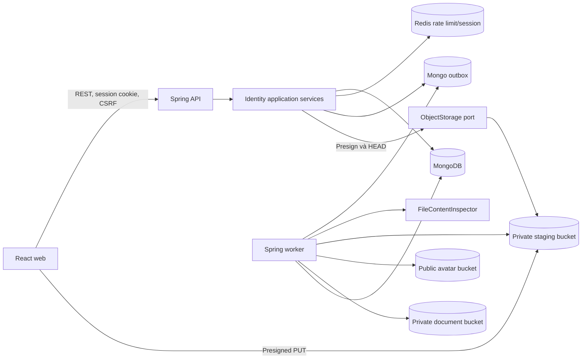
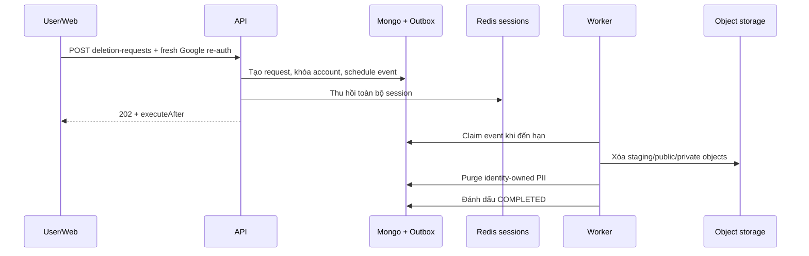

# Tổng quan Stage 4 — Hồ sơ, quyền riêng tư, consent và file

Tài liệu này giải thích thiết kế và cách hoạt động của Stage 4 ở mức tổng quan.
Nó dành cho thành viên mới, người review code, frontend, backend và vận hành.

Nguồn quyết định chính vẫn là
[ADR 0013](adr/0013-profile-privacy-consent-and-file-lifecycle.md). Kế hoạch và
điều kiện nghiệm thu chi tiết nằm trong [STAGE_4.md](../../plan/STAGE_4.md).

## 1. Stage 4 giải quyết vấn đề gì?

Sau Stage 2–3, Dike đã có đăng nhập, session, số điện thoại và authority. Stage 4
bổ sung lát cắt dữ liệu cá nhân đầu tiên để một thành viên có thể:

- chỉnh sửa tên hiển thị, phần giới thiệu và avatar;
- quyết định ai được xem hoặc tìm thấy hồ sơ;
- ghi nhận việc chấp nhận đúng phiên bản điều khoản và thông báo riêng tư;
- upload avatar hoặc tài liệu xác minh mà không đưa byte file qua API server;
- quản lý vòng đời file từ cách ly, kiểm tra, sử dụng đến xóa;
- yêu cầu xóa tài khoản theo workflow bất đồng bộ và có thể retry.

Mục tiêu quan trọng không chỉ là thêm màn hình profile. Stage này tạo nền móng an
toàn cho eKYC ở Stage 5, friendship ở Stage 6 và các module cần projection hồ sơ
sau này.

## 2. Phạm vi và ranh giới

### Trong phạm vi

- Profile, privacy, consent receipt và account-deletion request.
- Avatar công khai sau khi đã kiểm tra và tái mã hóa.
- Tài liệu xác minh luôn private, làm nền tảng cho Stage 5.
- Presigned upload/download, metadata file, worker, cleanup và rate limit.
- REST API, OpenAPI, TypeScript client và giao diện web tương ứng.

### Ngoài phạm vi

- Xác minh eKYC, phê duyệt tài xế hoặc cấp `APPROVED_DRIVER`.
- Visibility theo bạn bè; Stage 4 chỉ có `MEMBERS` và `PRIVATE`.
- Chỉnh sửa email, số điện thoại hoặc tự liên kết tài khoản.
- Public profile cho khách chưa đăng nhập hoặc indexing bởi search engine.
- Scanner production cụ thể. Inspector `basic` chỉ dùng local/test.

## 3. Kiến trúc tổng thể

Stage 4 vẫn nằm trong module `identity` của Spring Boot modular monolith. API và
worker dùng chung domain/application code nhưng chạy bằng workload profile khác
nhau.



Các lớp được đặt tên theo nghiệp vụ, không theo số giai đoạn. Ví dụ:

- `ProfileService`: use case profile và privacy.
- `ConsentService`: yêu cầu consent và receipt.
- `FileAssetService`: upload intent, complete, metadata, download và delete.
- `AccountDeletionService`: tạo và tra cứu yêu cầu xóa tài khoản.
- `ProfileDataStore`: port persistence của identity.
- `S3ObjectStorage`: adapter S3-compatible cho MinIO/R2.
- `FileAssetProcessingHandler`: worker kiểm tra và promote file.

Tên `V004__profile_privacy_file_indexes` là phiên bản migration dữ liệu, không
phải tên của kiến trúc hay business class.

## 4. Phân lớp backend

```text
com.dike.identity
├── api
│   ├── ProfileController
│   ├── FileController
│   └── request/response DTO
├── application
│   ├── ProfileService
│   ├── ConsentService
│   ├── FileAssetService
│   ├── AccountDeletionService
│   ├── ProfileDataStore
│   └── FileContentInspector
├── domain
│   ├── UserProfile / UserPrivacySettings
│   ├── ConsentReceipt
│   ├── FileAsset
│   └── AccountDeletionRequest
└── infrastructure
    ├── mongo
    ├── redis
    ├── profile
    └── security
```

Quy tắc dependency:

1. Controller chỉ gọi application service, không truy cập Mongo/Redis trực tiếp.
2. Domain không biết Spring MVC, MongoDB, Redis, S3 hoặc AWS SDK.
3. Infrastructure triển khai port do application/shared công bố.
4. Bucket name, object key và signed URL không trở thành domain identity hay quyền
   truy cập.

## 5. Mô hình dữ liệu

### `UserProfile`

Chứa `userId`, tên hiển thị, tên đã normalize để tìm kiếm, bio, avatar hiện tại,
timestamp và `version`. `version` hỗ trợ optimistic concurrency: hai thiết bị sửa
cùng lúc không âm thầm ghi đè nhau.

Quy tắc chính:

- tên hiển thị dài 2–80 Unicode code point;
- bio tối đa 300 Unicode code point và luôn là plain text;
- normalize khoảng trắng và line ending;
- chặn control character và bidi override nguy hiểm;
- tên hiển thị không cần unique.

### `UserPrivacySettings`

- `profileVisibility`: `MEMBERS` hoặc `PRIVATE`;
- `discoverableByName`: có xuất hiện trong tìm kiếm hay không;
- `allowMessageRequests`: policy đầu vào cho messaging Stage 12;
- `version`: chống stale write.

`MEMBERS` chỉ cho thành viên đã xác thực xem, không có nghĩa là public trên
Internet. `PRIVATE` chỉ owner hoặc admin được phép xem.

### `ConsentReceipt`

Mỗi quyết định là một record append-only gồm loại tài liệu, phiên bản, quyết định,
thời điểm, nguồn, locale và correlation ID. Không dùng một boolean có thể bị ghi đè
vì boolean không trả lời được người dùng đã chấp nhận phiên bản nào và khi nào.

Các loại hiện tại:

- `TERMS`;
- `PRIVACY_NOTICE`;
- `AGE_18_ATTESTATION`.

### `FileAsset`

MongoDB chỉ lưu metadata và locator nội bộ; byte file nằm trong object storage.

```text
PENDING_UPLOAD → UPLOADED → PROCESSING → READY
       │                         │
       └──────────────→ REJECTED

READY/REJECTED/... → DELETION_PENDING → DELETED
```

Mục đích file:

- `AVATAR`: sau inspection được tái mã hóa thành JPEG an toàn và chuyển sang public
  bucket bằng immutable key;
- `VERIFICATION_DOCUMENT`: luôn ở private bucket và chỉ tải qua signed URL sau
  authorization.

### `AccountDeletionRequest`

State machine gồm `REQUESTED`, `PROCESSING`, `COMPLETED`, `FAILED`. Một user chỉ có
tối đa một request đang hoạt động. Request giữ policy version và thời điểm
`executeAfter` để worker biết lúc nào được purge.

## 6. Luồng profile và privacy

### Khởi tạo lần đầu

1. User đã đăng nhập gọi `GET /api/v1/me/profile`.
2. `ProfileService` tìm `UserProfile` và `UserPrivacySettings`.
3. Nếu chưa có, service tạo profile từ snapshot tên/avatar của tài khoản và tạo
   privacy mặc định.
4. API trả DTO không chứa email, số điện thoại hoặc dữ liệu session.

### Cập nhật

1. Web gửi nội dung cùng `expectedVersion`.
2. Backend normalize và kiểm tra Unicode.
3. Mongo chỉ update khi version hiện tại bằng `expectedVersion`.
4. Nếu version đã thay đổi, API trả `409 PROFILE_VERSION_CONFLICT` hoặc
   `409 PRIVACY_VERSION_CONFLICT` để client tải lại thay vì mất dữ liệu.

### Xem và tìm thành viên

- Mỗi lần đọc đều kiểm tra account state và privacy hiện tại.
- User bị khóa hoặc đang xóa không xuất hiện trong search.
- Search chỉ tìm theo normalized display name, giới hạn tối đa 20 kết quả và có
  cursor/rate limit.
- Projection công khai chỉ gồm user ID, display name, bio, avatar đã duyệt và
  verified badge; không trả email/phone/object key.

## 7. Luồng consent

1. Backend đọc version tài liệu hiện hành từ typed configuration.
2. `GET /api/v1/me/consents` trả các requirement và receipt đã có.
3. Web hiển thị đúng link/version và gửi quyết định bằng
   `POST /api/v1/me/consents`.
4. Backend tự gắn current version; client không thể tự khai một version khác là
   version hiện hành.
5. Unique index khiến retry cùng quyết định trả lại receipt cũ thay vì tạo bản sao.
6. Nếu thiếu consent bắt buộc, session response trả
   `nextAction=REVIEW_CONSENT` và `/auth/complete` điều hướng tới màn hình consent.

Withdrawal chưa được bật vì semantics cần product/legal quyết định riêng. Receipt
cũ không bao giờ bị update hoặc xóa để mô phỏng việc rút consent.

## 8. Luồng upload và xử lý file

### Bước 1 — Tạo upload intent

Web gọi `POST /api/v1/files/uploads` với purpose, MIME, kích thước và checksum
SHA-256 tùy chọn. Backend:

- kiểm tra session, CSRF/origin, allowlist và giới hạn kích thước;
- áp quota/rate limit theo user và địa chỉ client;
- tạo random staging key không chứa PII;
- lưu `FileAsset(PENDING_UPLOAD)`;
- ký presigned PUT có TTL 5 phút và ký `Content-Type`/checksum nếu được cung cấp.

### Bước 2 — Browser upload trực tiếp

Browser PUT byte file thẳng vào private staging bucket bằng URL/header đã ký. API
server không giữ toàn bộ file trong memory và không chịu bandwidth upload.

### Bước 3 — Complete

Web gọi `POST /api/v1/files/{fileId}/complete` với `Idempotency-Key`. Backend HEAD
object, đối chiếu owner, size và content type, sau đó chuyển trạng thái sang
`PROCESSING` và ghi outbox event.

Gọi `complete` không làm file trở thành an toàn và không trả public URL.

### Bước 4 — Worker inspection

Worker nhận event và:

1. đọc file với hard byte limit;
2. kiểm tra magic bytes/nội dung thay vì tin MIME từ browser;
3. chặn PDF có active content;
4. decode ảnh, giới hạn pixel và re-encode JPEG để loại metadata/EXIF;
5. ghi derivative an toàn vào bucket đích;
6. conditional transition sang `READY`;
7. nếu là avatar, cập nhật pointer profile;
8. xóa object staging.

JPEG, PNG và WebP đều được decode; WebP dùng TwelveMonkeys ImageIO. Retry sau khi
đã chuyển `READY` vẫn có thể hoàn tất việc gắn avatar, tránh trạng thái file an toàn
nhưng profile chưa cập nhật.

### Bước 5 — Đọc hoặc xóa

- Avatar `READY` dùng public immutable URL.
- Verification document `READY` cần gọi
  `POST /api/v1/files/{fileId}/download-url`; signed URL private mặc định hết hạn
  sau 60 giây.
- Xóa avatar active sẽ clear pointer profile trước khi chuyển file sang
  `DELETION_PENDING`.
- Worker xóa object idempotently rồi mới đánh dấu metadata `DELETED`.

## 9. Cleanup và vòng đời storage

- Job định kỳ xử lý upload dở hoặc file rejected quá tuổi cấu hình.
- Bucket lifecycle xóa prefix staging sau hai ngày như safety net.
- CORS local chỉ cho exact web origin và các header/method upload cần thiết.
- Application job dựa trên metadata/index; không quét toàn bộ bucket mỗi vòng.
- Storage lỗi không làm profile text ngừng hoạt động, nhưng upload/download URL sẽ
  fail closed.

Production/staging không được khởi động với inspector `basic`. Một scanner adapter
đã review phải triển khai `FileContentInspector` trước khi nhận file thật.

## 10. Luồng yêu cầu xóa tài khoản



Điều kiện và hành vi:

- yêu cầu Google re-auth không quá 5 phút;
- `Idempotency-Key` bắt buộc;
- account chuyển sang `DELETION_REQUESTED` và authorization version tăng;
- toàn bộ session bị thu hồi ngay sau khi nhận request;
- purge mặc định được lên lịch sau 7 ngày;
- UI chỉ hiển thị trạng thái request, không báo dữ liệu đã xóa trước `COMPLETED`;
- tombstone request không giữ email, phone, tên hoặc object key.

Backup/PITR có retention riêng; workflow này không hứa xóa ngay lập tức khỏi mọi
bản backup.

## 11. REST API

| Method        | Endpoint                              | Mục đích                                   |
| ------------- | ------------------------------------- | ------------------------------------------ |
| `GET`         | `/api/v1/me/profile`                  | Đọc profile owner                          |
| `PATCH`       | `/api/v1/me/profile`                  | Sửa tên/bio bằng expected version          |
| `GET`         | `/api/v1/users/{userId}`              | Xem projection theo privacy                |
| `GET`         | `/api/v1/users`                       | Tìm thành viên theo tên                    |
| `GET`/`PATCH` | `/api/v1/me/privacy`                  | Đọc/sửa privacy                            |
| `GET`/`POST`  | `/api/v1/me/consents`                 | Requirement, receipt và quyết định consent |
| `GET`         | `/api/v1/me/deletion-request`         | Trạng thái yêu cầu xóa                     |
| `POST`        | `/api/v1/me/deletion-requests`        | Tạo yêu cầu xóa                            |
| `POST`        | `/api/v1/files/uploads`               | Tạo presigned upload intent                |
| `POST`        | `/api/v1/files/{fileId}/complete`     | Xác nhận upload và enqueue inspection      |
| `GET`         | `/api/v1/files/{fileId}`              | Đọc metadata/status an toàn                |
| `POST`        | `/api/v1/files/{fileId}/download-url` | Signed GET cho private file                |
| `DELETE`      | `/api/v1/files/{fileId}`              | Yêu cầu xóa file                           |

Contract chuẩn nằm tại [OpenAPI](../api/openapi.json). TypeScript client được sinh
từ contract; không sửa file trong `generated/` bằng tay.

## 12. Web application

Các màn hình Stage 4:

- `/me/profile`: sửa profile và upload avatar;
- `/users/[userId]`: xem projection của thành viên;
- `/settings/privacy`: cập nhật visibility/discoverability;
- `/settings/consent`: xem requirement và ghi receipt;
- `/settings/account`: xem hoặc tạo deletion request.

Browser chỉ gọi URL tương đối `/api/*` qua same-origin proxy. Session cookie vẫn là
`HttpOnly`; mutation đọc `XSRF-TOKEN` và gửi `X-XSRF-TOKEN`. Signed URL, cookie và
credential không được lưu trong localStorage hoặc global client state.

## 13. Kiểm soát bảo mật và riêng tư

- Authorization theo owner/resource trên mọi thao tác file và profile.
- File ID của user khác trả 404 để giảm khả năng enumeration.
- CSRF/origin protection cho mọi mutation dùng cookie.
- Rate limit search, upload intent, upload bytes, complete và download URL.
- Private bucket không public; public bucket chỉ chứa avatar derivative đã inspect.
- Signed URL là bearer secret ngắn hạn và query signature được redaction khỏi log.
- Không log bio, full phone/email, file byte, object key hoặc consent content.
- Không dùng original filename làm object key.
- Account bị khóa/đang xóa không xuất hiện trong public projection/search.
- API/worker không giữ Mongo transaction trong khi gọi object storage.

## 14. Cấu hình chính

| Biến                                   | Ý nghĩa                         | Mặc định local |
| -------------------------------------- | ------------------------------- | -------------- |
| `DIKE_TERMS_VERSION`                   | Phiên bản Terms hiện hành       | `2026-10-06`   |
| `DIKE_PRIVACY_VERSION`                 | Phiên bản Privacy Notice        | `2026-10-06`   |
| `DIKE_FILE_UPLOAD_TTL`                 | TTL presigned PUT               | `5m`           |
| `DIKE_FILE_DOWNLOAD_TTL`               | TTL signed GET                  | `60s`          |
| `DIKE_FILE_CLEANUP_AGE`                | Tuổi file staging trước cleanup | `24h`          |
| `DIKE_FILE_INSPECTOR`                  | Inspector implementation        | `basic`        |
| `DIKE_AVATAR_MAXIMUM_BYTES`            | Giới hạn avatar                 | `5242880`      |
| `DIKE_VERIFICATION_MAXIMUM_BYTES`      | Giới hạn tài liệu               | `10485760`     |
| `DIKE_MAXIMUM_IMAGE_PIXELS`            | Chống pixel bomb                | `20000000`     |
| `DIKE_ACCOUNT_DELETION_WAITING_PERIOD` | Thời gian chờ purge             | `7d`           |

Danh sách đầy đủ và giá trị local nằm trong `.env.local.example` và
`application.yml`. Không dùng giá trị local làm quyết định production nếu chưa có
security/product/legal review.

## 15. Migration và index

Migration `V004__profile_privacy_file_indexes`:

- tạo search index cho normalized display name;
- tạo unique key chống duplicate consent decision;
- tạo index cho file state/owner/expiry;
- bảo đảm một active deletion request trên mỗi user;
- backfill profile/privacy từ user hiện hữu;
- đặt privacy của account không active thành `PRIVATE`.

Migration không tạo consent giả và không tạo `FileAsset` giả cho Google avatar.

## 16. Kiểm thử và trạng thái nghiệm thu

Các lớp kiểm thử hiện có bao phủ:

- Modulith/ArchUnit boundary;
- Unicode, bidi control và optimistic profile behavior;
- allowlist/kích thước upload;
- JPEG/PNG/WebP decode và re-encode;
- PDF active-content rejection;
- OpenAPI/client parity và signed-query redaction;
- web profile/privacy/consent trên Chromium desktop/mobile;
- Mongo migration và S3-compatible storage qua Testcontainers.

Tại thời điểm 06/10/2026, core implementation đã hoàn thành nhưng Stage 4 chưa đạt
acceptance cuối:

- Docker daemon local chưa chạy nên 12 Testcontainers integration test bị skip;
- 10/10 browser assertion chạy qua, nhưng Node 22/Windows còn treo lúc teardown dev
  server; CI phải xác nhận bằng baseline Node 24.21.0;
- CORS/lifecycle cần smoke test với MinIO/R2 thật;
- scanner hosted và retention/legal approval chưa được chốt.

Không được đổi trạng thái Stage 4 thành `Complete` cho tới khi các gate trên đạt.

## 17. Điểm mở rộng cho stage sau

- Stage 5 nhận private verification document ở trạng thái `READY` bằng `fileId`,
  không nhận object key do browser cung cấp.
- Stage 6 có thể bổ sung visibility `FRIENDS` bằng policy của community module.
- Module khác tham gia account purge qua event versioned, không truy cập trực tiếp
  collection identity.
- Scanner production thay `FileContentInspector` adapter mà không đổi domain hoặc
  REST contract.

## 18. Bản đồ source code

- Backend API: `apps/backend/src/main/java/com/dike/identity/api/`
- Application: `apps/backend/src/main/java/com/dike/identity/application/`
- Domain: `apps/backend/src/main/java/com/dike/identity/domain/`
- Mongo adapter/migration: `apps/backend/src/main/java/com/dike/identity/infrastructure/mongo/`
- File worker/inspection: `apps/backend/src/main/java/com/dike/identity/infrastructure/profile/`
- Object storage adapter: `apps/backend/src/main/java/com/dike/shared/infrastructure/storage/`
- Web screens: `apps/web/app/me/`, `apps/web/app/settings/`, `apps/web/app/users/`
- TypeScript API client: `packages/api-client-ts/src/profile.ts`
- Runbook vận hành: [file storage và account deletion](../runbooks/file-storage-and-account-deletion.md)
