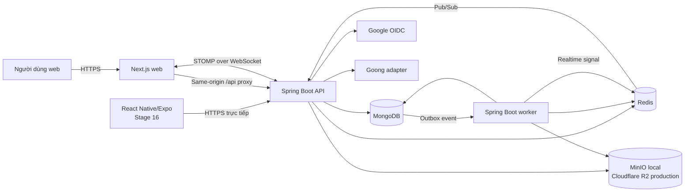
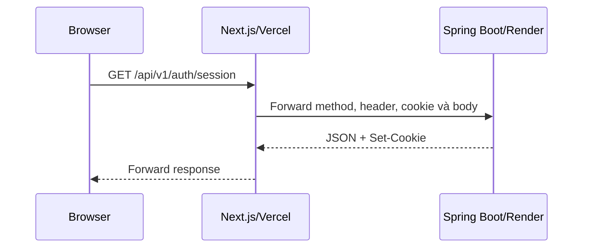
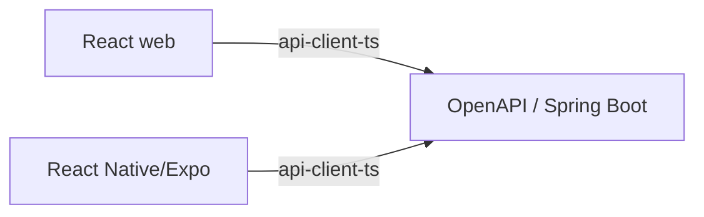
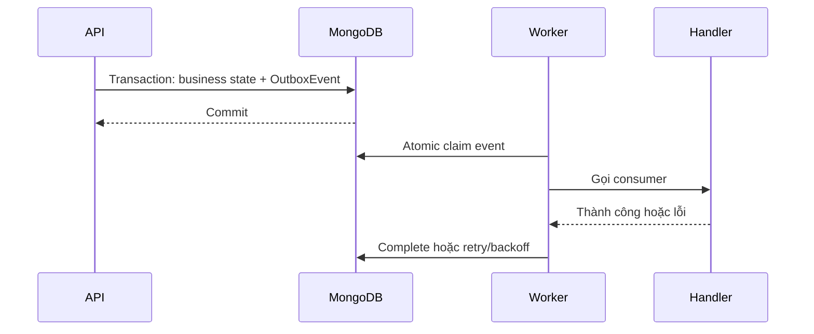
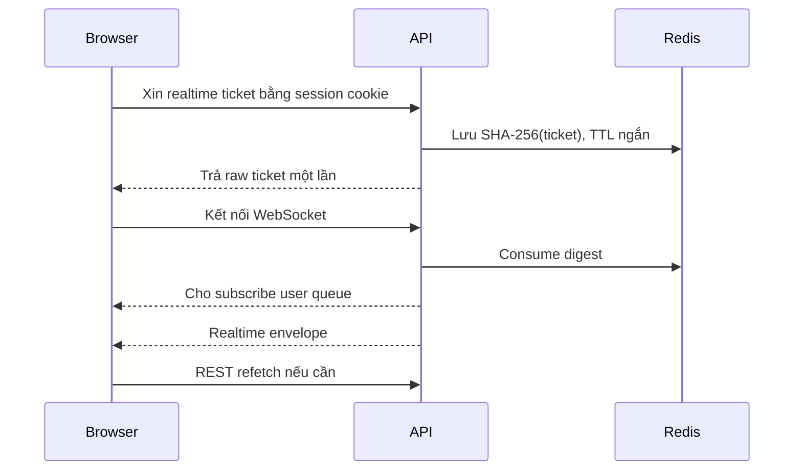
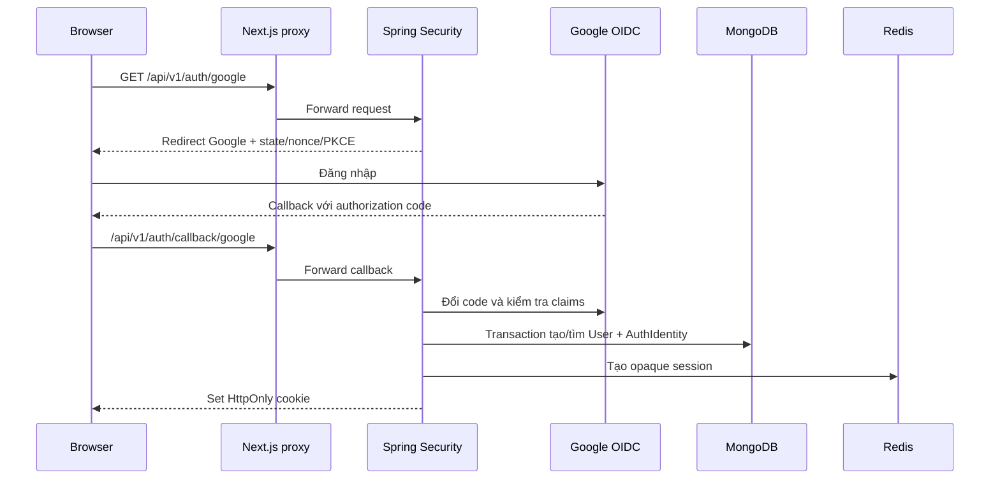
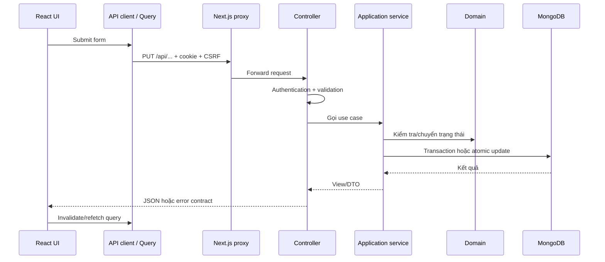
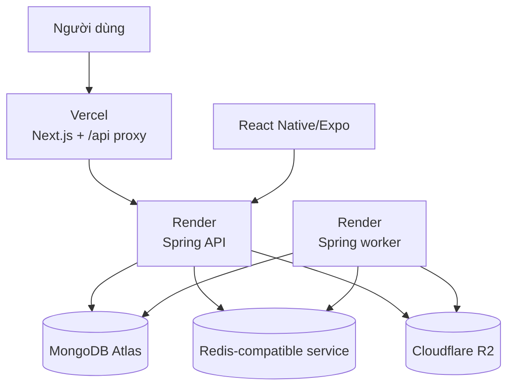

# Tổng quan kiến trúc hệ thống Dike

Tài liệu này giải thích kiến trúc Dike theo hướng dành cho thành viên mới hoặc
fresher. Sau khi đọc xong, bạn nên hiểu:

- Hệ thống gồm những thành phần nào và mỗi thành phần làm gì.
- Một request đi từ giao diện đến database như thế nào.
- Vì sao backend là modular monolith thay vì microservice.
- MongoDB, Redis và object storage khác nhau ra sao.
- REST, WebSocket/STOMP và outbox phối hợp như thế nào.
- Web và mobile dùng chung backend nhưng giữ phiên đăng nhập khác nhau ra sao.
- Nên bắt đầu đọc code hoặc thêm một tính năng mới từ đâu.

Tài liệu phản ánh kiến trúc hiện hành đến Stage 14 và kiến trúc mục tiêu đã được
duyệt. Web và backend đã tồn tại. React Native/Expo thuộc Stage 16, chưa được xem là
đã triển khai hoàn chỉnh.

## 1. Dike giải quyết bài toán gì?

Dike kết nối người có xe với người cần đi nhờ theo tuyến đường, thời gian và phạm
vi cộng đồng phù hợp. Luồng nghiệp vụ điển hình:

```text
Đăng nhập
  → hoàn thiện hồ sơ và xác minh số điện thoại
  → tạo lịch hoặc nhu cầu di chuyển
  → đăng/tìm bài phù hợp
  → gửi đề nghị
  → hai bên đồng ý và tạo booking
  → nhắn tin, gặp nhau và thực hiện chuyến đi
  → xác nhận đóng góp chi phí
  → đánh giá hai chiều
```

Dike không chỉ là một trang bản đồ. Hệ thống còn xử lý danh tính, quyền riêng tư,
số chỗ, trạng thái chuyến đi, giao tiếp realtime, báo cáo và quản trị. Vì vậy code
được chia theo **năng lực nghiệp vụ**, không gom tất cả controller, service và
repository của toàn hệ thống vào ba thư mục chung.

## 2. Bức tranh tổng thể



| Thành phần     | Công nghệ                      | Trách nhiệm chính                                               |
| -------------- | ------------------------------ | --------------------------------------------------------------- |
| Web            | Next.js, React, TypeScript     | UI, gọi API, state màn hình và kết nối realtime                 |
| Mobile         | React Native, Expo, TypeScript | Một client Android/iOS; secure storage, push và location nền    |
| API            | Java 21, Spring Boot           | Xác thực, phân quyền, validation và nghiệp vụ đồng bộ           |
| Worker         | Cùng code Spring Boot          | Outbox, retry và công việc nền                                  |
| MongoDB        | Atlas; replica set local/test  | Nguồn dữ liệu nghiệp vụ bền vững                                |
| Redis          | Redis-compatible store         | Session, rate limit, ticket realtime, Pub/Sub và dữ liệu có TTL |
| Object storage | MinIO local, R2 production     | Nội dung file; MongoDB giữ metadata và ownership                |
| Dịch vụ ngoài  | Google, Goong                  | Danh tính Google và định tuyến/bản đồ                           |

### 2.1. Source of truth là gì?

**Source of truth** là nơi được xem là dữ liệu chính xác cuối cùng khi các bản sao
khác nhau không đồng nhất.

Trong Dike:

- MongoDB là source of truth cho dữ liệu nghiệp vụ bền vững.
- REST API là giao diện chính để đọc và thay đổi trạng thái nghiệp vụ.
- Redis chứa session hoặc dữ liệu ngắn hạn, không thay MongoDB cho booking.
- WebSocket chỉ báo có thay đổi mới; client vẫn có thể gọi REST để đồng bộ lại.
- State trong React chỉ phục vụ hiển thị, không phải sự thật cuối cùng.

Ví dụ, browser nhận `MESSAGE_CREATED` qua WebSocket để cập nhật nhanh. Tin nhắn đã
được lưu MongoDB trước đó. Nếu browser mất mạng và bỏ lỡ sự kiện, nó tải lại danh
sách qua REST.

## 3. Vì sao chọn modular monolith?

Backend là một **modular monolith**: một codebase, một artifact Spring Boot và một
chu kỳ phát hành, nhưng bên trong có các module nghiệp vụ với ranh giới rõ ràng.

### 3.1. Monolith không có nghĩa là code hỗn độn

Monolith chỉ có nghĩa backend được build và phát hành cùng nhau. Spring Modulith
và ArchUnit kiểm tra các quy tắc:

- Không có vòng phụ thuộc giữa module.
- Controller không truy cập repository trực tiếp.
- Module không import implementation nội bộ của module khác.
- Domain không phụ thuộc MongoDB, Redis hoặc HTTP framework.

### 3.2. Vì sao chưa dùng microservice?

Với nhóm bốn người và pilot khoảng 500 người dùng, microservice làm tăng chi phí:

- Phải deploy, monitor và cấu hình nhiều service.
- Booking khó giữ transaction khi dữ liệu nằm ở nhiều service.
- Phải xử lý network timeout, distributed tracing và version contract.
- Debug một thao tác phải lần theo nhiều tiến trình.

Modular monolith giữ transaction và vận hành đơn giản, đồng thời vẫn tạo ranh giới
để có thể tách module sau này khi có bằng chứng thực tế về tải, ownership hoặc yêu
cầu pháp lý.

### 3.3. Modular monolith khác kiến trúc ba lớp thế nào?

Hai khái niệm mô tả hai hướng khác nhau và được dùng cùng nhau:

```text
Trục ngang: module nghiệp vụ

identity | community | planning | ride | messaging | trust

Trục dọc bên trong mỗi module:

api → application → domain ← infrastructure
```

- **Modular monolith** trả lời: hệ thống chia thành năng lực nghiệp vụ nào?
- **Layered architecture** trả lời: code bên trong một năng lực chia trách nhiệm
  kỹ thuật thế nào?

Chỉ tạo một thư mục `controller`, `service`, `repository` cho toàn hệ thống vẫn là
ba lớp, nhưng thiếu ranh giới nghiệp vụ và dễ tạo coupling.

## 4. Các module backend

| Module      | Nghiệp vụ sở hữu                                                        |
| ----------- | ----------------------------------------------------------------------- |
| `identity`  | Google login, session, OTP, hồ sơ, consent, file và tài khoản           |
| `community` | Cộng đồng, membership, kết bạn, block và social policy                  |
| `planning`  | Lịch, travel intent, bài đăng, tìm kiếm và routing snapshot             |
| `ride`      | Trip, proposal, booking, availability, vị trí và xác nhận chi phí       |
| `messaging` | Conversation, message, notification, read marker và realtime            |
| `trust`     | Review, report, moderation, admin operation và audit                    |
| `shared`    | Clock, error contract, outbox, storage port và observability dùng chung |

`shared` không phải nơi đặt mọi class “chưa biết để đâu”. Entity và business
service phải nằm trong module sở hữu nghiệp vụ.

### 4.1. Bốn layer bên trong module

```text
ride/
  api/
  application/
  domain/
  infrastructure/
```

#### `api`

Chứa controller và request/response DTO. Layer này nhận request, lấy principal,
validation định dạng cơ bản, gọi application use case và trả HTTP response. Nó
không chứa transaction phức tạp hoặc gọi MongoDB trực tiếp.

#### `application`

Điều phối một use case hoàn chỉnh, ví dụ “chấp nhận đề nghị và tạo booking”. Nó
quyết định thứ tự gọi domain, port, transaction và side effect.

#### `domain`

Chứa entity, value object, trạng thái và quy tắc nghiệp vụ. Domain trả lời các câu
hỏi như “proposal hết hạn có được chấp nhận không?” mà không cần biết dữ liệu nằm
ở MongoDB hay request đến từ web.

#### `infrastructure`

Chứa Mongo adapter, Redis, object storage và provider bên ngoài. **Port** là
interface mô tả điều application cần; **adapter** là implementation bằng công nghệ
cụ thể. Cách này giúp test bằng fake adapter hoặc đổi provider mà ít ảnh hưởng
domain.

## 5. Kiến trúc frontend web

Next.js cung cấp App Router, routing theo thư mục, server rendering và server-side
proxy. React xây component và cập nhật UI theo state.

| Package                    | Vai trò                                     |
| -------------------------- | ------------------------------------------- |
| `packages/api-client-ts`   | Type và operation client sinh từ OpenAPI    |
| `packages/design-tokens`   | Màu, spacing, typography và token giao diện |
| `packages/web-ui`          | Component React dùng lại trên web           |
| `packages/frontend-config` | Cấu hình TypeScript/frontend dùng chung     |

### 5.1. Same-origin proxy

Browser không gọi Render API trực tiếp:



Browser chỉ thấy origin web. Next.js forward `/api/*` tới upstream Spring Boot cố
định. Cookie vì thế là first-party, ít phụ thuộc third-party-cookie và cấu hình
CORS/CSRF bớt mong manh.

Next.js không phải business backend thứ hai. Nó không tự quản lý user, booking hay
session. Spring Boot vẫn là nơi xác thực và phân quyền.

### 5.2. State và API contract

- TanStack Query quản lý server state, cache và refetch.
- React Hook Form quản lý form.
- Zod giúp phản hồi validation nhanh trên UI.
- Backend vẫn validation lại vì client nằm ngoài trust boundary.
- API client được sinh từ OpenAPI để type của web không lệch backend.

**Server state** là dữ liệu backend như booking. **UI state** là trạng thái tạm như
modal đang mở. Không nên sao chép server state vào nhiều store nếu TanStack Query
đã quản lý nó.

## 6. Kiến trúc React Native/Expo mobile

React Native/Expo/TypeScript thuộc Stage 16, dùng chung Spring Boot backend và
generated TypeScript API client với web, không có backend riêng cho mobile.



Hai client dùng chung domain rule, endpoint, OpenAPI và chính sách authorization.
Web và mobile không dùng chung DOM/native component, navigation hoặc credential storage.

Web nhận opaque session ID qua cookie `HttpOnly`. React Native/Expo nhận opaque token
phù hợp mobile và lưu bằng secure storage của hệ điều hành. “Opaque” nghĩa là
client không đọc được nội dung hay tự suy ra quyền; backend tra session server-side.

## 7. MongoDB: dữ liệu bền vững

MongoDB lưu user, identity, schedule, ride post, trip, proposal, booking,
conversation, review và report.

### 7.1. MongoDB không có nghĩa là không có schema

Schema vẫn được kiểm soát qua Java model, validation, index, migration và OpenAPI.
MongoDB được chọn vì document phù hợp hồ sơ/lịch/hành trình, schema có thể tiến hóa
và replica set hỗ trợ transaction.

### 7.2. Replica set và transaction

**Replica set** là nhóm MongoDB node có replication và primary. Dike dùng replica
set ở local/test vì Mongo transaction cần topology này.

Transaction đảm bảo một nhóm thay đổi cùng thành công hoặc cùng rollback. Khi chấp
nhận proposal, các thay đổi sau thuộc cùng transaction:

```text
giảm số chỗ
+ tạo booking
+ đổi trạng thái proposal
+ cập nhật bài đăng
+ tạo boarding secret
+ tạo command receipt
+ tạo outbox event
```

Nếu tạo outbox event lỗi, toàn bộ phải rollback; nếu không hệ thống có thể trừ chỗ
nhưng không tạo booking.

### 7.3. Index và optimistic concurrency

**Index** giống mục lục sách: giúp tìm nhanh và có thể áp đặt uniqueness. Index
được quản lý bằng migration.

**Optimistic concurrency** dùng `version` để phát hiện hai update cạnh tranh. Nếu
document đã đổi từ lúc client đọc, update cũ bị từ chối thay vì âm thầm ghi đè.
Kỹ thuật này quan trọng với số chỗ, booking, moderation và xác nhận hai phía.

## 8. Redis: dữ liệu nhanh và ngắn hạn

Redis không thay MongoDB. Nó phù hợp với dữ liệu cần truy cập nhanh, có TTL hoặc có
thể mất mà không làm hỏng trạng thái nghiệp vụ bền vững.

| Dữ liệu Redis   | Mục đích                                                |
| --------------- | ------------------------------------------------------- |
| Session         | Phiên web server-side, revoke và logout nhiều thiết bị  |
| Rate limit      | Hạn chế login, OTP hoặc thao tác nhạy cảm quá nhiều lần |
| Realtime ticket | Ticket WebSocket một lần; chỉ lưu digest SHA-256        |
| Pub/Sub         | Chuyển tín hiệu realtime giữa API instance              |
| Availability    | Trạng thái sẵn sàng, tự hết hạn nếu không heartbeat     |
| Live location   | Tọa độ chính xác ngắn hạn trong booking có consent      |

### 8.1. TTL là gì?

TTL là Time To Live, thời gian một key được tồn tại. Availability hết hạn sau 60
giây; vị trí live sau 120 giây; ticket realtime sống ngắn và chỉ dùng một lần.

Nếu Redis mất dữ liệu, user có thể phải login hoặc gửi vị trí lại, nhưng booking
trong MongoDB không mất.

### 8.2. Pub/Sub không phải durable queue

Pub/Sub chỉ phát cho subscriber đang online; subscriber offline có thể bỏ lỡ.
Dike dùng nó để tăng tốc realtime, còn dữ liệu quan trọng đã nằm trong MongoDB và
có thể tải lại qua REST.

## 9. Object storage

Avatar và tài liệu nằm ở MinIO local hoặc Cloudflare R2 production. MongoDB chỉ lưu
metadata như owner, object key, loại file và trạng thái xử lý.

File private không có URL công khai cố định. Sau khi kiểm tra quyền, backend tạo
signed URL có thời hạn ngắn. Backend container không giữ file lâu dài vì filesystem
có thể bị thay thế khi deploy.

## 10. API profile và worker profile

API và worker dùng cùng source, domain model và phiên bản phát hành nhưng chạy với
profile khác:

- **API profile:** mở HTTP server, xử lý REST, OAuth, WebSocket và use case đồng bộ.
- **Worker profile:** không cần web server, claim outbox event, retry/backoff và
  chạy job định kỳ.

Tách process giúp job nền chậm không chiếm tài nguyên request. Đây chưa phải
microservice vì hai process vẫn thuộc cùng backend artifact và release.

## 11. Outbox pattern

### 11.1. Vấn đề dual write

Nếu API lưu booking rồi gửi notification trực tiếp, tiến trình có thể chết giữa
hai bước. Booking đã commit nhưng notification bị mất. Gửi notification trước cũng
không an toàn vì transaction có thể rollback sau đó.

### 11.2. Cách outbox giải quyết



Delivery là **at least once**, nghĩa là handler có thể chạy lại. Handler phải
**idempotent**: xử lý cùng event nhiều lần không tạo tác dụng trùng.

Một event có thể có nhiều consumer. Dike lưu delivery theo
`(eventId, consumerName)`, nên consumer đã thành công không chạy lại chỉ vì consumer
khác retry.

Một số side effect xuất hiện sau commit một khoảng ngắn; đó là **eventual
consistency**. Invariant quan trọng như số chỗ và booking vẫn ở transaction đồng bộ.

## 12. REST và WebSocket/STOMP

REST dùng để đọc trạng thái đầy đủ, mutation nghiệp vụ và đồng bộ sau reconnect.
WebSocket giữ kết nối dài; STOMP quy định destination và message trên WebSocket.

Dike chỉ cho subscribe `/user/queue/*`. Client không được dùng STOMP `SEND` để bỏ
qua REST authorization.



Không đặt session cookie hay token dài hạn trong URL WebSocket vì URL thường xuất
hiện trong log, history hoặc monitoring.

## 13. Luồng đăng nhập Google và session



- **OIDC** cung cấp danh tính trên OAuth 2.0.
- **PKCE** ràng buộc callback với request login ban đầu.
- **State** chống chèn/giả mạo luồng OAuth.
- **Nonce** chống phát lại ID token.
- **Opaque session** là ID ngẫu nhiên; dữ liệu thật nằm Redis.
- Cookie `HttpOnly` không cho JavaScript đọc.
- CSRF token và kiểm tra Origin bảo vệ mutation dùng cookie.

Google identity được nhận diện bằng `issuer + subject`, không phải email. Email
trùng không làm hệ thống tự merge tài khoản.

## 14. Luồng request nghiệp vụ



Không tin quyền, giá, số chỗ hoặc trạng thái do client tự gửi nếu backend có thể
suy ra từ session và dữ liệu hiện tại.

## 15. Luồng booking và chống vượt chỗ

1. Người nhận chấp nhận proposal kèm `version` và idempotency key.
2. Backend kiểm tra actor, authority và proposal còn hiệu lực.
3. Backend fence các tài nguyên cạnh tranh như user, intent, vehicle hoặc trip.
4. Backend kiểm tra số chỗ, time overlap, route snapshot và contribution.
5. Một Mongo transaction giảm chỗ, tạo booking, cập nhật proposal/post, tạo
   boarding secret, receipt và outbox event.
6. Sau commit, worker tạo conversation/notification từ outbox.

**Idempotency key** giúp gửi lại cùng request khi mất mạng mà không tạo hai booking.
**Fence** buộc các transaction cạnh tranh chạm cùng record để phát hiện xung đột.

## 16. Message và notification realtime

1. Client gửi message bằng REST.
2. Backend kiểm tra participant, block policy và conversation permission.
3. Message được lưu MongoDB với client message ID chống trùng.
4. Realtime envelope được publish qua Redis Pub/Sub.
5. API instance giữ socket người nhận chuyển envelope tới user queue.
6. Client cập nhật UI hoặc invalidate query.
7. Khi reconnect, client gọi REST lấy message/read marker thật.

Realtime giảm độ trễ hiển thị, không thay database.

## 17. Availability và vị trí

### Trước booking

- Chỉ công khai tâm vùng làm mờ khoảng 500 mét.
- Availability nằm Redis và hết hạn nếu không heartbeat.
- Không trả tọa độ chính xác cho người lạ.

### Trong booking đang hoạt động

- Chỉ participant hợp lệ mới gửi/nhận vị trí.
- Mỗi user phải consent rõ ràng.
- Tọa độ chính xác chỉ nằm Redis với TTL 120 giây.
- MongoDB lưu receipt đồng ý, không lưu lịch sử di chuyển.
- Realtime chỉ gửi cho counterpart.

## 18. Chi phí, review và moderation

### Xác nhận chi phí

Dike pilot không xử lý tiền. Backend chỉ ghi nhận hai bên nói rằng khoản đóng góp
trực tiếp đã được trả/nhận. Một phía xác nhận vẫn là pending; chỉ được rút trước khi
phía kia xác nhận; đủ hai phía thì record khóa. Đây không phải xác minh ngân hàng.

### Review hai chiều

- Mỗi participant review counterpart một lần trong bảy ngày.
- Review bất biến sau submit.
- Chỉ công bố khi cả hai gửi hoặc hết cửa sổ review.
- Điểm tài xế và hành khách được tổng hợp riêng.

### Moderation

- Report đi qua workflow chung.
- Authority moderator/admin được kiểm tra server-side.
- Update dùng version để tránh ghi đè cạnh tranh.
- Audit log append-only giữ dấu vết thao tác.
- Khóa tài khoản tăng authorization version để thu hồi quyền session cũ.

## 19. Bảo mật theo nhiều lớp

| Lớp              | Kiểm soát tiêu biểu                                    |
| ---------------- | ------------------------------------------------------ |
| Transport        | HTTPS ở hosted environment                             |
| Identity         | Google OIDC, OTP và Dike account                       |
| Session          | Redis server-side, rotation, revoke, absolute expiry   |
| Browser mutation | CSRF, exact Origin allowlist và SameSite cookie        |
| API              | Authentication, authority, ownership và validation     |
| Domain           | State transition và invariant                          |
| Database         | Transaction, unique index và optimistic version        |
| Realtime         | Single-use ticket, user destination, cấm client `SEND` |
| File             | Loại/kích thước, private bucket và signed URL          |
| Operations       | Secret scan, log redaction, health check và audit      |

**Authentication** trả lời “đây là ai?”. **Authorization** trả lời “người này được
làm gì trên resource này?”. Đã login không có nghĩa được đọc mọi booking.

## 20. Triển khai production



Local, test, staging và production phải tách database, Redis namespace, bucket,
OAuth client và secret. API/worker chạy cùng version. Container stateless, không
dùng filesystem local làm nơi lưu bền vững.

Health, readiness, migration, backup/restore, smoke test và rollback là một phần
của kiến trúc vận hành.

## 21. Local development

Docker Compose chạy MongoDB replica set, Redis và MinIO.

```powershell
pnpm install --frozen-lockfile
pnpm dev
pnpm check
.\mvnw.cmd -B -ntp verify
```

Secret không được commit. Dùng `.env.local` bị Git ignore hoặc file secret ngoài
repository theo runbook.

## 22. Testing và quality gate

- Unit test kiểm tra rule/service nhỏ.
- Architecture test kiểm tra module/layer.
- Integration test dùng MongoDB/Redis/MinIO thật qua Testcontainers.
- Contract test bảo đảm OpenAPI và generated client đồng bộ.
- Browser E2E chạy qua Next.js proxy và Spring backend.
- Negative security test thử CSRF/quyền/race/duplicate sai.

Test bị skip vì máy không có Docker không chứng minh integration đã đúng. CI có
Docker phải chạy test thật.

## 23. Khi thành phần bị lỗi

| Sự cố              | Ảnh hưởng                                      | Dữ liệu bền vững           |
| ------------------ | ---------------------------------------------- | -------------------------- |
| Web restart        | Client tải lại trang                           | Không mất                  |
| API restart        | Request đang chạy có thể fail; session ở Redis | MongoDB không mất          |
| Worker restart     | Event chưa xong được retry                     | Outbox còn MongoDB         |
| Redis mất dữ liệu  | Logout, mất presence/location/realtime tạm     | Booking/message không mất  |
| WebSocket đứt      | UI chậm cập nhật                               | Reconnect và REST refetch  |
| Map provider lỗi   | Không lập route mới tạm thời                   | Snapshot đã lưu còn        |
| Object storage lỗi | Upload/download tạm fail                       | Metadata cần reconcile     |
| MongoDB lỗi        | API fail closed                                | Không fallback dữ liệu giả |

**Fail closed** nghĩa là không xác minh được quyền/trạng thái thì từ chối thao tác,
không cho phép một cách thiếu an toàn.

## 24. Cách đọc code cho fresher

1. Tìm route/page trong `apps/web/app`.
2. Tìm lời gọi API trong `apps/web/src` hoặc `packages/api-client-ts`.
3. Tìm controller backend tương ứng.
4. Theo lời gọi vào application service.
5. Đọc domain rule và state transition.
6. Xem infrastructure adapter dùng collection/key nào.
7. Kiểm tra transaction, outbox và realtime side effect.
8. Đọc unit/integration test để tìm invariant.
9. Đọc ADR để hiểu lý do của quyết định kiến trúc.

Khi thêm tính năng, hãy hỏi:

- Module nào sở hữu nghiệp vụ?
- Dữ liệu bền vững hay tạm thời?
- Có cần transaction, version hoặc idempotency không?
- Side effect có nên qua outbox không?
- Bỏ lỡ realtime có khôi phục qua REST được không?
- Authorization đã kiểm tra server-side chưa?
- Có PII hoặc vị trí chính xác không?
- OpenAPI, client, test và ADR có cần cập nhật không?

## 25. Thuật ngữ nhanh

| Thuật ngữ            | Giải thích                                         |
| -------------------- | -------------------------------------------------- |
| API                  | Giao diện để client giao tiếp backend              |
| REST                 | Cách thiết kế API dựa trên HTTP resource/method    |
| DTO                  | Object truyền dữ liệu qua biên API                 |
| Domain               | Quy tắc và khái niệm nghiệp vụ cốt lõi             |
| Module               | Nhóm code sở hữu một năng lực nghiệp vụ            |
| Monolith             | Ứng dụng build/deploy như một đơn vị               |
| Microservice         | Service có deployment và vận hành riêng            |
| Transaction          | Nhóm thao tác cùng commit hoặc rollback            |
| Replica set          | Cấu hình MongoDB có replication/transaction        |
| Index                | Cấu trúc tăng tốc truy vấn hoặc enforce uniqueness |
| TTL                  | Thời gian sống trước khi dữ liệu tự hết hạn        |
| Session              | Trạng thái đăng nhập backend quản lý               |
| OIDC                 | Chuẩn danh tính xây trên OAuth 2.0                 |
| CSRF                 | Ép browser đã login gửi mutation ngoài ý muốn      |
| WebSocket            | Kết nối lâu dài cho realtime                       |
| STOMP                | Protocol message trên WebSocket                    |
| Pub/Sub              | Phát tín hiệu cho subscriber đang online           |
| Outbox               | Event ghi cùng business transaction                |
| Idempotent           | Chạy lặp không tạo tác dụng trùng                  |
| At least once        | Event có thể được giao nhiều hơn một lần           |
| Eventual consistency | Các phần đồng bộ sau một khoảng ngắn               |
| Optimistic locking   | Dùng version phát hiện update cạnh tranh           |
| PII                  | Dữ liệu có thể nhận diện cá nhân                   |
| Signed URL           | URL có chữ ký và thời hạn cho object private       |
| Source of truth      | Nơi được coi là dữ liệu đúng cuối cùng             |
| Adapter              | Implementation nối code với công nghệ ngoài        |
| Port                 | Interface mô tả khả năng application cần           |

## 26. Những điều dễ hiểu sai

1. Redis nhanh hơn nên lưu hết vào Redis: sai; nghiệp vụ bền vững ở MongoDB.
2. Có WebSocket thì không cần REST: sai; WebSocket có thể mất frame.
3. Frontend validation rồi thì backend không cần: sai; request có thể bị sửa.
4. Modular monolith là microservice chung repository: sai; module chưa deploy độc
   lập.
5. Worker là microservice: sai trong kiến trúc hiện tại; nó là profile khác của
   cùng artifact.
6. Một bên bấm “đã trả” là thanh toán hoàn tất: sai; cần đối ứng và vẫn không phải
   xác minh ngân hàng.
7. Điểm trước booking là vị trí thật: sai; đó là vùng làm mờ.
8. React Native/Expo dùng cookie web: sai; mobile dùng credential transport riêng.
9. JWT luôn tốt hơn session: sai; Dike cần revoke thiết bị nên server-side session
   phù hợp.
10. NoSQL không cần schema/index/transaction: sai; Dike dùng cả ba.

## 27. Chế độ Tài xế thử nghiệm ở local/test

Trong khi OTP, eKYC và duyệt phương tiện thật được hoãn, môi trường `local` và `test` có thể bật `DIKE_SIMULATED_FULL_ACCESS_ENABLED=true`. User đã đăng nhập Google, chấp nhận tài liệu và nhập số điện thoại hợp lệ sẽ nhận quyền hiệu lực của hành khách và tài xế để kiểm thử. Đây là quyền được tính động: MongoDB vẫn lưu số điện thoại là `UNVERIFIED` và không lưu role hay hồ sơ xe giả.

Backend trả `accessMode=SIMULATED`; frontend phải hiển thị “Tài xế thử nghiệm” và “Số điện thoại chưa xác minh”. Hai phương tiện tổng hợp chỉ dùng để chạy luồng local/test. Staging/production từ chối khởi động nếu cấu hình này được bật. Xem [ADR 0019](adr/0019-local-simulated-full-access.md).

## 28. Tài liệu liên quan

- [Kế hoạch tổng thể](../../plan/PLAN_MASTER.md)
- [Backend modules](modules/README.md)
- [Danh mục ADR](adr/README.md)
- [Spring Boot Modular Monolith](adr/0001-spring-boot-modular-monolith.md)
- [MongoDB primary store](adr/0003-mongodb-primary-store.md)
- [WebSocket/STOMP](adr/0004-websocket-stomp.md)
- [MongoDB outbox worker](adr/0005-mongodb-outbox-worker.md)
- [Auth and session model](adr/0006-auth-and-session-model.md)
- [React Native with Expo mobile client](adr/0021-react-native-expo-mobile.md)
- [Web same-origin auth proxy](auth/web-same-origin-proxy.md)
- [Realtime messaging và outbox fan-out](adr/0016-realtime-messaging-and-outbox-fanout.md)
- [Location privacy và availability](adr/0017-location-privacy-and-availability.md)
- [Trip settlement, reviews và moderation](adr/0018-trip-settlement-reviews-and-moderation.md)
- [Local simulated full access](adr/0019-local-simulated-full-access.md)

Nếu tài liệu này mâu thuẫn với ADR Accepted hoặc `PLAN_MASTER.md`, ADR và master
plan là nguồn quyết định. Thay đổi kiến trúc phải cập nhật ADR, master plan và tài
liệu tổng quan trong cùng thay đổi.
